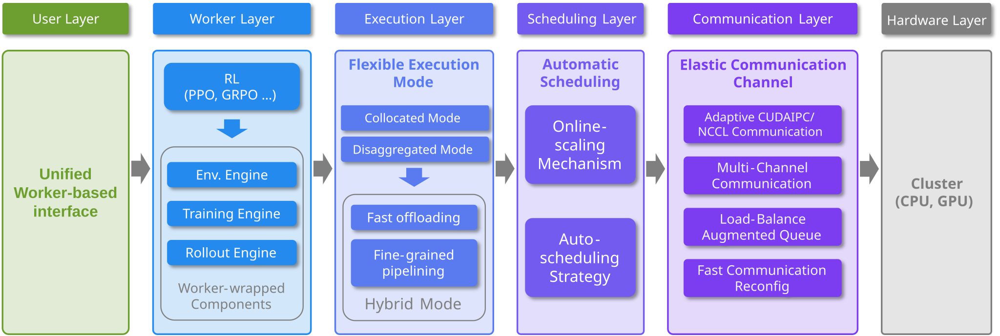

RLinf Execution Flow
====================

Every RLinf job runs through the same four-stage lifecycle: an entry script reads a Hydra config, starts a Ray-backed ``Cluster``, launches each role as a ``WorkerGroup``, and hands control to a runner loop that drives rollout, reward, advantage, and training. Read this page before tuning workers, channels, or placement.

   RLinf system architecture overview.

End-to-End Architecture
-----------------------

The figure below maps the entry script (left) to the driver process (middle) and the core abstractions—``Worker``, ``WorkerGroup``, and ``Channel``—that decouple logical RL workflows from physical hardware layout (right).

.. image:: https://raw.githubusercontent.com/RLinf/misc/main/pic/rlinf_exec_flow.jpg
   :alt: RLinf execution flow
   :width: 95%
   :align: center

Stage 1: Configuration and Cluster Boot
---------------------------------------

A launcher script such as ``examples/embodiment/run_embodiment.sh`` or ``examples/reasoning/run_main_grpo_math.sh`` invokes an entry script (``examples/embodiment/train_embodied_agent.py`` for embodied RL, ``examples/reasoning/main_grpo.py`` for math reasoning). The entry script validates the Hydra YAML config and creates a singleton ``Cluster``.

``Cluster`` connects to Ray, discovers available nodes and accelerators, and starts the global management actors (``NodeManager``, ``WorkerManager``, and ``CollectiveManager``). On multi-node runs, Ray must already be started on every node with a unique ``RLINF_NODE_RANK``, and the entry script runs only on the head node.

Stage 2: Placement and Launching WorkerGroups
---------------------------------------------

Next, the entry script parses ``cluster.component_placement`` into a placement strategy for each component (actor, rollout, env, reward, critic, or agent). Depending on the task, RLinf uses either ``ModelParallelComponentPlacement`` (collocated or disaggregated LLM runs) or ``HybridComponentPlacement`` (embodied and flexible mixed layouts).

For each component, calling ``WorkerClass.create_group(...).launch(cluster, placement_strategy=...)`` spawns one or more remote worker processes on the assigned nodes and GPUs and returns a ``WorkerGroup`` handle. Through that handle, the driver can call any public worker method across all ranks in parallel without writing Ray plumbing directly:

.. code-block:: text

   Entry Script (Hydra YAML)
       │
       ├──► Cluster(num_nodes=...)              # Discover nodes & start managers
       ├──► ComponentPlacement(cfg, cluster)    # Map roles to GPU / node ranks
       ├──► Worker.create_group().launch(...)   # Spawn Actor, Rollout, Env, Reward
       └──► Runner(cfg, actor, rollout, ...)    # Own the training / eval loop

Stage 3: Channel Setup and Runner Orchestration
-----------------------------------------------

The entry script passes the launched ``WorkerGroup`` handles into a task runner (such as ``EmbodiedRunner``, ``AsyncEmbodiedRunner``, or ``ReasoningRunner``) and calls ``runner.init_workers()`` followed by ``runner.run()``.

Workers never route bulk rollouts or observations through the driver process. Instead, the runner creates distributed queues via ``Channel.create()`` and passes those channel handles into worker methods:

- In embodied training, ``env_channel`` carries actions to environments, ``rollout_channel`` carries observations to rollout workers, and ``actor_channel`` assembles completed trajectories for the actor.
- Workers push and pull payloads directly with ``channel.put()`` and ``channel.get()``, while ``CollectiveGroup`` handles high-throughput weight synchronization and tensor transfers between worker groups.

Stage 4: One Training Iteration
-------------------------------

Inside ``runner.run()``, one synchronous training step follows a consistent sequence:

1. **Weight sync**: the actor broadcasts updated weights to rollout workers.
2. **Rollout and environment interaction**: rollout workers and environment workers (or tool/agent loops) exchange actions and observations over channels and publish completed trajectories.
3. **Reward and advantage**: optional reward workers score trajectories, and actor workers compute advantages and returns (such as GAE or GRPO).
4. **Policy update**: actor workers (and critic workers, when present) run forward, backward, and optimizer steps, then return aggregated metrics and stage timings to the runner.
5. **Evaluation and checkpointing**: at configured intervals, the runner runs validation and saves actor checkpoints.

In pipelined or asynchronous runners (such as ``AsyncEmbodiedRunner`` or ``AsyncPPOEmbodiedRunner``), environment stepping, rollout inference, and actor training overlap continuously over the same channel interfaces while the runner controls weight sync cadence and staleness bounds.

Next Steps
----------

- :doc:`cluster`: how ``Cluster`` boots Ray and tracks node topology.
- :doc:`worker`: how ``Worker`` and ``WorkerGroup`` expose distributed execution and timers.
- :doc:`channel`: how distributed queues decouple producers and consumers.
- :doc:`placement` and :doc:`execution_modes`: how collocated, disaggregated, and hybrid placement map onto hardware.
