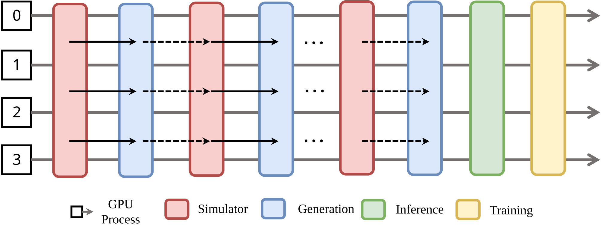
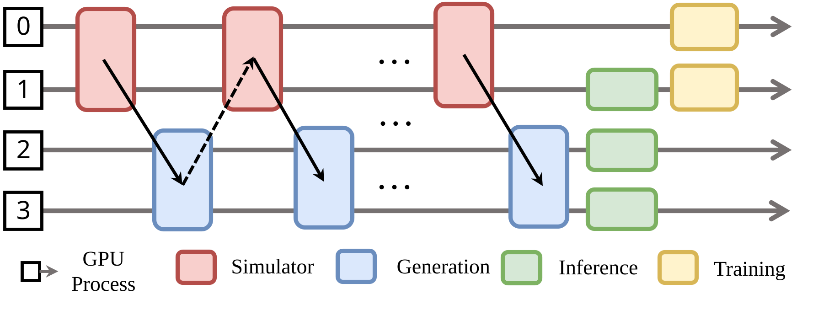
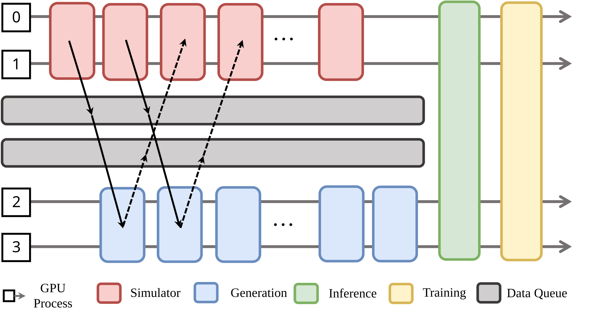

Execution Modes
===============

RLinf runs the same worker code in three placement patterns—collocated, disaggregated, and hybrid—depending on how components share GPUs and overlap in time. Read this page to compare their memory, utilization, and pipelining trade-offs; see :doc:`overview` for a quick visual summary and :doc:`placement` for full ``cluster.component_placement`` syntax and node-group rules.

Choosing a Mode
---------------

Each mode trades GPU memory headroom against pipeline utilization:

.. list-table::
   :header-rows: 1
   :widths: 18 24 28 30

   * - Mode
     - Device sharing
     - Main strength
     - Main trade-off
   * - Collocated
     - All roles share the same GPUs
     - Simplest layout on 1–8 GPUs; every stage uses full cluster compute
     - Requires CPU offloading between stages; long-tail rollout latency stalls training
   * - Disaggregated
     - Each role owns dedicated GPUs
     - No offloading overhead; supports overlapped pipelining and async RL
     - Unbalanced stage rates leave GPUs idle unless pipelining is tuned
   * - Hybrid
     - Some roles split GPUs while others share all GPUs
     - Pipelines rollout and env while giving actor full-cluster capacity
     - Needs offloading at the rollout-to-actor boundary and balanced GPU splits

Collocated Mode
---------------

In collocated mode, all worker groups run on the same set of GPUs and execute one stage at a time, giving each active stage the full compute of the cluster.

Because multiple components share the same devices, collocated runs either keep lightweight workers resident together or offload weights, gradients, and optimizer states to CPU memory between stages. Without offloading, large actor and rollout engines compete for GPU memory and can trigger OOM errors.

This minimal snippet assigns both ``actor`` and ``rollout`` to all 16 GPUs across two 8-GPU nodes and offloads the actor between stages:

.. code-block:: yaml

   cluster:
     num_nodes: 2
     component_placement:
       actor,rollout: all
   actor:
     offload_optimizer: true
     offload_weight: true
     offload_grad: true

Choose collocated mode when GPU count is small (1–8 GPUs), when you want the simplest setup for single-node runs, or when rollout sequences have uniform length so stragglers do not dominate step time.

Disaggregated Mode
------------------

In disaggregated mode, each role receives its own non-overlapping set of GPUs sized to its compute cost. Because actor, inference, and rollout never share a device, components stay resident in GPU memory without CPU offload stalls.

Disaggregated workers can run sequentially, or they can run concurrently with fine-grained pipelining so rollout chunks stream into inference and training as soon as they finish. Tuning ``pipeline_stage_num`` and matching GPU ratios across stages keeps every group busy and minimizes pipeline bubbles.

The example below dedicates separate global GPU slices across two 8-GPU nodes to rollout, inference, and actor workers:

.. code-block:: yaml

   cluster:
     num_nodes: 2
     component_placement:
       rollout: 0-9
       inference: 10-11
       actor: 12-15

Choose disaggregated mode on larger GPU pools (8+ GPUs) when offload latency is costly, when rollout generation has heavy long-tail variance, or when running asynchronous training loops.

Hybrid Mode
-----------

Hybrid mode combines both patterns within a single run: components that execute together split the GPUs, while components that run in a separate phase share the full pool.

Embodied RL is the canonical example. During rollout collection, simulation workers (``env``) and policy inference workers (``rollout``) occupy disjoint GPU subsets and overlap through producer-consumer channels. Once the rollout batch completes, both offload to CPU memory and ``actor`` loads onto all GPUs for high-throughput policy updates.

On a single 8-GPU node, hybrid placement splits GPUs 0–3 for ``env`` and 4–7 for ``rollout`` while giving ``actor`` all 8 GPUs:

.. code-block:: yaml

   cluster:
     num_nodes: 1
     component_placement:
       actor: 0-7
       env: 0-3
       rollout: 4-7
   env:
     enable_offload: true
   rollout:
     enable_offload: true
   actor:
     enable_offload: true

.. note::

   Set ``rollout.pipeline_stage_num`` to ``2`` or higher in hybrid embodied training so environment stepping and rollout inference overlap on their separate GPU subsets.

Hybrid mode also covers heterogeneous clusters—for example, placing ``env`` on CPU or physical robot hosts while ``rollout`` and ``actor`` share GPU nodes.

Next Steps
----------

- :doc:`placement`: full placement string syntax, process-to-resource ratios, and named node groups.
- :doc:`flow`: how the same runner Python code drives all three modes unchanged.
- :doc:`../guides/multi_node` and :doc:`../guides/hetero`: multi-node setup and heterogeneous GPU/robot clusters.
- :doc:`../reference/configuration`: complete Hydra configuration reference.
