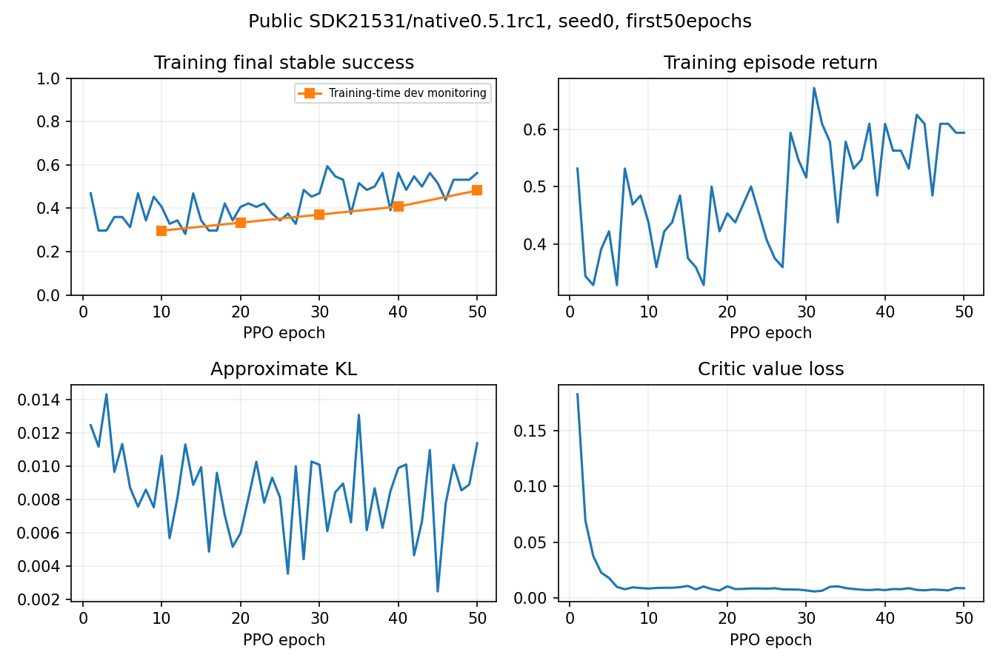

RL with EmbodiChain
===================

.. figure:: https://raw.githubusercontent.com/RLinf/misc/main/pic/embodichain.gif
   :align: center
   :width: 90%

   EmbodiChain (image: `EmbodiChain <https://github.com/DexForce/EmbodiChain>`__).

Train EmbodiChain policies with RLinf using CartPole PPO or PI 0.5 manipulation recipes. Three-block stacking covers expert collection, SFT, closed-loop evaluation and PPO; the sections below explain installation, task interfaces, commands and measured validation results.

Overview
--------

Choose CartPole for a state-based MLP policy, or three-block stacking for a two-camera PI 0.5 policy.

.. grid:: 2 4 4 4
   :gutter: 2

   .. grid-item-card:: Models
      :text-align: center

      MLP · OpenPI PI 0.5

   .. grid-item-card:: Algorithms
      :text-align: center

      PPO · SFT

   .. grid-item-card:: Tasks
      :text-align: center

      CartPole · manipulation

   .. grid-item-card:: Hardware
      :text-align: center

      1 node · CartPole: 4 GPUs · Stack Cube: 2 GPUs

| **You'll do:** install → launch ``run_embodiment.sh`` → watch rollout rewards.
| **Prerequisites:** :doc:`Installation </rst_source/start/installation>` · EmbodiChain package and task resources.

Tasks
~~~~~

.. list-table::
   :header-rows: 1
   :widths: 34 66

   * - Task
     - Description
   * - CartPole
     - Balance the pole with state observations from ``embodichain_tasks/configs/tasks/classic_control/cart_pole/env.json``.
   * - Three-block stacking
     - Stack red on blue, then green on red with a Panda arm, two RGB views and relative end-effector actions.

Observation and Action
~~~~~~~~~~~~~~~~~~~~~~

.. list-table::
   :header-rows: 1
   :widths: 18 82

   * - Field
     - Specification
   * - Observation
     - A single ``states`` tensor built from ``state_keys: ["qpos", "qvel", "qf"]``.
   * - Action
     - 2-dim continuous action for ``policy_setup: cartpole-delta-qpos``.
   * - Reward
     - Task reward from the EmbodiChain Gym config.
   * - Prompt
     - Not used; this is a low-dimensional state-control recipe.

Installation
------------

.. include:: _setup_common.rst

**Docker image**

.. code:: bash

   docker run -it --rm --gpus all \
      --shm-size 32g \
      --network host \
      --name rlinf \
      -v .:/workspace/RLinf \
      rlinf/rlinf:agentic-rlinf0.4-embodichain

   # For mainland China users:
   # infinigence-ai-registry.cn-beijing.cr.aliyuncs.com/rlinf/rlinf:agentic-rlinf0.4-embodichain

Switch to the EmbodiChain virtual environment inside the image:

.. code:: bash

   source switch_env embodichain

**Custom environment**

Install EmbodiChain 0.3.0 and its dependencies. The installer gets
``dexsim-engine==0.5.0`` from ``http://pyp.open3dv.site:2345/simple/dexsim-engine/``
and resolves the remaining packages through your configured Python package index.
Your machine must be able to reach the vendor server on port 2345.

.. code:: bash

   # Mainland China users can add --use-mirror.
   bash requirements/install.sh embodied --env embodichain
   source .venv/bin/activate

.. warning::

   EmbodiChain's ``dexsim`` dependency needs ``libpython3.xx.so``. If you hit
   ``libpython3.11.so`` runtime errors with UV's Python layout, use a Conda
   environment and rerun ``bash requirements/install.sh embodied --env embodichain --no-root``.

Use the installed package configs by default. To point at a local EmbodiChain
checkout, set:

.. code:: bash

   export EMBODICHAIN_PATH=/path/to/EmbodiChain

If a run fails because task resources are missing, download them in the same
Python environment:

.. code:: bash

   export EMBODICHAIN_DATA_ROOT=/path/to/data
   python -m embodichain.data download --name CartPole
   python -m embodichain.data download --name SimResources

Download the Model
------------------

No checkpoint is required. The MLP policy starts from scratch.

Run It
------

Launch the CartPole recipe:

.. list-table::
   :header-rows: 1
   :widths: 28 46 26

   * - Recipe
     - Config
     - Command suffix
   * - MLP + PPO
     - ``examples/embodiment/config/embodichain_ppo_cart_pole.yaml``
     - ``embodichain_ppo_cart_pole``

.. code:: bash

   bash examples/embodiment/run_embodiment.sh embodichain_ppo_cart_pole

What this does:

1. Loads the EmbodiChain CartPole Gym JSON through ``gym_config_path``.
2. Creates Ray workers for the actor, rollout, and EmbodiChain env components.
3. Concatenates the configured state fields into ``states`` and trains an MLP policy with PPO.

.. note::

   Keep ``actor.model.obs_dim``, ``actor.model.action_dim``, and
   ``actor.model.policy_setup`` aligned with the EmbodiChain task config when you
   adapt this recipe to another task.

Visualization and Results
-------------------------

The default config logs to W&B. You can switch to TensorBoard by setting:

.. code:: yaml

   runner:
     logger:
       logger_backends: ["tensorboard"]

Then launch TensorBoard from the RLinf repo root:

.. code:: bash

   tensorboard --logdir ../results --port 6006

For every logged metric, see
:doc:`Training metrics <../../reference/metrics>`.

Evaluation and CI
-----------------

EmbodiChain CartPole is also covered by embodied e2e configs under
``tests/e2e_tests/embodied/``. Set ``EMBODICHAIN_PATH`` only when you need a
non-default checkout.

Train PI 0.5 for Three-Block Stacking
------------------------------------------------------------

Train PI 0.5 to place the red block on the blue block, then the green block on
the red block, using Task Program demonstrations in EmbodiChain. This workflow
uses the task contract of ``isaaclab_franka_stack_cube_ppo_openpi_pi05.yaml`` and
the `IsaacLab Stack Cube dataset <https://huggingface.co/datasets/RLinf/IsaacLab-Stack-Cube-Data>`_.
Validate the scene, recorded actions, and model-loaded replay before SFT; measure
learned-policy success separately after training.

Select the native Gym deployment with ``gym_config_path``. RLinf resolves its
task ID through ``get_env_cls("embodichain", env_cfg)`` and returns
``StackCubeEnv`` for this task. That wrapper owns frozen request selection and
synchronized resets; the shared ``EmbodiChainEnv`` handles ordinary SDK tasks.

Prepare the Scene and Dataset Reader
~~~~~~~~~~~~~~~~~~~~~~~~~~~~~~~~~~~~~~~~

Install separate model and simulator environments from the RLinf repository
root. OpenPI's LeRobot v2.1 reader uses NumPy 1.x, while the SDK's current data
stack uses LeRobot 0.4.4 and NumPy 2. Select the CUDA 12.8 build of Torch 2.7.1:

.. code-block:: bash

   export REPO_PATH="$PWD"
   export STACK_CUBE_MODEL_VENV="$REPO_PATH/.venv"
   UV_TORCH_BACKEND=cu128 bash requirements/install.sh --torch 2.7.1 embodied \
     --venv "$STACK_CUBE_MODEL_VENV" --model openpi --env embodichain
   source "$STACK_CUBE_MODEL_VENV/bin/activate"
   export STACK_CUBE_MODEL_PYTHON="$STACK_CUBE_MODEL_VENV/bin/python"
   export STACK_CUBE_ENV_PYTHON="${STACK_CUBE_MODEL_VENV}-embodichain/bin/python"

The installer creates the model venv and a sibling with the
``-embodichain`` suffix. The model contains ``rlinf-openpi==0.1.1``,
``lerobot==0.3.3``, ``datasets==3.6.0`` and ``pyarrow<26``. The simulator uses
EmbodiChain commit ``21531b77c1deb5856a5aa11e3a3d8c6cbbeed9d3`` and
``dexsim-engine==0.5.1rc1``. PPO's node groups select these interpreters using
``STACK_CUBE_MODEL_PYTHON`` and ``STACK_CUBE_ENV_PYTHON``.

Run conversion, normalization and SFT from the model venv. Launch expert
collection with the simulator interpreter. Closed-loop evaluation also starts
there; ``--model-python`` selects its separate inference process.

The public ``RLinf/openpi_tokenizer`` asset is pinned to revision
``befaa248e4f82954b625a421658f933dfd1a97a0``. The installer downloads it
anonymously and reuses ``big_vision/paligemma_tokenizer.model`` from the cache.
Docker target ``embodied-embodichain-openpi`` creates both environments,
activates ``openpi``, and exports their interpreter paths.

Use the Isaac Sim URDF importer's ``panda_arm_hand.urdf`` as the source asset.
The collector creates a private mesh/URDF copy, adds the 0.107 m control TCP,
and removes finger mimic because both finger joints are actuated explicitly.
The observation EEF point uses a 0.1034 m offset. Expert and policy actions use
the same scale-0.5 relative EEF controller, with rotation-vector increments.
Dataset state has eight channels: EEF XYZ, Euler XYZ, and two signed finger
positions. The ``pi05_isaaclab_stack_cube`` recipe sets
``discrete_state_input: false`` and adds no phase input.

Front and wrist RGB are 256×256 at 20 Hz. The wrist pose relative to
``panda_hand`` is (0.13, 0, -0.15) m. Convert the reference ROS WXYZ quaternion
(-0.70614, 0.03701, 0.03701, -0.70614) to the attached camera's OpenGL convention
using ``R_gl = R_ros @ Rx(pi)``; the checked-in YAML supplies the resulting XYZW
quaternion, focal lengths 293.19971367215464 pixels, and clipping range 0.1–2 m.
Review both camera streams before freezing a cohort. The front view and box
scene retain their EmbodiChain configuration, so renderer pixels are not an
identity test between simulators. Cube solver iterations are 32/8 for position
and velocity in EmbodiChain; the inspected IsaacLab configuration uses 16/1.

The exported data uses LeRobot v2.1 with H.264 videos; the reference videos use
AV1. The model venv provides the matching reader. Select two available GPU
indices and fresh output paths:

.. code-block:: bash

   export STACK_RUN=/path/to/new_stack_cube_run
   export PI05_BASE_MODEL=/path/to/pi05_base
   export STACK_SIM_GPU=0
   export STACK_MODEL_GPU=1
   export OMP_NUM_THREADS=4 MKL_NUM_THREADS=4 OPENBLAS_NUM_THREADS=4 JAX_PLATFORMS=cpu
   export PYTHONPATH="$REPO_PATH"

Download the base model at its recorded revision. Obtain the original Panda
asset from the public Isaac Sim 5.1.0 source and prepare it without starting a
simulator:

.. code-block:: bash

   hf download lerobot/pi05_base \
     --revision 22c30e5b34f9e7ab738b1b34fc2fc5ecfe2d28f0 \
     --local-dir "$PI05_BASE_MODEL"
   export STACK_ASSET_SOURCE="$STACK_RUN/isaacsim_source"
   git clone --filter=blob:none --no-checkout --depth 1 --branch v5.1.0 \
     https://github.com/isaac-sim/IsaacSim.git "$STACK_ASSET_SOURCE"
   git -C "$STACK_ASSET_SOURCE" sparse-checkout set \
     source/extensions/isaacsim.asset.importer.urdf/data/urdf/robots/franka_description
   git -C "$STACK_ASSET_SOURCE" checkout --detach 47d886f2858d1ceed556b21c88927aa67bc81c12
   export STACK_PANDA_URDF="$STACK_ASSET_SOURCE/source/extensions/isaacsim.asset.importer.urdf/data/urdf/robots/franka_description/robots/panda_arm_hand.urdf"
   python toolkits/lerobot/prepare_stack_cube_data.py prepare-panda \
     --source "$STACK_PANDA_URDF" --output "$STACK_RUN/assets"
   export STACK_PREPARED_PANDA="$STACK_RUN/assets/panda.urdf"

The public source URDF has SHA256
``ad9f5298a4d1a375cf16824b0de4f0d1c7cc446597964b80aa639ca830e998a1``.
The prepared URDF and every copied mesh match the assets used in the experiment;
the prepared URDF has SHA256
``bab737f22329c7e0d74084caeeae0771c1416fe5636ae82a95226c7d01d876de``.
Collection uses the original URDF; evaluation and PPO use the prepared copy.
Keep camera configuration, source revisions, asset hashes, and native library
hashes with every cohort.

Freeze Initial States and Collect the Splits
~~~~~~~~~~~~~~~~~~~~~~~~~~~~~~~~~~~~~~~~~~~~

Create requests before seeing any expert or policy outcome. The smoke profile
samples independent ±5 mm XY offsets without boundary clipping, while keeping
cube yaw and the robot initial joints fixed. Seeds 42–49 belong to the original
preview regression set and are excluded from training and test manifests.
Use independent train, validation, and test seeds:

.. code-block:: bash

   for spec in train:10000:16 val:20000:8 test:30000:16; do
     IFS=: read -r split seed count <<< "$spec"
     python toolkits/lerobot/prepare_stack_cube_data.py manifest \
       --profile smoke --split "$split" --seed "$seed" --episodes "$count" \
       --output "$STACK_RUN/requests/$split.json"
     CUDA_VISIBLE_DEVICES="$STACK_SIM_GPU" "$STACK_CUBE_ENV_PYTHON" \
       toolkits/lerobot/collect_embodichain_stack_cube.py \
       --panda-urdf "$STACK_PANDA_URDF" \
       --requests "$STACK_RUN/requests/$split.json" \
       --output "$STACK_RUN/${split}_episodes"
     python toolkits/lerobot/prepare_stack_cube_data.py assemble \
       --manifest "$STACK_RUN/requests/$split.json" \
       --collection "$STACK_RUN/${split}_episodes" \
       --output "$STACK_RUN/$split" --split "$split"
   done

The loop produces 16 train, 8 validation, and 16 test requests. Each raw episode
retains its request, full initial poses and joint state, actual 7-D commands,
physical measurements, and two camera videos. During reset, the environment
briefly separates cubes from the table for one physics tick to clear stale
contact anchors, then restores the requested poses and zeroes velocities. This
happens before the recorded episode; execution advances ordinary dynamics.

Assembly verifies numeric fields, 20 Hz timestamps, decoded video frame counts,
and requested initial positions. It copies both videos and records accepted
and rejected attempts in ``meta/collection_audit.json``. Acceptance requires
stable completion within 450 steps; collection allows up to 600 to retain
long or failed attempts. Keep the original request denominator and investigate
rejections rather than silently replacing validation or test cases.

.. warning::

   A changed camera requires a fresh cohort. Preserve superseded data and mark
   its collection manifest ``camera_superseded: true`` and ``training_ready:
   false``; assembly rejects that collection. Disable its normalization
   authorization as well. Recollect and recompute statistics for the new camera,
   even when recorded actions happen to have the same distribution.

Verify Replay and Compute Training Statistics
~~~~~~~~~~~~~~~~~~~~~~~~~~~~~~~~~~~~~~~~~~~~~

First replay all validation episodes without a model. Then compute statistics
only from the audited train split and repeat the same saved actions while the
model processes real observations. The model-loaded diagnostic runs actual
inference in a separate process, discards predictions, and executes the expert
commands for their original episode length:

.. code-block:: bash

   for episode in "$STACK_RUN"/val_episodes/episode_*; do
     CUDA_VISIBLE_DEVICES="$STACK_SIM_GPU" "$STACK_CUBE_ENV_PYTHON" \
       toolkits/lerobot/collect_embodichain_stack_cube.py \
       --panda-urdf "$STACK_PANDA_URDF" --replay "$episode" \
       --output "$STACK_RUN/replay/$(basename "$episode")"
   done
   python toolkits/lerobot/calculate_stack_cube_norm_stats.py \
     --dataset "$STACK_RUN/train"
   export STACK_CUBE_TRAIN_DATA="$STACK_RUN/train"
   export STACK_CUBE_NORM_STATS="$STACK_RUN/train/norm_stats.json"
   "$STACK_CUBE_ENV_PYTHON" toolkits/lerobot/evaluate_stack_cube_openpi.py \
     --model-python "$STACK_CUBE_MODEL_PYTHON" \
     --checkpoint "$PI05_BASE_MODEL" --norm-stats "$STACK_CUBE_NORM_STATS" \
     --requests "$STACK_RUN/requests/val.json" \
     --panda-urdf "$STACK_PREPARED_PANDA" \
     --sim-gpu "$STACK_SIM_GPU" --model-gpu "$STACK_MODEL_GPU" \
     --replay-collection "$STACK_RUN/val_episodes" \
     --output "$STACK_RUN/model_loaded_replay"

The statistics command writes ``norm_stats.json`` and a manifest containing
source hashes. It covers every H10 action window, repeats the final action at
episode boundaries, and refuses validation/test datasets or unauthorized audits.
Normalization uses eight state and seven action dimensions; model transforms
subsequently pad to 32. Do not mutate the train audit after computing statistics.

A replay passes when both layers remain stacked, the fingers are released,
linear speed is at most 0.02 m/s, and angular speed is at most 0.5 rad/s for
20 consecutive control steps. Compare complete initial states and executed
actions, and report endpoint differences separately. The model-loaded report
sets ``action_source: expert_replay`` and ``learned_policy_evaluation: false``;
its success rate is a data/runtime check, not learned-policy performance.

Establish a Baseline and Run SFT
~~~~~~~~~~~~~~~~~~~~~~~~~~~~~~~~~~~~~~~~

Evaluate PI 0.5 base on the same validation requests before updating weights.
The offline evaluator reports action error on uniform samples, episode
boundaries, and gripper-transition neighborhoods. The closed-loop evaluator
measures physical task completion through RLinf's environment adapter:

.. code-block:: bash

   CUDA_VISIBLE_DEVICES="$STACK_MODEL_GPU" python \
     toolkits/lerobot/evaluate_stack_cube_action_error.py \
     --dataset "$STACK_RUN/val" --checkpoint "$PI05_BASE_MODEL" \
     --norm-stats "$STACK_CUBE_NORM_STATS" \
     --output "$STACK_RUN/base_val_actions.json"
   "$STACK_CUBE_ENV_PYTHON" toolkits/lerobot/evaluate_stack_cube_openpi.py \
     --model-python "$STACK_CUBE_MODEL_PYTHON" \
     --checkpoint "$PI05_BASE_MODEL" --norm-stats "$STACK_CUBE_NORM_STATS" \
     --requests "$STACK_RUN/requests/val.json" \
     --panda-urdf "$STACK_PREPARED_PANDA" \
     --sim-gpu "$STACK_SIM_GPU" --model-gpu "$STACK_MODEL_GPU" \
     --output "$STACK_RUN/base_val"

The current Stack Cube evaluation path uses ``num_envs=1`` and processes the
frozen request list sequentially. Its model and simulator are separate
processes; ``--model-gpu`` and ``--sim-gpu`` select their physical devices.
Evaluation uses the RLinf wrapper. Use the simulator probe described below
for controller diagnostics.

After camera review, all requested data, both eight-episode replay checks, and
the base evaluation are verified, launch the smoke recipe on the two available
GPUs. The experiment coordinator records this decision in the cohort manifest;
it is separate from the immutable dataset/statistics audit.

.. code-block:: bash

   CUDA_VISIBLE_DEVICES="$STACK_SIM_GPU,$STACK_MODEL_GPU" python \
     examples/sft/train_vla_sft.py \
     --config-name embodichain_stack_cube_sft_openpi_pi05_smoke \
     runner.logger.log_path="$STACK_RUN/training" \
     runner.logger.experiment_name=stack_cube_smoke actor.seed=0

This recipe trains 1,000 optimizer steps from base with global batch 32,
micro batch 1, learning rate ``2.5e-5``, and 100 warmup steps. It supervises the
full H10×32 tensor, executes C5 during inference, and uses five denoising steps.
The Stack Cube SFT and evaluation recipes enable ``eval_sft_image_crop: true``:
only the front image receives the SFT-compatible 95% top-left crop and resize.
The wrist image is preserved. This differs from the default of unrelated recipes.

Weights are exported every 100 steps; recoverable optimizer/RNG state is saved
at step 1,000. Wait for ``actor/checkpoint_metadata.json`` to contain
``complete: true`` before loading an export. The SFT worker has no built-in
validation; run the external evaluators when the required GPUs are available:

.. code-block:: bash

   export STACK_CHECKPOINT="$STACK_RUN/training/stack_cube_smoke/checkpoints/global_step_1000"
   CUDA_VISIBLE_DEVICES="$STACK_MODEL_GPU" python \
     toolkits/lerobot/evaluate_stack_cube_action_error.py \
     --dataset "$STACK_RUN/val" --checkpoint "$STACK_CHECKPOINT" \
     --norm-stats "$STACK_CUBE_NORM_STATS" \
     --output "$STACK_RUN/selected_val_actions.json"
   "$STACK_CUBE_ENV_PYTHON" toolkits/lerobot/evaluate_stack_cube_openpi.py \
     --model-python "$STACK_CUBE_MODEL_PYTHON" \
     --checkpoint "$STACK_CHECKPOINT" --norm-stats "$STACK_CUBE_NORM_STATS" \
     --requests "$STACK_RUN/requests/val.json" \
     --panda-urdf "$STACK_PREPARED_PANDA" \
     --sim-gpu "$STACK_SIM_GPU" --model-gpu "$STACK_MODEL_GPU" \
     --output "$STACK_RUN/selected_val"

The example selects step 1,000. Compare the exported checkpoints on validation
and choose by stable closed-loop completion, using action error as a diagnostic.
Then evaluate the selected checkpoint with ``requests/test.json`` and a fresh
output directory. Keep the independent test set out of checkpoint selection.
Report first-layer, complete-stack, and final stable success with counts and
videos. Expert replay, decreasing loss, and offline error improvements do not
establish learned-policy success or PPO improvement.

Expand the Spatial Distribution and Compare Simulators
~~~~~~~~~~~~~~~~~~~~~~~~~~~~~~~~~~~~~~~~~~~~~~~~~~~~~~

Expand only after the local SFT and replay checks pass. Qualify eight expert
requests with position variation first, then add yaw, then robot-joint noise.
The formal sampler follows the inspected RLinf/IsaacLab task configuration:
X in [0.4, 0.6] m, Y in [-0.1, 0.1] m, yaw in [-1, 1] rad, pairwise cube
separation greater than 0.1 m, and arm-joint Gaussian offsets with standard
deviation 0.02 rad. All three cubes move. Invalid layouts are rejected without
clipping or accepting a final invalid retry.

.. code-block:: bash

   for profile in position position_yaw formal; do
     python toolkits/lerobot/prepare_stack_cube_data.py manifest \
       --profile "$profile" --split qualification --seed 110000 --episodes 8 \
       --output "$STACK_RUN/requests/qualification_${profile}.json"
   done
   python toolkits/lerobot/prepare_stack_cube_data.py manifest \
     --profile formal --split train --seed 40000 --episodes 120 \
     --output "$STACK_RUN/requests/formal_train.json"
   python toolkits/lerobot/prepare_stack_cube_data.py manifest \
     --profile formal --split val --seed 50000 --episodes 27 \
     --output "$STACK_RUN/requests/formal_val.json"

These commands freeze qualification requests and the first 120/27 formal
train/validation allocation; they do not establish expert feasibility.
Record unsuccessful requests and their spatial coverage before deciding how
to acquire the target number of successful demonstrations. The corresponding
training config is ``embodichain_stack_cube_sft_openpi_pi05``: at most 30,000
steps, 1,000 warmup steps, and exports every 1,000 steps. Run seeds 0, 1, and 2
from the same base checkpoint, subject to measured GPU time and checkpoint
storage requirements.

For the broader layouts, select the formal expert deployment explicitly with
``--task-config``. It applies the same 90° rotation about each cube's local
vertical axis to both top grasps. This changes expert grasp planning only;
the policy task retains the same physics, cameras, controller, and success
criteria. Omitting the flag preserves the original smoke expert.

Use this deployment for each qualification cohort as well. After reviewing
all three cohorts, collect the frozen formal train and validation requests:

.. code-block:: bash

   export STACK_EXPERT_TASK=rlinf/envs/sim/embodichain/configs/tasks/manipulation/stack_cube/task.panda.formal_expert.yaml
   for split in train val; do
     CUDA_VISIBLE_DEVICES="$STACK_SIM_GPU" "$STACK_CUBE_ENV_PYTHON" \
       toolkits/lerobot/collect_embodichain_stack_cube.py \
       --task-config "$STACK_EXPERT_TASK" \
       --panda-urdf "$STACK_PANDA_URDF" \
       --requests "$STACK_RUN/requests/formal_${split}.json" \
       --output "$STACK_RUN/formal_${split}_episodes"
   done

The collector saves every attempt, including failed episodes, together with
the selected deployment path and hash. Passing the 24 qualification episodes
does not establish that 147 formal demonstrations have been collected. Audit
accepted counts, initial poses, action timing, videos, and physical completion
before assembling training data; retain rejected requests and keep the fixed
closed-loop validation cohort separate from demonstration filtering.

For the reference-data arm, download the complete pinned 147-episode dataset
and save ``source_revision.json`` at its root with ``repo_id`` and ``revision``.
Split it independently and recompute statistics from its 120 training episodes:

.. code-block:: bash

   python toolkits/lerobot/prepare_stack_cube_data.py split-reference \
     --source /path/to/complete_isaaclab_reference \
     --output "$STACK_RUN/reference" --seed 0
   python toolkits/lerobot/calculate_stack_cube_norm_stats.py \
     --dataset "$STACK_RUN/reference/train"

Use ``isaaclab_stack_cube_sft_openpi_pi05`` with ``STACK_CUBE_TRAIN_DATA`` and
``STACK_CUBE_NORM_STATS`` pointing to the reference train split. Keep full
reference episodes, including those longer than 450 frames. The public dataset
contains no producer configuration proving its exact initial-state distribution.
In the inspected fork, lighting and material randomization are gated by
``eval_mode`` and ``eval_type``; their declaration alone does not mean they run
in the default training task.

For new OpenPI SFT runs, ``actor.seed`` initializes Python, NumPy, and PyTorch
before model construction. Training then uses ``actor.seed + rank`` for each
actor's stochastic image augmentation and flow-matching draws. A resumed run
restores its checkpoint RNG after initialization. Use this behavior for all
formal seeds 0, 1, and 2.

The frozen local smoke checkpoint selected at step 600 achieved 14/16 stable
completions on its independent test set; PI 0.5 base achieved 0/16. Its run name
``smoke_seed0`` records the configured seed only: that earlier implementation
seeded the data loader but did not initialize the training RNG from
``actor.seed``. Saved RNG state confirms this distinction. That ``NO_SHARD``
run also wrapped the vision stem separately, while the functional convolution
read its parameters without invoking the wrapper. The stem gradients were not
synchronized across ranks. The 14/16 result remains the measurement of the saved
step-600 checkpoint; preserve it and the original source snapshot as historical
evidence rather than an exactly reproducible seed-0 baseline.

Formal recipes use the standard OpenPI FSDP wrapping policy with ``NO_SHARD``.
Recheck distributed gradient synchronization before starting a new formal run
with the current implementation.

Both formal recipes enable ``data.stateful_loader: true`` so a restarted stage
continues from the next data batch, including prefetched worker state. Use at
least two actor ranks (``world_size >= 2``), and keep rank assignments, micro
batch size, ``data.num_workers``, ``actor.seed``, and dataset length unchanged.
The loader rejects incompatible settings. Also preserve the dataset contents,
normalization statistics, and preprocessing revision; record their hashes before
the first stage and verify them before resuming. The smoke recipe retains its
original loader, so start a new formal run with stateful loading enabled rather
than resuming a smoke checkpoint through this path. RLDS datasets are not
supported by this opt-in loader.

Resume only after the actor checkpoint contains the DCP model/optimizer state,
``data.pt``, ``rng.pt``, and ``openpi_loader_state.json``. The last file is
published after all ranks finish saving data and RNG state; it records the
loader settings and file hashes. A weights export or the ordinary checkpoint
completion marker alone does not establish data-resume readiness. Set
``runner.resume_dir`` to the enclosing ``global_step_N`` directory, not its
``actor`` subdirectory. For example, resume a completed formal step 1,000 and
stop after step 2,000 for validation:

.. code-block:: bash

   export STACK_FORMAL_CHECKPOINT=/path/to/formal/run/checkpoints/global_step_1000
   CUDA_VISIBLE_DEVICES="$STACK_SIM_GPU,$STACK_MODEL_GPU" python \
     examples/sft/train_vla_sft.py \
     --config-name embodichain_stack_cube_sft_openpi_pi05 \
     runner.resume_dir="$STACK_FORMAL_CHECKPOINT" runner.max_steps=2000 \
     data.stateful_loader=true data.num_workers=4 actor.seed=0

The runner stops at step 2,000 while the learning-rate schedule remains 30,000
steps with 1,000 warmup steps. Resume each source/seed arm from its own complete
checkpoint. Local CPU checks with the real reference dataset and four workers
matched the next five batches after restoring both camera inputs, state, and
actions. Archived two-rank GPU checks on the earlier vision wrapping layout
verified nonzero stem gradients, synchronized parameters and Adam state, exact
DCP restore, and the next update under ``NO_SHARD``. The archived full formal
model also completed the step-1,000 to step-2,000 resume with its model,
optimizer, data, and RNG state. These checks do not qualify the current default
wrapping layout or establish bitwise equivalence to an uninterrupted full-model
run. ``FULL_SHARD`` failed its GPU check and is not a qualified fallback for
this example.

The planned comparison evaluates each SFT data source in both simulators:

.. list-table::
   :header-rows: 1

   * - SFT Data
     - EmbodiChain Evaluation
     - IsaacLab Evaluation
   * - EmbodiChain experts
     - Primary result
     - Transfer result
   * - IsaacLab reference data
     - Transfer result
     - Primary result

Use independent formal ID requests (128 episodes) and separate position/yaw OOD
requests (64 each). The sampler supports ``ood_position`` and ``ood_yaw``.
Visual OOD requests remain a planned extension: the current EmbodiChain reset
rejects ``ood_visual`` until a material/light adapter is implemented and validated.

IsaacLab evaluation requires the inspected RLinf fork at
``4246b6b4f4a3e74ee20e002ed7536b1c788d39f4`` in an isolated Isaac Sim 5.1
installation; the model runs in the OpenPI interpreter. See :doc:`isaaclab` for
the task context, then evaluate a selected checkpoint with:

.. code-block:: bash

   /path/to/isaacsim51/bin/python toolkits/lerobot/evaluate_isaaclab_stack_cube_openpi.py \
     --isaaclab-root /path/to/RLinf-IsaacLab \
     --model-python /path/to/openpi/bin/python \
     --checkpoint "$STACK_CHECKPOINT" --norm-stats "$STACK_CUBE_NORM_STATS" \
     --requests "$STACK_RUN/requests/val.json" \
     --sim-gpu "$STACK_SIM_GPU" --model-gpu "$STACK_MODEL_GPU" \
     --output "$STACK_RUN/isaaclab_transfer_val"

The experimental integration is based on `PR #3
<https://github.com/yuecideng/RLinf/pull/3>`_ at
``5b2d5cdd163884ecc41c7dc4a895e21af0262f89``. The recorded baseline regression
run passed 76 selected cases in ``tests/unit_tests/test_real_env.py``. Report
SFT and transfer success only after the corresponding closed-loop runs finish;
the data and interface checks above do not constitute PPO results.

Prepare PPO After SFT Validation
~~~~~~~~~~~~~~~~~~~~~~~~~~~~~~~~~~~~~~~~~~~~~~~~~~~~~~~~~~~~~~~~

Start PPO only after the selected SFT checkpoint meets the frozen closed-loop
gate: at least 4/8 local validation successes and 8/16 independent local test
successes, followed by at least 6/27 formal validation successes for each seed.
Success requires a released two-layer stack that remains stable for the last
20 control steps of the 450-step evaluation. Qualify the batched simulator,
reward, weight synchronization, and checkpoint recovery before a training run;
the CPU contract tests alone do not establish GPU feasibility.

The Stack Cube environment selects the episode rules with
``stack_cube_protocol: isaaclab``. Each baseline stacking success gives reward 1
at 20 Hz, matching the reference reward weight 20 multiplied by the 0.05 s
control interval. Dropping a cube below z=-0.05 m terminates the episode.
Stable completion remains a separate metric; it does not
replace the reference reward predicate.

Configure reward terms in the native Gym environment component, ``env.yaml``.
EmbodiChain's ``config_to_cfg()`` resolves these terms, and its native ``step()``
computes reward through ``RewardManager``. The simulation task's
``compute_task_state()`` supplies native success and failure: ``isaaclab`` uses
the first baseline success/drop transition, while ``evaluation`` uses twenty
consecutive stable frames. The task advances this state once per physical
control step; reading info does not advance the dwell. RLinf passes the returned
reward through and exposes the unweighted success term in
``info["rewards"]["success"]``. The SDK applies
weights directly; the default weight is already 1 per control step and must
not be multiplied by the control interval again.

To change the reward, copy the environment component, edit its ``env.rewards``,
and select it through ``environment.component`` in a native task deployment.
Point ``env.train.gym_config_path`` or ``env.eval.gym_config_path`` at that
deployment. The default term is:

.. code-block:: yaml

   env:
     rewards:
       success:
         func: success_reward
         mode: add
         weight: 1.0
         params: {}

Changing the weight changes the training objective. The measured results below
use the default weight and the original success and termination predicates.
CartPole continues to use its task's native reward.

The earlier :download:`native reward comparison <../../../../../examples/embodiment/results/embodichain_stack_cube_pi05/native_reward_parity.json>` records 14 scripted CPU traces against the preceding adapter: 74,700 scalar rewards and the existing transition fields match exactly at the recorded source snapshot. The current Gym configuration names its reward term ``success`` in both protocols. These checks establish reward and episode contracts; they do not constitute a new PPO training result.

The :download:`Stack Cube reward validation <../../../../../examples/embodiment/results/embodichain_stack_cube_pi05/isaaclab_reward_alignment.json>` records 39 passing CPU cases and eight real GPU expert replays of 380 control steps each, all stable at completion. Comparing their 3,040 measured rewards and 1,055 boundary samples against the pinned IsaacLab source produced zero error. The IsaacLab comparison executes its original manager and predicate source with lightweight configuration and scene objects; a full IsaacLab runtime test remains pending first-launch NVIDIA EULA confirmation.

Keep ``actor.model.openpi.eval_sft_image_crop: true`` for checkpoints trained
with the deterministic SFT crop. In this recipe it applies to RL evaluation,
stochastic training rollouts, and actor logprob recomputation. Each path uses
the same front-image crop with no augmentation RNG; wrist images retain their
original framing. Before the first optimizer update, verify unchanged policy
weights, matching stored/recomputed logprobs, and the selected checkpoint's
closed-loop success again. The new value head is initialized separately.
With ``train_expert_only: true``, calling ``train()`` keeps the frozen vision
encoder in evaluation mode so its attention kernel matches rollout inference.
The action expert and critic retain their training behavior; full SFT continues
to train the vision encoder normally.

For OpenPI, ``actor.seed`` initializes Python, NumPy, and PyTorch before model
construction so all actor ranks create the same critic. After initialization,
each actor uses ``actor.seed + rank``. Rollout uses ``rollout.seed + rank``
before construction and resets that stream once after construction; the recipe
sets ``rollout.seed: ${actor.seed}``, which is also the fallback when the field
is omitted. Subsequent prediction and weight synchronization do not reseed the
stream. Actor checkpoint loading follows initialization and restores its saved
RNG state. These startup seeds do not add rollout RNG checkpoint persistence.
Other model types retain their existing initialization behavior.

Training uses synchronized resets and ``auto_reset: false``. The first success
or drop produces a termination at its actual position inside the action chunk;
later rewards for that scene are zero, and RLinf masks subsequent training
chunks. All scenes reset together at the rollout boundary. The contact-cache
flush advances the shared physics world, so requesting a partial reset raises
``NotImplementedError`` instead of advancing unrelated scenes. Evaluation sets
``ignore_terminations: true`` and runs to the full time limit to detect a stack
that subsequently collapses. Terminal observations and masks are retained.

This first-episode training protocol intentionally differs from IsaacLab's
native automatic reset after success or failure. In the inspected reference
configuration, the native timeout is 600 steps and the RLinf wrapper imposes
450 steps. With ``auto_reset: false``, RLinf's GAE ends continuation at the
reported done, including the wrapper time limit; the auto-reset reward
bootstrap path is inactive. Compare final stable success through the same
fixed-duration evaluator rather than treating native reset metrics as equal.

Prepare a training request manifest from the formal sampler with a seed
separate from validation and test. Its requests rotate across rollouts;
``use_fixed_reset_state_ids: true`` rewinds only the validation cohort. Point
the following variables at the qualified assets and selected checkpoint:

.. code-block:: bash

   export STACK_CUBE_PANDA_URDF="$STACK_PREPARED_PANDA"
   export STACK_CUBE_SFT_MODEL="$STACK_CHECKPOINT"
   export STACK_CUBE_NORM_STATS=/path/to/sft/train/norm_stats.json
   export STACK_CUBE_PPO_TRAIN_REQUESTS=/path/to/ppo_train_requests.json
   export STACK_CUBE_PPO_VAL_REQUESTS=/path/to/frozen_validation_requests.json
   bash examples/embodiment/run_embodiment.sh embodichain_franka_stack_cube_ppo_openpi_pi05_smoke

The smoke recipe runs 10 epochs with 8 environments, actor microbatch 8, and global batch 32,
placing actor/rollout on logical GPU 0 and simulation on logical GPU 1.
Use an eight-request validation cohort for this smoke run. After confirming
updates and recovery, select
``embodichain_franka_stack_cube_ppo_openpi_pi05`` and the complete 27-request
validation cohort. The formal recipe uses 32 training environments, two
450-step rollouts per epoch, H10/C5/5, actor microbatch 32, global batch 128, and three PPO update
passes. Its 5,760 chunks divide into 45 global batches. Run seeds 0, 1, and 2
separately, and report PPO gains only from completed independent evaluations.

Keep actor microbatch size equal to the rollout inference batch for this
recipe. BF16 kernels can produce different results when the same observations
are recomputed individually. With the frozen vision encoder in evaluation
mode, matched batches of 8 and 32 passed real NO_SHARD actor forward/backward
checks, including shuffled rows from separate rollout chunks: stored and
recomputed logprobs matched exactly, gradients were finite, and parameters
remained unchanged without optimizer updates. This verifies the model path;
batched closed-loop success remains a separate requirement. Initial B1/B8
observations had identical state, camera matrices, cube poses, and depth but
different RGB, which changed the selected checkpoint's first commands.
The narrow smoke checkpoint was sensitive to those RGB differences; no specific
renderer defect was established. Disabling DLSS tiling or light shadows did not
restore its batched success. Keep the renderer configuration fixed and qualify
the formal SFT checkpoint through the actual production worker layout before PPO:

.. code-block:: bash

   python toolkits/lerobot/verify_stack_cube_workers.py \
     --checkpoint "$STACK_CUBE_SFT_MODEL" --norm-stats "$STACK_CUBE_NORM_STATS" \
     --train-requests "$STACK_CUBE_PPO_TRAIN_REQUESTS" \
     --val-requests "$STACK_CUBE_PPO_VAL_REQUESTS" \
     --panda-urdf "$STACK_CUBE_PANDA_URDF" \
     --output "$STACK_RUN/production_validation" --gpu "$STACK_MODEL_GPU" --seed 0 \
     --env-python "$STACK_CUBE_ENV_PYTHON"

This command constructs the formal 32-training/27-evaluation layout, synchronizes
actor and rollout weights, and evaluates all 27 fixed requests for 450 steps.
It records RNG states, source and weight hashes, video, per-chunk physical
measurements, and cleanup. It never invokes the training loop. ``passed`` means
the interface checks completed; ``formal_gate_met`` additionally requires at
least 6/27 final stable successes. Both must be true before PPO. Use ``--dry-run``
to inspect the resolved configuration while the GPUs are occupied; it does not
initialize Ray or CUDA.

After PPO training, evaluate its checkpoint through the same worker layout with
``--checkpoint-kind ppo``. Native PPO saves contain full weights and DCP state
without the SFT completion marker. This mode checks the model, optimizer,
scheduler and RNG entries and their backing file ranges, and records the
checkpoint kind and hashes. An absent producer marker remains ``complete: null``
in the report. These file checks do not replace a successful training exit or
an actual checkpoint recovery test.
Published inference-only PPO exports can omit optimizer state when their
completion marker explicitly records ``checkpoint_kind: ppo`` and
``save_training_state: false``. They remain unsuitable for training recovery.

.. code-block:: bash

   export STACK_CUBE_PPO_CHECKPOINT=/path/to/ppo/run/checkpoints/global_step_10
   python toolkits/lerobot/verify_stack_cube_workers.py \
     --checkpoint "$STACK_CUBE_PPO_CHECKPOINT" --checkpoint-kind ppo \
     --norm-stats "$STACK_CUBE_NORM_STATS" \
     --train-requests "$STACK_CUBE_PPO_TRAIN_REQUESTS" \
     --val-requests "$STACK_CUBE_PPO_VAL_REQUESTS" \
     --panda-urdf "$STACK_CUBE_PANDA_URDF" \
     --output "$STACK_RUN/ppo_production_validation" --gpu "$STACK_MODEL_GPU" --seed 0 \
     --env-python "$STACK_CUBE_ENV_PYTHON"

Reset info exposes ``reset_request_ids`` and ``reset_request_seeds`` for the
actual rows selected by the environment. The verifier compares them with the
frozen validation manifest. These fields stay in environment metadata and are
excluded from policy observations.

CI uses ``embodichain_stack_cube_ppo_openpi_pi05`` from
``tests/e2e_tests/embodied/`` for one full-length PPO epoch, with public PI 0.5
base weights and statistics recomputed from the reference train split. The
workflow pins model, dataset, and Panda revisions. This test covers installation
and rollout-to-optimizer execution; learned-policy results come from the
separately qualified SFT and PPO experiments.

The SFT CI job uses the public reference train split for two actor ranks. Its
first stage performs one update and saves training and loader state; the second
stage restores that checkpoint, completes update two and exports weights.
The CI job then initializes the PPO smoke from that export. Run the SFT and
resume portion with a prepared reference split:

.. code-block:: bash

   export STACK_CI_RUN=/path/to/new_stack_cube_ci_run
   export STACK_CUBE_TRAIN_DATA="$STACK_RUN/reference/train"
   export STACK_CUBE_SFT_MODEL="$PI05_BASE_MODEL"
   export STACK_CUBE_NORM_STATS="$STACK_CUBE_TRAIN_DATA/norm_stats.json"
   bash tests/e2e_tests/sft/run_stack_cube_resume.sh

This checks the SFT and resume interfaces on public inputs. Qualify the exported
policy through the closed-loop gate before using it as a PPO initialization.
The smoke uses NCCL socket transport for portability. Set
``STACK_CUBE_NCCL_SOCKET_FALLBACK=0`` to test the host's configured transport,
and ``STACK_CUBE_SFT_PLACEMENT`` to select physical GPU ranks (default ``0-1``).

For a CPU reward comparison, check out the inspected ``RLinf/IsaacLab`` revision
``4246b6b4f4a3e74ee20e002ed7536b1c788d39f4`` and compare the published samples:

.. code-block:: bash

   python toolkits/lerobot/compare_stack_cube_rewards.py \
     --isaaclab-root /path/to/RLinf-IsaacLab \
     --trace tests/fixtures/embodichain_stack_cube/boundary_trace.npz \
     --trace tests/fixtures/embodichain_stack_cube/gpu_reward_trace.npz \
     --output "$STACK_RUN/reward_comparison.json"

The 4,095 samples cover measured GPU states and geometry/gripper boundaries.
The report records source and input hashes, reward error and drop-predicate
agreement. This executes pinned manager and predicate source with lightweight
scene objects; native IsaacLab physics and policy transfer are separate checks.

Historical Stack Cube Validation
----------------------------------------

The completed 50-epoch experiments compare the selected SFT step-3,000 export with PPO through cold production-worker evaluation on the same 27 development requests. Each episode lasts 450 control steps; final success requires both layers, released fingers and velocity bounds throughout the final 20 consecutive steps. These requests were used for checkpoint qualification and are not an independent test set.

.. list-table:: Cold production evaluation, seed 0
   :header-rows: 1
   :widths: 40 20 20 20

   * - Runtime
     - Initial SFT
     - PPO, 50 epochs
     - Change
   * - Public SDK commit 21531 / native wheel 0.5.1rc1 / Torch 2.7.1
     - 11/27 (40.74%)
     - 12/27 (44.44%)
     - +3.70 percentage points
   * - Same SDK commit / custom native library / Torch 2.7.0
     - 11/27 (40.74%)
     - 16/27 (59.26%)
     - +18.52 percentage points

Both checkpoints contain 6,750 actual Adam updates across 198 optimizer states. The audit found finite policy/critic tensors, 190 changed policy tensors and 477 unchanged frozen tensors. Each run used two RTX PRO 5000 72 GB Blackwell GPUs, with actor/rollout on one and simulation on the other. The 32 training environments and global batch 128 differ from the IsaacLab reference's 128 environments and global batch 256; equal epoch counts do not imply equal sample budgets.

The public runtime's paired cases include seven gains and six losses; the custom runtime has seven gains and two losses. The native binaries have distinct checksums, and Torch also differs, so these experiments do not isolate which dependency accounts for the result difference. The public runtime's SFT standalone score is 7/27; the custom runtime's is 8/27. Both production baselines are 11/27.

   First 50 public-runtime PPO epochs. Training-time evaluation uses a continuing rollout RNG; the table above uses separate cold evaluation.

Download the :download:`experiment summary <../../../../../examples/embodiment/results/embodichain_stack_cube_pi05/summary.json>`, :download:`public paired episode results <../../../../../examples/embodiment/results/embodichain_stack_cube_pi05/public_pinned_paired_episodes.csv>`, :download:`custom-runtime paired episode results <../../../../../examples/embodiment/results/embodichain_stack_cube_pi05/custom_native_paired_episodes.csv>`, :download:`training scalars <../../../../../examples/embodiment/results/embodichain_stack_cube_pi05/public_training_scalars.csv>` and :download:`iteration ledger <../../../../../examples/embodiment/results/embodichain_stack_cube_pi05/iteration_ledger.csv>`. The accompanying README and checksums explain the remaining files and their scope.

The public installation's separate CI recipe completed 45 actual Adam updates using base weights and reference-train statistics. It establishes rollout, reward and actor-update integration; it is a different run from the learned-policy comparisons above. CPU regression coverage includes 95 distinct cases: 88 passed in the model environment, and seven SDK-dependent cases passed in the simulator environment.

Reproduction Status and Limits
~~~~~~~~~~~~~~~~~~~~~~~~~~~~~~~~

The model, reference dataset, SDK and Panda sources have pinned download or checkout instructions above. The measured V2 dataset contains 120 episodes and 45,600 pre-action frames: 380 expert commands per episode, followed during collection by 70 hold steps excluded from SFT. Its production renderer roles comprise 64 train-world and 56 eval-world episodes; both use training requests. The fresh collector documented above is a separate recipe and does not recreate these V2 images.

The selected SFT weights, exact V2 dataset and trained PPO weights are staged locally but have no public download URLs yet. To run PPO now, supply your own task-qualified SFT checkpoint and its matching normalization; the checked-in evidence statistics alone do not replace its training dataset. Docker build and remote CI execution remain pending; the image target and workflow wiring are included for review. Independent test/OOD evaluation, the remaining source/seed arms and the native IsaacLab comparison remain pending.

The recipe's 6/27 qualification threshold and any experiment-specific improvement target are experiment choices, not RLinf PR merge requirements. The 1,000-epoch setting is a training budget; the results table reports only the completed 50-epoch stages. This example does not claim equivalent renderer pixels, native automatic-reset behavior, SOTA performance or multi-seed improvement.
