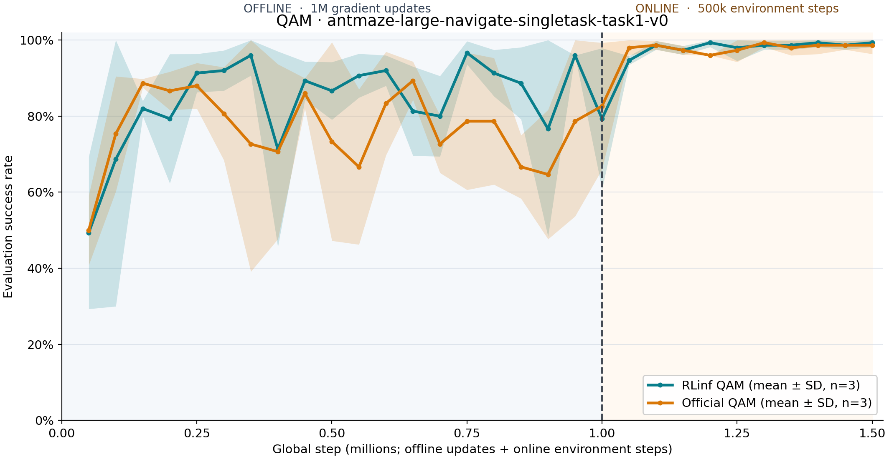

Train QAM on OGBench AntMaze
============================

   Mean success and one sample standard deviation across three seeds. The dashed line marks the transition from offline updates to online environment steps.

Run QAM on OGBench AntMaze with RLinf's PyTorch implementation. The example trains three independent seeds: one million offline gradient updates followed by 500,000 online environment steps per seed. Each seed owns a model, optimizer, replay buffer, and AntMaze environment on one GPU.

Overview
--------

QAM uses a fast flow policy, a slow flow policy, and an ensemble of Q critics. RLinf schedules the experiment through a ``QAMRunner`` and a ``QAMPolicyWorker`` for each seed. The worker keeps environment collection next to the policy, so the online stage does not send each AntMaze observation across Ray.

The example task is ``antmaze-large-navigate-singletask-task1-v0``. Its observation size is 29 and action size is 8. The configuration sets ``horizon_length: 1``; ``action_chunking: true`` therefore produces one action per policy call. Training evaluates 50 episodes every 50,000 steps and writes one CSV per seed.

Installation
------------

Install the embodied stack and OGBench from the RLinf repository root:

.. code-block:: bash

   bash requirements/install.sh embodied --env ogbench
   source .venv/bin/activate

This installs the tested OGBench and MuJoCo versions. OGBench loads the AntMaze dataset when the run starts. Set ``MUJOCO_GL=egl`` on a headless NVIDIA server.

Run It
------

Select three free GPU indices and start the full offline and online run. The command below uses GPUs 0, 1, and 2; the config defaults to GPUs 1, 2, and 3.

.. code-block:: bash

   export MUJOCO_GL=egl
   export PYOPENGL_PLATFORM=egl
   export PYTHONPATH="$(pwd):${PYTHONPATH:-}"
   python examples/embodiment/train_qam.py gpu_start=0 gpu_end=2

The entry point reads ``examples/embodiment/config/ogbench_qam_antmaze.yaml``. It creates three independent Ray workers and writes ``logs/qam-antmaze-3seed/seed_<seed>/train.csv`` and ``eval.csv``. Checkpoints are under ``logs/qam-antmaze-3seed/checkpoints/global_step_<step>/actor/``.

For a quick one-GPU check, keep the same entry point and shorten the schedule:

.. code-block:: bash

   python examples/embodiment/train_qam.py \
     'seeds=[10001]' gpu_start=0 gpu_end=0 \
     runner.offline_steps=4 runner.online_steps=4 \
     runner.max_steps=8 runner.max_epochs=8 \
     runner.start_training=1 runner.val_check_interval=4 \
     runner.save_interval=4 runner.eval_episodes=1 \
     actor.batch_size=8 actor.updates_per_call=2 \
     'actor.model.actor_hidden_dims=[16,16]' \
     'actor.model.value_hidden_dims=[16,16]' \
     actor.model.num_qs=2 actor.model.flow_steps=3 \
     runner.logger.experiment_name=qam-smoke

This checks offline updates, online collection, evaluation, and checkpoint writing. Its success rate is not a benchmark result.

To continue a saved run, point ``runner.resume_dir`` at a ``global_step_<step>`` directory and give the continuation a new experiment name:

.. code-block:: bash

   python examples/embodiment/train_qam.py \
     gpu_start=0 gpu_end=2 \
     runner.resume_dir=/absolute/path/to/global_step_1000000 \
     runner.logger.experiment_name=qam-antmaze-resumed

Use ``runner.only_eval=true`` with the same checkpoint path to run evaluation only. The saved online checkpoint includes the replay buffer, optimizer, random generator, and AntMaze simulator state.

Results and Checks
------------------

The three-seed RLinf run reached mean success 0.7933 at the offline endpoint and 0.9933 at the online endpoint. Under the same task and stage lengths, the pinned official QAM implementation reached 0.8267 and 0.9867. Each value averages three seeds and each endpoint uses 50 evaluation episodes per seed. PyTorch and JAX use different random streams, so seed numbers do not make trajectories pairwise identical.

Run the QAM unit tests on CPU. The optional parity test compares losses, gradients, and one parameter update against an official QAM checkout at commit ``2726d767c9a0a7a46d49693f0391f73dc2cf58ac``.

.. code-block:: bash

   CUDA_VISIBLE_DEVICES='' JAX_PLATFORMS=cpu python -m pytest tests/unit_tests/test_qam.py
   CUDA_VISIBLE_DEVICES='' JAX_PLATFORMS=cpu \
     QAM_REFERENCE_ROOT=/path/to/pinned/QAM \
     python -m pytest tests/parity_tests/test_qam_reference.py

The parity test uses the reference checkout only as a test oracle. Training imports RLinf's own PyTorch QAM implementation.
