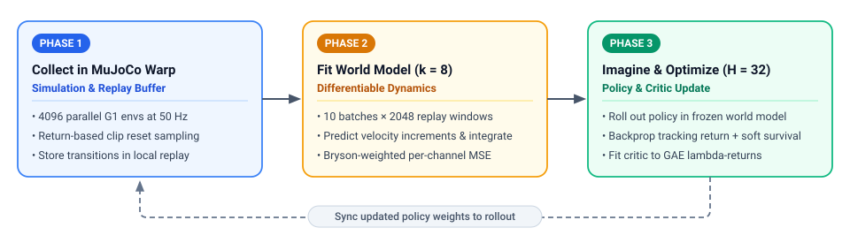

SuperMimic: Whole-Body Motion Tracking with a Differentiable World Model
========================================================================

Train a 29-DoF Unitree G1 whole-body motion-tracking policy with **SuperMimic** (`arXiv:2610.28480 <https://arxiv.org/abs/2610.28480>`__, `project page <https://supermimic.github.io>`__) in MuJoCo Warp. SuperMimic learns a differentiable dynamics world model from simulation rollouts, backpropagates exact tracking returns through 32-step imagined rollouts with a critic for value bootstrapping, and focuses resets on low-return clip segments. On 40 LAFAN1 clips, the 6000-update single-GPU GenCoord recipe reaches a normalized return of ``0.836`` with a fail rate of ``0.025``.

Overview
--------

.. grid:: 2 4 4 4
   :gutter: 2

   .. grid-item-card:: Algorithm
      :text-align: center

      SuperMimic (Differentiable World Model + Actor-Critic)

   .. grid-item-card:: Models
      :text-align: center

      Dynamics World Model · Motion Policy · Critic

   .. grid-item-card:: Environments / Data
      :text-align: center

      :doc:`G1 Motion Tracking <g1_mimic>` · 40 LAFAN1 clips

   .. grid-item-card:: Training
      :text-align: center

      1–4 NVIDIA GPUs (FSDP2) · :ref:`AMD ROCm <supermimic-hardware>`

| **You'll do:** learn the algorithm → install & prepare LAFAN1 → launch training → watch TensorBoard → evaluate checkpoints.
| **Prerequisites:** :doc:`Installation </rst_source/start/installation>` · one or more NVIDIA GPUs (or AMD ROCm) · network access to Hugging Face for LAFAN1 clips.

Tasks
~~~~~

.. list-table::
   :header-rows: 1
   :widths: 22 28 24 26

   * - Recipe
     - Config
     - State Representation
     - Task
   * - GenCoord (default)
     - ``supermimic_lafan1_gencoord``
     - Generalized coordinates (68-dim)
     - 40 LAFAN1 clips on ``g1_mimic``
   * - MaxCoord
     - ``supermimic_lafan1_maxcoord``
     - Tracked-body poses & twists (214-dim)
     - 40 LAFAN1 clips on ``g1_mimic``

Observation and Action
~~~~~~~~~~~~~~~~~~~~~~

For the 14 tracked bodies, PD control parameters, reward weights, and domain randomization, see the :doc:`G1 Motion Tracking Environment <g1_mimic>` page.

.. list-table::
   :header-rows: 1
   :widths: 18 82

   * - Field
     - Summary
   * - Observation
     - Current G1 state encoding (GenCoord or MaxCoord) plus 10 future reference frames spaced 5 control steps apart (0.1 s stride).
   * - Action
     - 29-dim target joint angles at 50 Hz (Gaussian noise ``0.1`` in training; deterministic in evaluation).
   * - Reward
     - 6 tracking kernels plus action-rate and soft joint-limit penalties, scaled by ``0.02 s`` (ceiling ``0.1`` per step).
   * - Prompt
     - Not used.

How SuperMimic Works
--------------------

Each global update runs three phases in lockstep across GPUs:

   SuperMimic three-phase training loop in RLinf.

1. **Collect and return-based reset.** Parallel G1 environments step in MuJoCo Warp with exploration noise and append transitions to each GPU's local replay buffer. Finished episodes reset preferentially to low-return clip segments so training focuses on difficult motions.
2. **Fit the world model.** The dynamics network unrolls ``k = 8`` consecutive steps from replay states under recorded actions, predicts velocity increments, and integrates them into the next pose using Bryson-weighted per-channel MSE.
3. **Optimize policy and critic.** Starting from replay states, the policy rolls forward ``H = 32`` steps inside the frozen world model. Differentiable forward kinematics computes the tracking reward and a smooth termination probability weights survival at every step, sending exact first-order gradients back to the policy. The critic then fits GAE lambda-returns computed on the same imagined rollouts.

State Representations: GenCoord vs. MaxCoord
~~~~~~~~~~~~~~~~~~~~~~~~~~~~~~~~~~~~~~~~~~~~

``actor.model.representation`` selects the state space shared by the world model and policy. Checkpoints load only into the representation they were trained with.

.. list-table::
   :header-rows: 1
   :widths: 16 24 22 38

   * - Representation
     - Stored / Encoded State
     - World-Model Prediction
     - Kinematics & Trade-Off
   * - ``gencoord``
     - 71-dim simulator state / 68-dim root-relative vector
     - 35-dim velocity increments (root twist + 29 joint velocities)
     - Recovers the 14 tracked bodies via differentiable forward kinematics. Compact state and default recipe (``supermimic_lafan1_gencoord``).
   * - ``maxcoord``
     - 182-dim world pose & twist of 14 bodies / 214-dim pelvis-frame vector
     - 84-dim linear & angular velocity increments across 14 bodies
     - Predicts body dynamics directly and recovers joint angles via chain inverse kinematics (``supermimic_lafan1_maxcoord``).

For equations, network dimensions, optimizer settings (Muon + fused Adam), FSDP2 sharding, and differences from the paper, see :doc:`../../reference/algorithms/supermimic`.

Installation
------------

Create a dedicated virtual environment from the repository root (pins PyTorch, MuJoCo Warp, and ``warp-lang`` separately from other RLinf environments):

.. code-block:: bash

   bash requirements/install.sh embodied --env supermimic --venv .venv-supermimic
   source .venv-supermimic/bin/activate

For Docker container builds, see :doc:`g1_mimic`. For AMD ROCm GPUs, see :ref:`Run on Different Hardware Backends <supermimic-hardware>`.

Prepare LAFAN1
--------------

Download, verify, and convert the 40 LAFAN1 Unitree G1 clips (`lvhaidong/LAFAN1_Retargeting_Dataset <https://huggingface.co/datasets/lvhaidong/LAFAN1_Retargeting_Dataset>`_, originating from Ubisoft La Forge `LAFAN1 <https://github.com/ubisoft/ubisoft-laforge-animation-dataset>`_ under CC BY-NC-ND 4.0; review terms before passing ``--accept-license``):

.. code-block:: bash

   python toolkits/supermimic/prepare_lafan1.py --out /data/lafan1_g1 --accept-license

A successful run ends with:

.. code-block:: text

   [lafan1] wrote 40 clips, 2.45 h, manifest /data/lafan1_g1/manifest.json

For offline conversion on a separate internet-connected machine or custom ``clip_*.pt`` files, see :doc:`supermimic_motion`.

Run It
------

Key Algorithm Configuration
~~~~~~~~~~~~~~~~~~~~~~~~~~~

The default training config is ``examples/embodiment/config/supermimic_lafan1_gencoord.yaml`` (MaxCoord inherits it in ``supermimic_lafan1_maxcoord.yaml``). Key settings:

.. list-table::
   :header-rows: 1
   :widths: 36 16 48

   * - Config Key
     - Default
     - Meaning
   * - ``actor.model.representation``
     - ``gencoord``
     - State representation: ``gencoord`` or ``maxcoord``
   * - ``algorithm.k`` / ``algorithm.H``
     - ``8`` / ``32``
     - World-model unroll window and policy imagination horizon
   * - ``algorithm.replay_ratio``
     - ``16``
     - Average draws per transition by the world model (0.4 updates/step at 4096 envs)
   * - ``algorithm.wm_batches`` / ``wm_window_batch``
     - ``10`` / ``2048``
     - World-model batches per update and global windows per batch
   * - ``algorithm.imagine_batch``
     - ``4096``
     - Global number of imagined rollouts per policy update
   * - ``actor.cuda_graph``
     - ``False``
     - Capture each global update as one CUDA graph (recommended ``True`` on NVIDIA GPUs)
   * - ``actor.fsdp_config.amp_autocast.enabled``
     - ``False``
     - Run network matmuls in bf16 while keeping weights and optimizer state in float32

Train on One GPU
~~~~~~~~~~~~~~~~

Set the motion clip directory and disable MuJoCo's OpenGL renderer, then launch the 6000-update GenCoord run on GPU 0 with CUDA graph replay:

.. code-block:: bash

   export PYTHONPATH=$PWD:$PYTHONPATH
   export MUJOCO_GL=disabled
   export SUPERMIMIC_MOTION_PATH=/data/lafan1_g1
   export RUN_DIR=/data/runs/supermimic_gencoord

   python examples/embodiment/train_embodied_agent.py \
       --config-name supermimic_lafan1_gencoord \
       runner.logger.log_path=$RUN_DIR actor.cuda_graph=True

After 3 warm-up updates, the log prints ``Recorded the SuperMimic update as a CUDA graph.``. Every 100 updates it prints a metrics table starting with ``Global Step: <N>/6000``. Checkpoints are written under ``$RUN_DIR/supermimic_lafan1_gencoord/checkpoints/global_step_<N>/`` every 2000 updates and at step 6000.

To resume an interrupted run from the latest complete checkpoint on the same GPU count, pass ``runner.resume_dir=auto``:

.. code-block:: bash

   python examples/embodiment/train_embodied_agent.py \
       --config-name supermimic_lafan1_gencoord \
       runner.logger.log_path=$RUN_DIR actor.cuda_graph=True \
       runner.resume_dir=auto

The log prints ``Resuming from <path>`` when a checkpoint is loaded.

Train on Multiple GPUs
~~~~~~~~~~~~~~~~~~~~~~

Environment count, world-model batches, and imagined rollouts are global totals divided evenly across GPUs, so the learning rate and total update count stay unchanged:

.. list-table::
   :header-rows: 1
   :widths: 40 20 20 20

   * - Per Update
     - Global Total
     - Per GPU (2 GPUs)
     - Per GPU (4 GPUs)
   * - Parallel environments
     - 4096
     - 2048
     - 1024
   * - World-model windows (×10 batches)
     - 2048
     - 1024
     - 512
   * - Imagined rollouts
     - 4096
     - 2048
     - 1024

To run on two GPUs (use ``0-3`` for four GPUs), override ``cluster.component_placement`` with a fresh ``RUN_DIR``:

.. code-block:: bash

   export RUN_DIR=/data/runs/supermimic_gencoord_2gpu
   python examples/embodiment/train_embodied_agent.py \
       --config-name supermimic_lafan1_gencoord \
       runner.logger.log_path=$RUN_DIR actor.cuda_graph=True \
       '~cluster.component_placement' \
       '+cluster.component_placement={actor:0-1,env:0-1,rollout:0-1}'

Train with MaxCoord
~~~~~~~~~~~~~~~~~~~

Switch ``--config-name`` to ``supermimic_lafan1_maxcoord`` with a new ``RUN_DIR``. Checkpoints are saved under ``$RUN_DIR/supermimic_lafan1_maxcoord/checkpoints/``.

Evaluate a Checkpoint
~~~~~~~~~~~~~~~~~~~~~

Run motion-tracking evaluation on all 40 LAFAN1 clips with the step-6000 weights:

.. code-block:: bash

   bash evaluations/run_eval.sh supermimic_lafan1_eval \
       runner.ckpt_path=$RUN_DIR/supermimic_lafan1_gencoord/checkpoints/global_step_6000/actor/model_state_dict/full_weights.pt \
       runner.eval_export.output_dir=$RUN_DIR/eval_6000

For MaxCoord checkpoints, add ``rollout.model.representation=maxcoord``. For standing push recovery, full output formats, and metric definitions, see :doc:`../../evaluations/guides/supermimic`.

Visualization and Results
-------------------------

Watch training progress in TensorBoard:

.. code-block:: bash

   tensorboard --logdir $RUN_DIR/tensorboard

Key metrics (x-axis is the update count; see :doc:`../../reference/metrics` for shared names):

* ``env/sim/reward_mean``: Mean simulated per-step tracking reward (rises toward its ceiling of ``0.1``).
* ``env/sim/terminal_rate``: Fraction of environments falling per step (drops toward ``0``).
* ``train/world_model/state_loss``: Bryson-weighted world-model prediction loss.

Tracking Quality (LAFAN1, 40 Clips)
~~~~~~~~~~~~~~~~~~~~~~~~~~~~~~~~~~~

Single-GPU GenCoord run on one NVIDIA A800 (seed 0):

.. list-table::
   :header-rows: 1
   :widths: 25 25 25 25

   * - Updates
     - ``normalized_return``
     - ``fail_rate``
     - ``body_pos_err`` (m)
   * - 6000
     - 0.836
     - 0.025
     - 0.024

One of the 40 clips falls (the paper reports ``0.82`` normalized return on these clips).

.. figure:: https://raw.githubusercontent.com/RLinf/misc/main/pic/supermimic_gencoord_curves.png
   :alt: SuperMimic GenCoord training curves
   :width: 100%

   Training curves of the 6000-update GenCoord run on NVIDIA A800. Simulated reward reaches up to 5.0/s (0.1 per 50 Hz control step); the imagined return (top right) includes the terminal critic bootstrap value and therefore exceeds 5.

Throughput Comparison
~~~~~~~~~~~~~~~~~~~~~

Seconds per global update of the GenCoord recipe on dedicated NVIDIA A800 GPUs compared with the official single-GPU implementation (mean ``time/step`` over 1000 updates after 200 warm-up updates). RLinf runs enable ``actor.cuda_graph=True``, and bf16 rows also set ``actor.fsdp_config.amp_autocast.enabled=True``:

.. list-table::
   :header-rows: 1
   :widths: 25 25 25 25

   * - Implementation
     - GPUs
     - Matmul
     - s/update
   * - Official
     - 1
     - TF32
     - 0.515
   * - RLinf
     - 1
     - TF32
     - 0.702
   * - RLinf
     - 1
     - bf16
     - 0.627
   * - RLinf
     - 2
     - TF32
     - 0.534
   * - RLinf
     - 2
     - bf16
     - 0.528
   * - RLinf
     - 4
     - TF32
     - 0.411
   * - RLinf
     - 4
     - bf16
     - 0.385

On 1 GPU with TF32, RLinf is ~36% slower per update than the single-process official code due to worker observation/action exchange and per-update weight sync; with bf16, one GPU takes 0.627 s, and 2–4 GPUs scale further.

.. _supermimic-hardware:

Run on Different Hardware Backends
----------------------------------

AMD ROCm
~~~~~~~~

The AMD path runs MuJoCo Warp on ROCm Warp and targets the MI300X (``gfx942``). This path requires Linux x86_64, ROCm 7.2 SDK with ``hipcc``, a C++ toolchain (see the `ROCm Warp gfx942 Dockerfile <https://github.com/ROCm/warp/blob/36ed75aa65f837a78b20d1a3a1ac08cfe1fc7b71/docker/rocm/Dockerfile>`_), and a recent ``uv`` supporting flat wheel indexes.

Install from the repository root:

.. code-block:: bash

   export ROCM_PATH=/opt/rocm  # set to your ROCm SDK path
   bash requirements/install.sh --platform amd --rocm 7.2 --no-flash-attn \
       embodied --env supermimic --venv .venv-supermimic
   source .venv-supermimic/bin/activate

The installer fetches PyTorch 2.9.1 from AMD's index, builds ROCm Warp ``1.13.0+rocm.0``, and installs mjlab 1.2.0, MuJoCo 3.8.1, and ``mujoco-warp`` 3.8.1. Override ``SUPERMIMIC_WARP_PATH`` (default ``../warp-rocm``) or ``SUPERMIMIC_HIP_ARCH`` (default ``gfx942``) if needed.

Data preparation and launch commands then follow the sections above. Full end-to-end training convergence on AMD ROCm is untested.
