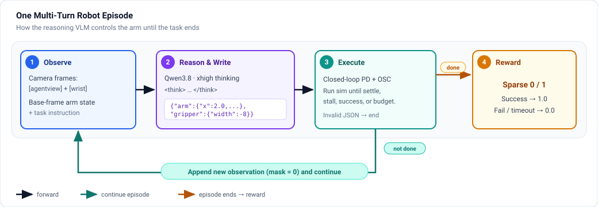
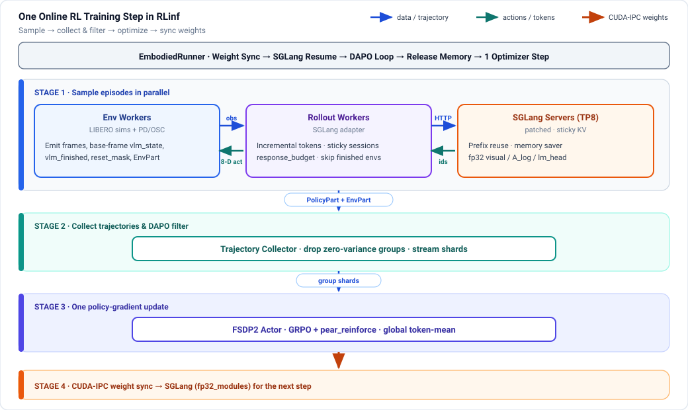
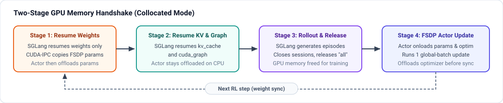

Train Reasoning Models as Embodied Policies
===========================================

VLM-as-Policy trains a reasoning vision-language model (VLM) directly as a robot policy through online reinforcement learning in simulation, without demonstrations or a separate action head. Instead of predicting low-level motor torques at high frequency, the model observes camera images and arm state, reasons in a chain of thought, and writes the next relative end-effector pose as a JSON text block.

This page starts with a high-level overview of the end-to-end flow, then walks through worker interaction, SGLang inference, weight synchronization, trajectory collection with DAPO filtering, and the policy-gradient objective.

At a Glance
-----------

It helps to read the system at two levels: how the reasoning model controls a robot arm across one multi-turn episode, and how RLinf turns many parallel episodes into a single online RL update.

One Multi-Turn Robot Episode
~~~~~~~~~~~~~~~~~~~~~~~~~~~~

In a single episode, the reasoning model acts like a computer-use agent controlling a robot arm. It reads camera frames and base-frame arm state, writes a chain of thought, emits one relative end-effector pose as JSON, and lets the low-level controller execute that move in the simulator. If the task is not finished, a new observation is appended and the loop continues; only when the episode ends does the environment return a sparse 0/1 reward:

   One multi-turn episode: observe, reason in ``<think>``, write a JSON delta pose, execute; continue until success or timeout, then receive a sparse 0/1 reward.

One Online RL Training Step
~~~~~~~~~~~~~~~~~~~~~~~~~~~

During training, RLinf samples episodes in parallel across environment workers and SGLang servers, drops zero-variance groups with DAPO, applies one GRPO and REINFORCE update, and syncs the new weights back to the inference engines over CUDA IPC. The step breaks down into sampling, collection and filtering, optimization, and weight sync:

   One online RL training step: sample trajectories in parallel, filter with DAPO, update weights, then sync them back to SGLang over CUDA IPC.

Traditional vision-language-action (VLA) models map each frame to continuous action chunks through supervised fine-tuning on demonstrations. Here, the base reasoning model keeps its native multimodal token interface and learns manipulation from sparse task-completion rewards alone.

Actor, Rollout, and Environment Interaction
-------------------------------------------

Three worker groups divide simulation, text generation, and policy optimization. In the default single-node and multi-node configurations, all three groups time-share the same GPUs under ``actor,env,rollout: all`` placement so that FSDP training and SGLang tensor-parallel inference never occupy GPU memory at the same time.

During rollout, the environment workers step their simulators and send observations through the channel to the rollout workers. Each observation carries multi-camera frames, the task instruction, reset and completion flags (``reset_mask`` and ``vlm_finished``), and the robot state expressed in the robot base frame (``vlm_state``). Keeping the state in base-frame coordinates with fixed decimal rounding matches the coordinate convention described in the system prompt; the rollout adapter rejects observations that omit ``vlm_state`` under ``vlm_action_mode`` rather than falling back to world-frame coordinates.

When a rollout worker receives an observation batch, it generates one macro action per environment and returns an 8-dimensional vector for LIBERO: six Cartesian deltas (``x``, ``y``, ``z``, ``roll``, ``pitch``, ``yaw``), a gripper width delta, and a trailing validity flag. If the model output fails JSON parsing or exhausts the episode token budget, the rollout worker sets the validity flag to ``0.0``. The environment worker treats a zero flag as an immediate episode termination rather than executing a zero-motion command.

To keep the actor channel ordered with a single producer, the environment attaches the previous chunk's transition to the next policy request. The rollout worker forwards that completed transition together with the current step's policy output to the trajectory collector. When ``runner.enable_decoupled_mode`` is enabled, the SGLang rollout worker routes dynamic batches with recorded batch routes so environment stepping and model inference can run asynchronously across separate resources.

SGLang Inference and Multi-Turn Context
---------------------------------------

Multi-turn embodied episodes average around 20 rounds and can reach 160k to 256k tokens with dozens of 512x512 images. Calling a language model naively on every turn would re-encode every past image and risk rewriting earlier thinking tokens through the chat template.

Incremental Token Construction and Sticky Sessions
~~~~~~~~~~~~~~~~~~~~~~~~~~~~~~~~~~~~~~~~~~~~~~~~~~

The SGLang rollout worker splits each observation batch by environment and posts concurrent HTTP ``/generate`` requests to the patched SGLang server, bounded by ``rollout.sglang.max_inflight_sessions`` when set. Each user turn formats the rounded state JSON, appends the turn reminder, and places explicit camera tags (``[agentview]`` and ``[wrist]`` for LIBERO) directly before each image.

Instead of re-rendering the full message history through ``apply_chat_template`` on every turn, the rollout adapter tracks each episode incrementally:

1. On the first turn, it tokenizes the system prompt and initial user message once and opens a sticky SGLang session with ``/open_session``.
2. After each generation, it appends the exact returned ``output_ids`` to the episode token buffer, marks those positions with mask ``1``, and records their exact global indices as ``response_index``.
3. On subsequent turns, it renders only the incremental user-turn suffix, encodes only the new turn's camera frames, appends the resulting tokens with mask ``0``, and sends only the new suffix and new frames over the open sticky session so SGLang reuses its prefix KV cache.

This incremental construction guarantees that earlier ``<think>`` spans stay intact in the training sequence even if a chat template strips historical reasoning text, and reduces per-turn image preprocessing from quadratic to constant cost over episode length.

Response Budget and Post-Termination Short-Circuit
~~~~~~~~~~~~~~~~~~~~~~~~~~~~~~~~~~~~~~~~~~~~~~~~~~

The episode budget (``rollout.sglang.response_budget``, set to ``160000`` in stage 1 and ``262144`` in stage 2) counts every token after the initial prompt, including both generated assistant tokens and injected observation and image tokens. Each turn receives only the remaining budget as ``max_new_tokens``. When appending the next observation or finishing a turn reaches the budget, the episode marks itself exhausted and terminates without issuing an extra server request.

Because vectorized environments run in lockstep across a rollout epoch, fast episodes finish earlier than slow ones. Once an environment reports ``vlm_finished`` (or exhausts its budget), the rollout worker skips HTTP inference for that slot and emits a tiny placeholder sample instead of re-encoding 512x512 images, preventing idle steps from inflating memory and inter-process transfer.

Two-Stage GPU Memory Handshake
~~~~~~~~~~~~~~~~~~~~~~~~~~~~~~

In collocated runs, SGLang memory saving prevents FSDP parameters and SGLang KV cache from residing on the GPU simultaneously:

   Two-stage GPU memory handshake between FSDP actor training and collocated SGLang rollout.

Weight Synchronization
----------------------

At the start of each RL step (controlled by ``runner.weight_sync_interval``), the actor pushes fresh FSDP weights to the patched SGLang servers over CUDA IPC without round-tripping through disk or CPU RAM.

The actor first offloads its optimizer state, loads its sharded parameters onto GPU, and partitions the state dictionary into fixed-size buckets (128 MB by default). For each bucket, every actor rank gathers its ``DTensor`` shards into full tensors and sends CUDA IPC handles to its mapped SGLang model instance and tensor-parallel rank.

On the rollout side, every rollout worker rank notifies its adapter to increment the policy version and close stale sticky sessions (unless ``rollout.sglang.keep_sessions_on_weight_sync`` is enabled for asynchronous runs). One leader rank per launched SGLang server (``rank < num_servers``) issues the server-side load RPC so multi-node deployments with multiple TP8 engines synchronize every engine exactly once.

Before loading each tensor, the patched SGLang scheduler strips the policy wrapper prefix and maps HuggingFace multimodal paths (``model.visual.*`` and ``model.language_model.*``) to SGLang's parameter tree (``visual.*`` and ``model.*``). Both the sender and the scheduler inspect ``rollout.sglang.fp32_modules`` (default ``["visual", "A_log", "lm_head"]``) so parameters matching those substrings stay in ``fp32`` while the remaining weights cast to ``rollout.sglang.dtype`` (``bf16``). Keeping the vision encoder, Gated DeltaNet ``A_log``, and language-model head in ``fp32`` aligns rollout sampling with training precision.

Trajectory Assembly and DAPO Filtering
--------------------------------------

The trajectory collector pairs each ``PolicyPart`` with its matching ``EnvPart`` and stacks turns along the time axis. Because multi-turn responses and image sequences grow across turns, the collector right-pads ``prev_logprobs``, ``versions``, and every tensor inside ``forward_inputs`` (``input_ids``, ``attention_mask``, ``pixel_values``, ``image_grid_thw``, ``mm_token_type_ids``, ``response_index``, ``response_mask``, and optional top-K head tensors) into a ``[T, B, ...]`` trajectory.

DAPO Zero-Variance Group Filtering and Collection Modes
~~~~~~~~~~~~~~~~~~~~~~~~~~~~~~~~~~~~~~~~~~~~~~~~~~~~~~~

Under GRPO, a prompt group whose trajectories all succeed or all fail produces zero advantage and contributes no learning signal. RLinf drops zero-variance groups and resamples until enough variable groups are available, using three collection modes selected under ``algorithm.pear``:

.. list-table::
   :header-rows: 1
   :widths: 22 32 46

   * - Mode
     - Config Keys
     - Behavior
   * - In-place filter and resample (MVP)
     - ``dapo_filter: True``, ``dapo_resample: True``
     - Masks constant groups to zero; the runner repeats rollout batches until kept groups reach ``dapo_target_groups`` or ``dapo_max_batches``.
   * - Global compact pool
     - ``dapo_compact: True``, ``stream_to_actors: False``
     - Pools variable groups across every environment source; emits a pending signal while short and deals exact equal shards once ``dapo_target_groups`` is met.
   * - Streaming group waves (Paper)
     - ``dapo_compact: True``, ``stream_to_actors: True``
     - Splits each finished source into groups immediately and dispatches one group per actor rank per wave without waiting for slower sources.

When pooling leaves surplus variable groups after filling one step, synchronous on-policy runs enable ``clear_surplus_after_step: True`` to clear the leftover pool so old-policy groups never enter the next REINFORCE update. Asynchronous runs set ``max_off_policy_threshold`` (for example ``5``, keeping staleness at most 4 policy versions) so both the collector and the actor drop stale groups by checking trajectory ``versions``.

Episode Sequence Compaction
~~~~~~~~~~~~~~~~~~~~~~~~~~~

Because the final valid turn of each environment already packs the complete multi-turn sequence and every earlier assistant span in ``forward_inputs``, earlier turns must not be trained a second time. With ``algorithm.pear.episode_sequence: True``, the actor first masks out all turns except each environment's last valid turn, then compacts the ``[T, B, ...]`` rollout batch down to ``[1, B, ...]`` before shuffling and slicing:

- Each environment keeps the ``forward_inputs`` and masks from its terminating turn.
- Episode rewards are summed across all ``T`` steps into slot ``0``, preserving exact GRPO returns.
- The flattened batch size equals ``batch_size_per_rank``, so one RL step performs exactly one optimizer update rather than ``T`` updates over mostly zero-masked intermediate steps.

RL Algorithm and Long-Context Optimization
------------------------------------------

Sparse Rewards and GRPO Advantages
~~~~~~~~~~~~~~~~~~~~~~~~~~~~~~~~~~

Each LIBERO environment runs a closed-loop PD and operational-space decoupling controller that steps the simulator until the target pose is reached at rest, the arm stalls, the task completes, or the suite's native step budget runs out (220 for ``libero_spatial``, 280 for ``libero_object``, 300 for ``libero_goal``, and 520 for ``libero_10``). Camera frames are rotated 180 degrees and left/right words in the instruction are mirrored to match the rendered view.

The environment returns a sparse reward of ``1.0`` on task success and ``0.0`` otherwise, with no critic model, no KL penalty (``kl_beta: 0.0``), and no entropy bonus (``entropy_bonus: 0``). Within each prompt group of size ``group_size`` (8 by default), GRPO normalizes the episode returns to a scalar advantage broadcast across every generated token of that episode:

.. math::

   A_{g,i} = \frac{R_{g,i} - \mu_g}{\sigma_g + 10^{-6}}

Bypass REINFORCE and Top-K Score Centering
~~~~~~~~~~~~~~~~~~~~~~~~~~~~~~~~~~~~~~~~~~

Training uses bypass-mode REINFORCE (``algorithm.loss_type: pear_reinforce``) without PPO clipping. Since this loss does not read ``old_logprobs``, ``algorithm.recompute_logprobs`` is set to ``False``, avoiding an extra full forward pass over the 27B model.

When training asynchronously with off-policy trajectories, enabling ``algorithm.pear.score_centering: True`` requests per-token top-K sampler heads from SGLang (``rollout.sglang.topk_log_probs: 32`` by default). Letting :math:`H_t` denote the sampler's top-K token set at generated position :math:`t` with sampler probabilities :math:`q_t` and trainer probabilities :math:`p_\theta`, the per-token loss adds the score-centering correction:

.. math::

   \rho_t = \frac{\max\!\left(1 - \sum_{k \in H_t} q_t(k),\; \varepsilon\right)}{\max\!\left(1 - \sum_{k \in H_t} p_\theta(k),\; \varepsilon\right)}, \qquad
   c_t = \sum_{k \in H_t} \operatorname{sg}\!\left[q_t(k) - \rho_t \, p_\theta(k)\right] \log p_\theta(k)

.. math::

   \ell_t = -A_i \log \pi_\theta(y_t \mid x_{<t}) + A_i \, c_t

When the sampler and trainer match (:math:`q_t = p_\theta`), the residual cancels and :math:`c_t = 0`. When trajectories lag behind the current weights, :math:`c_t` centers the policy-gradient score under the sampler distribution without truncated importance sampling.

Global Batch Token-Mean Normalization
~~~~~~~~~~~~~~~~~~~~~~~~~~~~~~~~~~~~~

Multi-turn episodes vary widely in response length, so averaging each micro-batch independently and dividing by gradient accumulation steps biases the update toward short episodes. Before iterating over micro-batches, the actor sums the count of valid response tokens across all data-parallel ranks via ``all_reduce(SUM)`` to obtain :math:`N_{\text{global}}`. Each micro-batch normalizes its summed token loss by :math:`N_{\text{global}}` and multiplies by the data-parallel world size :math:`W` so that FSDP's mean gradient reduction yields the exact batch-wide token-mean gradient:

.. math::

   \frac{1}{W} \sum_{r=1}^{W} \sum_{m \in r} \nabla \!\left(\frac{W \sum_{t \in m} \ell_t}{N_{\text{global}}}\right)
   = \frac{1}{N_{\text{global}}} \sum_{\text{all valid } t} \nabla \ell_t

Memory and Precision Techniques for Long Sequences
~~~~~~~~~~~~~~~~~~~~~~~~~~~~~~~~~~~~~~~~~~~~~~~~~~

To train a 27B multimodal model on sequences up to 256k tokens:

- **Unpadded sample forward**: each sample slices ``input_ids`` and ``mm_token_type_ids`` to its true ``attention_mask`` length before entering the backbone, avoiding attention compute on right-padded tails.
- **Chunked FP32 LM head**: the language-model head never materializes the full ``[sequence, vocab]`` logits tensor. Instead, it processes hidden states in chunks of 4,096 rows in ``fp32``, computing target token log-probabilities, entropy, and (when score centering is enabled) top-K head log-probabilities in a single chunked pass.
- **FSDP2 module-level FP32 and residual precision**: setting ``actor.fsdp_config.strategy: fsdp2`` with ``fp32_modules: ["model.visual"]``, ``fp32_modules_tf32: True``, and ``fp32_residual: True`` wraps the vision tower in an ``fp32`` mixed-precision policy and leaves transformer residual inputs uncast.
- **Host-resident streamed AdamW**: setting ``actor.optim.streamed_adamw: True`` keeps FP32 Adam moments in pinned CPU memory and streams 2 GiB parameter chunks across three GPU staging slots during each update step.
- **Ulysses sequence parallelism**: setting ``actor.fsdp_config.ulysses_sp_size`` above ``1`` creates sequence-parallel groups and provides differentiable sequence slice, gather, all-to-all, and local response-window mapping primitives for multi-GPU long-context sharding.

Configurations and Next Steps
-----------------------------

The repository ships four configs that share the same VLM-as-Policy stack:

.. list-table::
   :header-rows: 1
   :widths: 36 20 44

   * - Config
     - Scale
     - Purpose
   * - ``examples/embodiment/config/libero_gso_grpo_pear_sglang.yaml``
     - 1 node, 8 GPUs
     - Default MVP for stage 1 on ``libero_gso`` (64 envs, group size 8, 160k budget, 2 steps). Launch with ``bash examples/embodiment/run_vlm_policy.sh``.
   * - ``examples/embodiment/config/libero_gso_grpo_pear_sglang_paper.yaml``
     - 4 nodes, 32 GPUs
     - Full stage-1 setup (2,048 envs, 128 variable groups per update, streaming waves, FSDP2 with ``fp32_modules`` and ``fp32_residual``).
   * - ``examples/embodiment/config/libero_10_grpo_pear_stage2.yaml``
     - 1 node, 8 GPUs
     - Stage 2 extending training to ``libero_10`` with a 262,144-token response budget and 520 native steps.
   * - ``examples/embodiment/config/pear_stage3_libero_robodojo.yaml``
     - Multi-embodiment template
     - Enables ``score_centering: True`` and ``max_off_policy_threshold: 5`` for stage-3 training.

To explore the underlying RLinf components used here, see :doc:`../../concepts/trajectory_collector`, :doc:`../../concepts/execution-model/index`, and :doc:`../../concepts/scheduling-model/index`.
