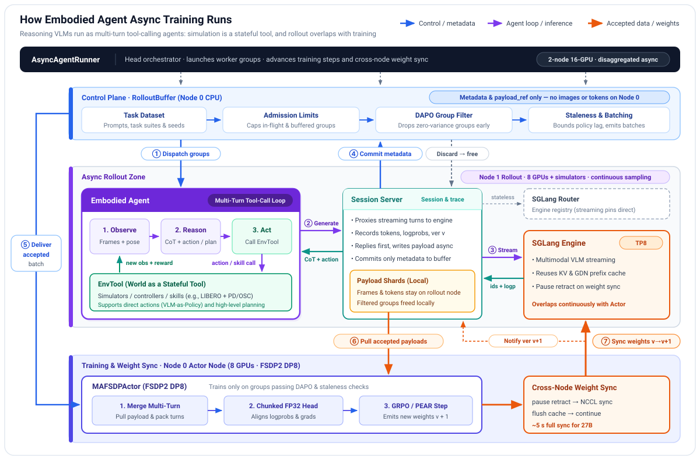
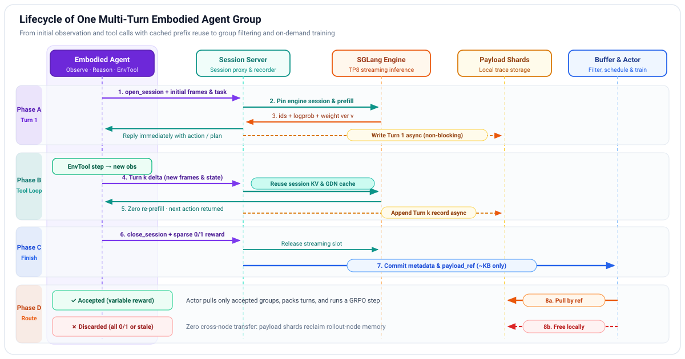

Embodied Agents
===============

Embodied agents in RLinf train reasoning vision-language models (VLMs) as multi-turn, tool-calling robot agents with online reinforcement learning. This section hosts multi-turn embodied workflows—starting with direct end-effector control via VLM-as-Policy and expanding to high-level VLM planners that orchestrate robot skills.

Examples
--------

.. grid:: 1 2 2 2
   :gutter: 3

   .. grid-item-card:: VLM-as-Policy (LIBERO + Qwen3.8-27B)
      :link: vlm_as_policy
      :link-type: doc

      Train ``Qwen3.8-27B`` directly as a multi-turn robot policy on LIBERO with async GRPO and streaming SGLang sessions.

   .. grid-item-card:: VLM Planner (Planned)

      Train a reasoning VLM as a high-level embodied brain that decomposes long-horizon tasks and invokes low-level robot skills.

When to Use an Embodied Agent
-----------------------------

Reactive VLA models such as OpenVLA or π₀ emit dense continuous action chunks at 10–50 Hz with a fixed inference cost per step. A synchronous rollout pipeline fits that workload because every parallel simulator finishes a step at roughly the same time.

Reasoning VLMs behave differently. On each turn, the model reads multi-view camera frames and robot state, writes a chain of thought inside ``<think>``, and emits a structured action or high-level skill call. One episode can finish in three turns while another runs for fifteen, and thinking lengths vary widely across episodes. Waiting for the slowest episode in a synchronous batch leaves training GPUs idle, and shipping full multi-turn image histories to the head node saturates host memory and network bandwidth.

RLinf handles variable-length reasoning by wrapping the simulator, controller, or skill library as a stateful environment tool with ``open``, ``step``, and ``close`` operations, and keeps heavy multimodal trajectories on the rollout node behind a session server. Once the robot environment sits behind a tool interface, an embodied reasoning agent follows the same multi-turn loop as text or code agents: observe the world, reason, call the tool, receive the next observation, and collect a task reward at episode end. Embodied agent recipes then reuse RLinf's async rollout buffer, staleness bounds, group filtering, and cross-node weight synchronization.

How an Async Training Run Works
-------------------------------

An embodied agent run places actor and rollout workers on disjoint GPU groups so sampling and training run at the same time. The runner on the head node launches all worker groups, starts background sampling, advances optimizer steps, and coordinates weight synchronization.

   End-to-end flow of an async embodied agent run: the rollout buffer controls admission and group filtering on Node 0, embodied agents run multi-turn loops against the environment tool and streaming SGLang engine on Node 1, and the FSDP2 actor updates weights and syncs them back across nodes.

Following steps 1 through 7 in the diagram, one training cycle moves through five stages:

1. **Task dispatch and admission control (step 1).** The rollout buffer on Node 0 reads tasks from the dataset and dispatches prompt groups whenever both in-flight and buffered group limits allow it.
2. **Continuous multi-turn agent loop (steps 2 and 3).** Each task group spawns a parallel group of embodied agent episodes on Node 1. On every turn, an agent reads camera frames and state from the environment tool, sends a generation request through the session server to the streaming SGLang engine, and executes the returned action or skill call in the environment tool. Sampling runs continuously in the background while Node 0 trains.
3. **Metadata reporting and group filtering (step 4).** When every episode in a group finishes, the session server reports a few kilobytes of metadata—rewards, weight versions, token counts, and a local payload reference—to the rollout buffer. Images and tokens stay on Node 1. The buffer drops zero-variance groups (all success or all failure under DAPO filtering) and groups older than the staleness bound, then tells the rollout node to free their local payload memory immediately.
4. **On-demand training fetch (steps 5 and 6).** Once enough accepted groups accumulate, the buffer hands their metadata batch to the FSDP2 actor on Node 0. The actor pulls images, tokens, and rollout logprobs from local payload shards only for those accepted groups, merges continuous turns into one sequence per episode, and computes policy gradients.
5. **Cross-node weight sync (step 7).** After each optimizer step produces weight version ``v + 1``, the runner pauses in-flight generation with ``retract`` (returning active requests to the engine queue while preserving generated tokens), broadcasts updated weights over NCCL to the SGLang engine, flushes stale KV and recurrent caches, notifies the session server of the version bump, and resumes rollout.

One Multi-Turn Group Lifecycle
------------------------------

Inside a single task group, the embodied agent, session server, SGLang engine, and local payload shards coordinate across turns as follows.

   Lifecycle of one embodied agent group across four phases: initial observation and session setup, cached multi-turn tool calls, episode completion with metadata-only commit, and routing accepted groups to training while freeing discarded ones locally.

On turn 1, the embodied agent opens a streaming session with the initial camera frames and task prompt. The session server pins that episode directly to a specific SGLang engine instance (bypassing stateless router hops) so the engine builds and retains its KV and recurrent caches. As soon as the engine returns tokens, logprobs, and the weight version, the session server replies to the agent first so the simulator can step immediately, then writes the multimodal turn record to local payload shards in the background.

On turn 2 and later turns, after the environment tool finishes stepping the previous action or skill, the agent sends only the incremental observation—new camera frames and updated state. Because the streaming session stays pinned on the same engine, SGLang reuses the cached prefix instead of re-prefilling earlier images and thinking tokens.

At episode completion, the agent closes the session and submits the task reward. The session server releases the engine slot and commits lightweight group metadata to Node 0, so the actor pulls accepted groups by reference right before its update while the rollout node frees discarded groups locally.

Next Steps
----------

- :doc:`vlm_as_policy`: install, download checkpoints, and launch the LIBERO + Qwen3.8-27B VLM-as-Policy run.
- :doc:`../../guides/async_agentic`: tune in-flight and buffer admission limits, staleness bounds, and weight-sync pause modes.
- :doc:`../../guides/session_server`: configure session server ports, payload shards, routing policies, and verification checks.
- :doc:`../../concepts/execution-model/index`: review RLinf's core worker, channel, and cluster abstractions.

.. toctree::
   :hidden:
   :maxdepth: 2

   VLM-as-Policy <vlm_as_policy>
