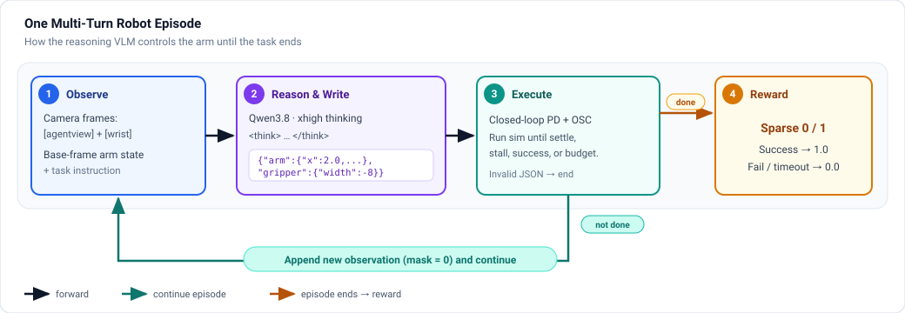

VLM-as-Policy: LIBERO + Qwen3.8-27B
===================================

This recipe trains ``Qwen3.8-27B`` directly as a multi-turn robot policy on LIBERO using RLinf's :doc:`embodied agent <index>` architecture. The model reads multi-view camera frames and base-frame arm pose, reasons inside ``<think>``, and outputs a JSON pose delta executed by a closed-loop controller.

Overview
--------

.. grid:: 2 4 4 4
   :gutter: 2

   .. grid-item-card:: Environments
      :class-card: sd-rounded-3

      LIBERO (``libero_gso``, ``libero_10``) and RoboDojo schema

   .. grid-item-card:: Algorithms
      :class-card: sd-rounded-3

      GRPO (``grpo_dynamic`` + ``pear_reinforce``), DAPO equal-reward filtering, optional top-K score centering

   .. grid-item-card:: Tasks
      :class-card: sd-rounded-3

      Multi-turn tabletop manipulation from sparse 0/1 rewards

   .. grid-item-card:: Hardware
      :class-card: sd-rounded-3

      2 nodes (16 × 80 GB GPUs) default; 4 nodes (32 H200 GPUs) paper scale

In each episode, the model observes camera frames and rounded base-frame arm coordinates, writes a chain of thought inside ``<think>``, and emits one JSON pose delta. The simulator runs closed-loop PD and operational-space control until the target is reached, the arm stalls, the task finishes, or the native step budget runs out.

   One multi-turn episode: observe camera frames and arm pose, reason in ``<think>``, emit a JSON pose delta, step the simulator, and receive a sparse 0/1 reward at completion.

For the disaggregated rollout and training architecture behind this recipe, see :doc:`index`.

Tasks
~~~~~

.. list-table::
   :header-rows: 1
   :widths: 18 22 30 30

   * - Environment
     - Task / Suite
     - Config
     - Focus
   * - LIBERO
     - ``libero_gso`` (Goal, Spatial, Object)
     - ``libero_gso_grpo_pear_sglang.yaml``
     - Stage 1 default (2 nodes, 16 GPUs, 8 groups/step, 160k budget, ``max_steps: 2`` quick check)
   * - LIBERO
     - ``libero_gso`` (Goal, Spatial, Object)
     - ``libero_gso_grpo_pear_sglang_paper.yaml``
     - Stage 1 paper scale (4 nodes, 32 GPUs, 128 groups/step, ``max_turns: 300``, ``max_steps: 1000``)
   * - LIBERO
     - ``libero_10`` (Long)
     - ``libero_10_grpo_pear_stage2.yaml``
     - Stage 2 long-horizon training (262,144 token budget, ``max_turns: 64``)
   * - LIBERO / RoboDojo
     - Mixed multi-embodiment
     - ``pear_stage3_libero_robodojo.yaml``
     - Stage 3 off-policy training with top-K score centering (``topk_log_probs: 32``, ``seq_length: 8192``)

Observation and Action
~~~~~~~~~~~~~~~~~~~~~~

.. list-table::
   :header-rows: 1
   :widths: 20 80

   * - Field
     - Format
   * - Observation
     - Two 512x512 RGB camera frames rotated 180 degrees (``[agentview]`` and ``[wrist]`` for LIBERO) plus rounded base-frame arm pose (cm and rad) and gripper width.
   * - Action
     - One fenced ``json`` block giving relative deltas for ``arm`` (``x``, ``y``, ``z``, ``roll``, ``pitch``, ``yaw``) and ``gripper`` (``width``). Unparseable output ends the episode with reward ``0.0``.
   * - Reward
     - Sparse ``1.0`` on task success and ``0.0`` otherwise, with no critic, KL penalty, or entropy bonus.
   * - Prompt
     - System prompt defining the coordinate frame and JSON schema, followed by incremental per-turn state JSON and tagged camera frames. Left and right directions in LIBERO instructions are mirrored to match the rotated cameras.

Setup and Run
-------------

Start a multi-node Ray cluster first (2 nodes for the default config, 4 nodes for the paper-scale config), exporting a unique ``RLINF_NODE_RANK`` on each node (``0`` on the head node, ``1`` on the next node, and so on) before running ``ray start``.

.. tab-set::

   .. tab-item:: LIBERO + Qwen3.8-27B (GRPO / PEAR)

      **1. Install**

      Install the embodied Qwen3.8 environment with LIBERO and SGLang ``0.5.22`` (CUDA 13 wheels), then activate it on every node:

      .. code-block:: bash

         bash requirements/install.sh embodied --model qwen3_8 --env libero
         source .venv/bin/activate

      **2. Download the Model**

      Download ``Qwen/Qwen3.8-27B`` to a directory accessible from every node (for example on shared storage):

      .. code-block:: bash

         hf download Qwen/Qwen3.8-27B --local-dir ./Qwen3.8-27B

      The launch script sets ``HF_HUB_OFFLINE=1`` and ``TRANSFORMERS_OFFLINE=1``, so every node reads the model locally. Point ``actor.model.model_path`` and ``actor.tokenizer.tokenizer_model`` in ``examples/embodiment/config/libero_gso_grpo_pear_sglang.yaml`` to that local directory (rollout inherits the model path when set identically):

      .. code-block:: yaml

         actor:
           model:
             model_path: ./Qwen3.8-27B
           tokenizer:
             tokenizer_model: ./Qwen3.8-27B

      **3. Launch**

      Launch the default 2-node (16-GPU) Stage 1 quick check from the head node (configured with ``max_steps: 2`` and ``rollout_batch_size: 8``):

      .. code-block:: bash

         bash examples/embodiment/run_vlm_policy.sh libero_gso_grpo_pear_sglang

      Raise ``runner.max_steps`` (for example ``1000``) for full training, or launch the 4-node (32-GPU) paper-scale Stage 1 config and the 2-node Stage 2 ``libero_10`` config directly:

      .. code-block:: bash

         bash examples/embodiment/run_vlm_policy.sh libero_gso_grpo_pear_sglang_paper
         bash examples/embodiment/run_vlm_policy.sh libero_10_grpo_pear_stage2

Key Configuration Fields
~~~~~~~~~~~~~~~~~~~~~~~~

Edit these fields in the YAML when adapting the run to your cluster or training stage:

.. list-table::
   :header-rows: 1
   :widths: 24 38 38

   * - Area
     - Config Keys
     - Guidance
   * - Placement and length
     - ``cluster.num_nodes``, ``cluster.component_placement``, ``runner.max_steps``, ``runner.seq_length``
     - Split ``actor`` and ``rollout`` across disjoint GPU ranks; keep ``reward`` on the same ranks as ``rollout``.
   * - Rollout concurrency
     - ``data.task_suite_name``, ``data.rollout_batch_size``, ``agentloop.max_turns``, ``tools.embodied_env.max_concurrent_envs``
     - Scale parallel LIBERO simulators and turn limits with your rollout GPU count.
   * - Buffer and staleness
     - ``rollout_buffer.max_inflight_groups``, ``rollout_buffer.max_buffered_groups``, ``agentloop.max_actor_accept_staleness``
     - Keep engines saturated while bounding policy lag.
   * - Streaming sessions
     - ``session_server.engine_streaming_session``, ``session_server.merge_continuous_turns``, ``session_server.payload_shards``
     - Preserve cross-turn KV/GDN caches and store heavy frames locally on rollout nodes.
   * - SGLang and FSDP2 memory
     - ``rollout.sglang.attention_backend``, ``rollout.sglang.max_mamba_cache_size``, ``actor.fsdp_config.enable_gradient_accumulation``
     - Keep ``attention_backend: null``, ``max_mamba_cache_size: 256``, and ``enable_gradient_accumulation: False`` on 80 GB GPUs.
   * - Filtering and Stage 3
     - ``algorithm.down_sampling.down_sampling_config.reject_equal_reward``, ``algorithm.pear.score_centering``, ``session_server.topk_log_probs``
     - Drop zero-variance groups under DAPO; enable top-K score centering for Stage 3.

Visualization and Results
-------------------------

Logs and TensorBoard events are written under ``logs/<timestamp>-<config_name>/``. Open TensorBoard on that directory:

.. code-block:: bash

   tensorboard --host 0.0.0.0 --logdir logs/

Watch ``rollout/rewards``, ``rollout/buffer/dropped_equal_reward``, ``rollout/session_server/payload_queued_groups``, and ``train/actor/policy_loss``. A steady queued-group count close to the rollout buffer size confirms that discarded multimodal groups free rollout-node memory promptly. On 2 nodes (16 × 80 GB GPUs), the default config completes each FSDP2 update in ~8–10 s and each cross-node 27B weight sync in ~5 s.

Troubleshooting
---------------

**``InvalidAuthToken`` when a worker node joins Ray**
   On Ray 2.60+ without a shared cluster token, export ``RAY_AUTH_MODE=disabled`` on every node before running ``ray start``.

**Out of memory on 80 GB actor GPUs**
   Keep ``actor.fsdp_config.enable_gradient_accumulation: False`` and ``actor.fsdp_config.gradient_checkpointing_use_reentrant: False`` so FSDP2 reduce-scatters gradients per layer instead of retaining full unsharded 27B gradients.

**Rollout stalls before filling a batch**
   Increase ``rollout.sglang.max_mamba_cache_size`` (default ``256``) if you raise ``rollout.max_running_requests`` or ``rollout_buffer.max_inflight_groups``, because each active streaming session holds multiple recurrent-state slots.

Next Steps
----------

- :doc:`index`: review the embodied agent architecture, async training flow, and multi-turn group lifecycle.
- :doc:`../../guides/async_agentic`: tune admission caps, staleness bounds, and weight-sync pause modes.
- :doc:`../../guides/session_server`: configure session servers, payload shards, and router policies.
- :doc:`../../guides/multi_node`: set up multi-node Ray clusters and ``RLINF_NODE_RANK``.
- :doc:`../../reference/metrics`: inspect rollout, staleness, and actor training metrics.
