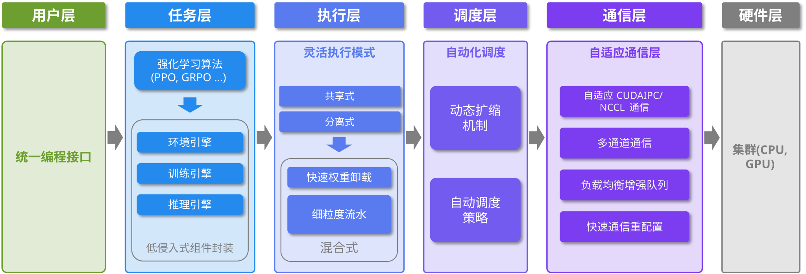

RLinf 执行流程
==============

RLinf 的每次训练任务都遵循同一套四阶段生命周期：入口脚本加载 Hydra 配置、启动基于 Ray 的 ``Cluster``、按角色启动各 ``WorkerGroup``，再交由 runner 循环驱动 rollout、奖励计算、优势估计与参数更新。在调优 worker、channel 或 placement 之前，先通过本页建立整体认知。

   RLinf 系统架构总览。

端到端架构
----------

下图将入口脚本（左）、主控进程调度逻辑（中）以及 ``Worker``、``WorkerGroup`` 与 ``Channel`` 三个核心抽象（右）对应起来，展示了逻辑工作流与物理硬件部署的解耦方式。

.. image:: https://raw.githubusercontent.com/RLinf/misc/main/pic/rlinf_exec_flow.jpg
   :alt: RLinf execution flow
   :width: 95%
   :align: center

阶段 1：配置加载与 Cluster 启动
-------------------------------

启动脚本（例如具身训练的 ``examples/embodiment/run_embodiment.sh`` 或数学推理的 ``examples/reasoning/run_main_grpo_math.sh``）调用对应的 Python 入口脚本（``examples/embodiment/train_embodied_agent.py`` 或 ``examples/reasoning/main_grpo.py``）。入口脚本先校验 Hydra YAML 配置，再创建全局单例 ``Cluster``。

``Cluster`` 负责连接 Ray、探测各节点的 CPU 与加速器拓扑，并拉起三个全局管理 actor（``NodeManager``、``WorkerManager`` 与 ``CollectiveManager``）。多节点运行时，需先在各节点设置唯一的 ``RLINF_NODE_RANK`` 并启动 Ray，再仅在头节点运行入口脚本。

阶段 2：Placement 解析与启动 WorkerGroup
----------------------------------------

随后，入口脚本根据 ``cluster.component_placement`` 为 actor、rollout、env、reward、critic 或 agent 等组件生成 placement 策略：LLM 共置或分离部署通常使用 ``ModelParallelComponentPlacement``，具身与混合部署使用 ``HybridComponentPlacement``。

对每个组件调用 ``WorkerClass.create_group(...).launch(cluster, placement_strategy=...)`` 后，RLinf 会在指定节点和 GPU 上拉起对应数量的远程 worker 进程，并返回一个 ``WorkerGroup`` 句柄。主控进程通过该句柄即可并行触发整组 worker 的公有方法，无需手写 Ray 调度代码：

.. code-block:: text

   入口脚本（Hydra YAML）
       │
       ├──► Cluster(num_nodes=...)              # 发现节点并启动全局管理器
       ├──► ComponentPlacement(cfg, cluster)    # 将各角色映射到节点与 GPU
       ├──► Worker.create_group().launch(...)   # 拉起 Actor、Rollout、Env、Reward
       └──► Runner(cfg, actor, rollout, ...)    # 接管训练与评估主循环

阶段 3：Channel 构建与 Runner 编排
----------------------------------

入口脚本将所有 ``WorkerGroup`` 句柄传入任务对应的 runner（如 ``EmbodiedRunner``、``AsyncEmbodiedRunner`` 或 ``ReasoningRunner``），依次执行 ``runner.init_workers()`` 与 ``runner.run()``。

Worker 之间的观测、动作和轨迹数据不经过主控进程中转。Runner 通过 ``Channel.create()`` 建立分布式数据队列，并将句柄传入各 worker 方法：

- 在具身训练中，``env_channel`` 负责向环境发送动作，``rollout_channel`` 负责向 rollout worker 传递观测，``actor_channel`` 负责汇总完整轨迹并分发给 actor。
- Worker 直接调用 ``channel.put()`` 与 ``channel.get()`` 读写数据，权重同步和大张量点对点传输则交由底层 ``CollectiveGroup`` 完成。

阶段 4：单步训练迭代
--------------------

在 ``runner.run()`` 中，一个同步训练步按固定顺序推进：

1. **权重同步**：actor 将最新权重同步给 rollout worker。
2. **Rollout 与环境交互**：rollout worker 与环境 worker（或工具/智能体循环）通过 channel 交换观测与动作，并输出完整轨迹。
3. **奖励与优势计算**：若配置了独立 reward worker 则先打分，再由 actor 计算 GAE、GRPO 等优势与回报。
4. **Policy 更新**：actor（以及存在时的 critic）执行前向、反向与优化器更新，并返回汇总指标与阶段耗时。
5. **评估与保存**：到达设定步数间隔时，runner 触发验证并保存 checkpoint。

在流水线或异步 runner（如 ``AsyncEmbodiedRunner`` 与 ``AsyncPPOEmbodiedRunner``）中，环境步进、rollout 推理和 actor 训练通过同一套 channel 接口持续并发重叠执行，runner 负责控制权重同步节奏与样本陈旧度边界。

延伸阅读
--------

- :doc:`cluster`：``Cluster`` 如何连接 Ray 并维护节点拓扑。
- :doc:`worker`：``Worker`` 与 ``WorkerGroup`` 的分布式执行与计时接口。
- :doc:`channel`：分布式队列如何解耦生产者与消费者。
- :doc:`placement` 与 :doc:`execution_modes`：共享式、分离式与混合式部署如何映射到硬件。
