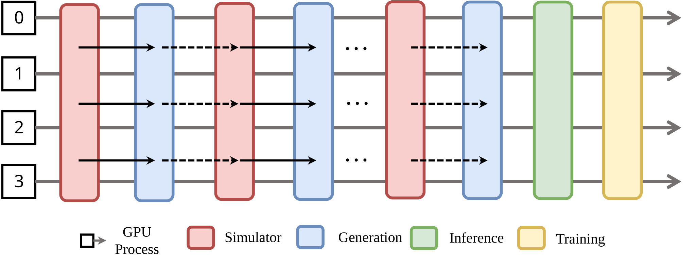
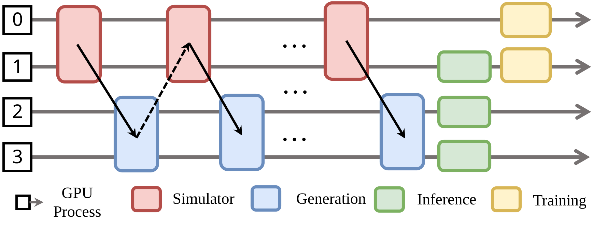
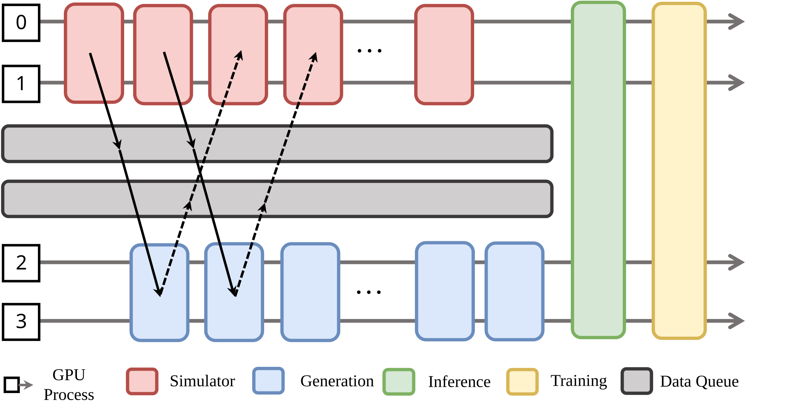

执行模式
========

RLinf 用同一套 worker 代码支持共享式、分离式与混合式三种部署模式，按组件共享 GPU 的方式与阶段并发关系灵活切换。本页对比三种模式在显存、利用率与流水线上的权衡；快速图示总览见 :doc:`overview`，``cluster.component_placement`` 完整语法与节点组规则见 :doc:`placement`。

模式对比与选型
--------------

三种模式在显存余量与流水线利用率之间各有侧重：

.. list-table::
   :header-rows: 1
   :widths: 16 24 30 30

   * - 模式
     - 设备分配方式
     - 核心优势
     - 主要权衡
   * - 共享式
     - 所有角色共享同一组 GPU
     - 1–8 卡下配置最简单，每个阶段独占全集群算力
     - 阶段切换需卸载到 CPU 内存；rollout 长尾延迟会拖慢整步训练
   * - 分离式
     - 每个角色独占独立 GPU 组
     - 无需卸载开销，支持细粒度流水线与异步 RL
     - 各阶段速率不匹配时会产生 GPU 空闲，需调优流水线分片
   * - 混合式
     - 并发阶段拆分 GPU，串行阶段共享全部 GPU
     - 兼顾 rollout 与 env 流水线并发，同时让 actor 用满整机算力
     - rollout 与 actor 切换边界需要卸载，且需平衡两组 GPU 比例

共享式模式
----------

共享式模式下，所有 worker 组部署在同一组 GPU 上，每个阶段只有一类 worker 运行并占满全部计算能力。

由于多个组件共用显存，轻量级组件可以同时常驻，大模型组件则需在阶段结束后将权重、梯度与优化器状态卸载到 CPU 内存。未开启卸载时，actor 与 rollout 引擎会争夺显存并触发 OOM。

下面示例在两台 8 卡节点上把 ``actor`` 与 ``rollout`` 都放到全部 16 张 GPU，并在阶段间卸载 actor：

.. code-block:: yaml

   cluster:
     num_nodes: 2
     component_placement:
       actor,rollout: all
   actor:
     offload_optimizer: true
     offload_weight: true
     offload_grad: true

GPU 数量较少（1–8 卡）、单机快速验证，或者 rollout 长度较均匀、长尾不明显时，适合采用共享式模式。

分离式模式
----------

分离式模式按计算开销把不同角色映射到互不重叠的 GPU 组。由于 actor、inference 与 rollout 各自独占设备，模型常驻显存，省去了阶段间的卸载与重载开销。

分离式 worker 可以按阶段顺序执行，也可以用细粒度流水线并发推进：rollout 每生成一批分片就立刻送入推理与训练。合理调整 ``pipeline_stage_num`` 与各角色卡数比例，可以压低流水线气泡并提高整体利用率。

下面示例在两台 8 卡节点上为 rollout、inference 与 actor 分配独立 GPU 区间：

.. code-block:: yaml

   cluster:
     num_nodes: 2
     component_placement:
       rollout: 0-9
       inference: 10-11
       actor: 12-15

在 8 卡以上规模、显存卸载开销大、rollout 生成存在明显长尾，或采用异步训练循环时，适合使用分离式模式。

混合式模式
----------

混合式模式在同一次任务中结合共享式与分离式：并发执行的组件拆分 GPU，处于不同阶段的组件共享整组 GPU。

具身 RL 是典型场景。在采样阶段，仿真环境（``env``）与策略推理（``rollout``）分配到互不重叠的 GPU，通过生产者-消费者队列流水线并行；采样结束后，两者卸载到 CPU 内存，``actor`` 加载到全部 GPU 上完成高吞吐参数更新。

在单台 8 卡节点上，混合式布局可将 GPU 0–3 分给 ``env``、GPU 4–7 分给 ``rollout``，同时让 ``actor`` 使用全部 8 张 GPU：

.. code-block:: yaml

   cluster:
     num_nodes: 1
     component_placement:
       actor: 0-7
       env: 0-3
       rollout: 4-7
   env:
     enable_offload: true
   rollout:
     enable_offload: true
   actor:
     enable_offload: true

.. note::

   具身混合式训练建议将 ``rollout.pipeline_stage_num`` 设为 ``2`` 或更大，让环境步进与 rollout 推理在各自 GPU 子集上并发重叠。

混合式模式同样适用于异构集群，例如把 ``env`` 部署在 CPU 节点或真机控制主机上，而 ``rollout`` 与 ``actor`` 共用 GPU 节点。

延伸阅读
--------

- :doc:`placement`：完整的 placement 语法、进程与资源配比及命名节点组。
- :doc:`flow`：同一套 runner 代码如何不经修改即可适配三种执行模式。
- :doc:`../guides/multi_node` 与 :doc:`../guides/hetero`：多节点部署与 GPU/真机异构集群配置。
- :doc:`../reference/configuration`：完整的 Hydra 配置项参考。
