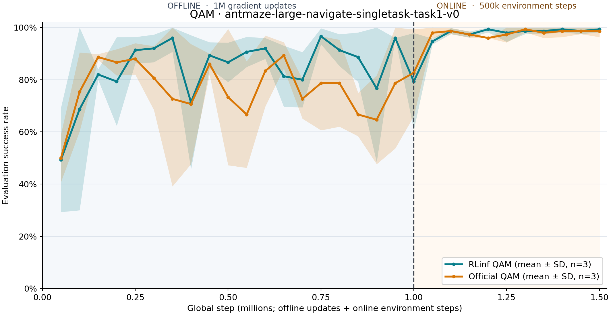

在 OGBench AntMaze 上训练 QAM
=============================

   三个 seed 的平均成功率与一个样本标准差。竖向虚线区分离线更新与在线环境步。

本页说明如何用 RLinf 的 PyTorch 实现，在 OGBench AntMaze 上运行 QAM。示例并行训练三个独立 seed：每个 seed 先完成 100 万次离线梯度更新，再执行 50 万个在线环境步；各自占用一张 GPU，维护自己的模型、优化器、replay buffer 和环境。

概览
----

QAM 使用 fast flow policy、slow flow policy 和 Q critic 集成。RLinf 由 ``QAMRunner`` 安排训练和评估，每个 ``QAMPolicyWorker`` 管理一个 seed。在线采样与 policy 位于同一 worker，AntMaze 的每个 observation 无需单独经过 Ray 传输。

示例任务是 ``antmaze-large-navigate-singletask-task1-v0``，observation 为 29 维，action 为 8 维。配置设定 ``horizon_length: 1``；因此 ``action_chunking: true`` 在本任务中每次输出一个 action。训练每 5 万步使用 50 个 episode 评估，并为每个 seed 保存独立 CSV。

安装环境
--------

在 RLinf 仓库根目录安装 embodied 依赖和 OGBench：

.. code-block:: bash

   bash requirements/install.sh embodied --env ogbench
   source .venv/bin/activate

安装命令使用本例验证过的 OGBench 和 MuJoCo 版本。运行开始时，OGBench 会加载 AntMaze 数据集。在无显示器的 NVIDIA 服务器上设置 ``MUJOCO_GL=egl``。

启动训练
--------

选定三张空闲 GPU 后启动完整的离线与在线训练。下面使用 GPU 0、1、2；配置默认使用 GPU 1、2、3。

.. code-block:: bash

   export MUJOCO_GL=egl
   export PYOPENGL_PLATFORM=egl
   export PYTHONPATH="$(pwd):${PYTHONPATH:-}"
   python examples/embodiment/train_qam.py gpu_start=0 gpu_end=2

入口读取 ``examples/embodiment/config/ogbench_qam_antmaze.yaml``，启动三个独立的 Ray worker。每个 seed 的 ``train.csv`` 和 ``eval.csv`` 保存在 ``logs/qam-antmaze-3seed/seed_<seed>/``；checkpoint 保存在 ``logs/qam-antmaze-3seed/checkpoints/global_step_<step>/actor/``。

如果要先用一张 GPU 检查完整流程，保留同一入口并缩短训练：

.. code-block:: bash

   python examples/embodiment/train_qam.py \
     'seeds=[10001]' gpu_start=0 gpu_end=0 \
     runner.offline_steps=4 runner.online_steps=4 \
     runner.max_steps=8 runner.max_epochs=8 \
     runner.start_training=1 runner.val_check_interval=4 \
     runner.save_interval=4 runner.eval_episodes=1 \
     actor.batch_size=8 actor.updates_per_call=2 \
     'actor.model.actor_hidden_dims=[16,16]' \
     'actor.model.value_hidden_dims=[16,16]' \
     actor.model.num_qs=2 actor.model.flow_steps=3 \
     runner.logger.experiment_name=qam-smoke

这条命令会检查离线更新、在线采样、评估与 checkpoint 保存；这个短实验的成功率不能用于算法性能比较。

继续训练时，把 ``runner.resume_dir`` 指向 ``global_step_<step>`` 目录，并给续跑设置新的实验名：

.. code-block:: bash

   python examples/embodiment/train_qam.py \
     gpu_start=0 gpu_end=2 \
     runner.resume_dir=/absolute/path/to/global_step_1000000 \
     runner.logger.experiment_name=qam-antmaze-resumed

若只需评估同一 checkpoint，增加 ``runner.only_eval=true``。在线 checkpoint 保存 replay buffer、优化器、随机数生成器和 AntMaze 模拟器状态。

结果与验证
----------

三个 seed 的 RLinf 运行在离线终点取得 0.7933 平均成功率，在线终点为 0.9933；相同任务和训练阶段长度下，固定版本的官方 QAM 实现分别为 0.8267 和 0.9867。每个终点值汇总三个 seed，每个 seed 使用 50 个 episode 评估。PyTorch 与 JAX 的随机数流不同，相同 seed 编号不代表逐步配对的训练轨迹。

在 CPU 上运行 QAM 单元测试。可选的 parity test 需要官方 QAM commit ``2726d767c9a0a7a46d49693f0391f73dc2cf58ac``，用于对照损失、梯度和一次参数更新。

.. code-block:: bash

   CUDA_VISIBLE_DEVICES='' JAX_PLATFORMS=cpu python -m pytest tests/unit_tests/test_qam.py
   CUDA_VISIBLE_DEVICES='' JAX_PLATFORMS=cpu \
     QAM_REFERENCE_ROOT=/path/to/pinned/QAM \
     python -m pytest tests/parity_tests/test_qam_reference.py

parity test 只把官方仓库作为测试参照；正式训练调用 RLinf 自身的 PyTorch QAM 实现。
