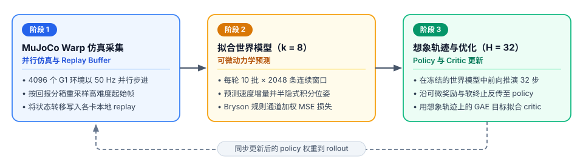

SuperMimic：基于可微世界模型的人形全身动作跟踪
==============================================

使用 **SuperMimic**\ （`arXiv:2610.28480 <https://arxiv.org/abs/2610.28480>`__，`项目主页 <https://supermimic.github.io>`__）在 MuJoCo Warp 中训练 29 自由度 Unitree G1 的全身动作跟踪 policy。SuperMimic 从仿真轨迹中学习可微动力学世界模型，在 32 步想象轨迹上将跟踪回报梯度直接反向传播给 policy，并配合 critic 做末端价值估计与按回报重采样。在 40 条 LAFAN1 片段上，单卡 GenCoord 配置训练 6000 次更新后归一化回报达到 ``0.836``，摔倒率为 ``0.025``。

概览
----

.. grid:: 2 4 4 4
   :gutter: 2

   .. grid-item-card:: 算法
      :text-align: center

      SuperMimic（可微世界模型 + Actor-Critic）

   .. grid-item-card:: 模型
      :text-align: center

      动力学世界模型 · 动作 Policy · Critic

   .. grid-item-card:: 环境 / 数据
      :text-align: center

      :doc:`G1 动作跟踪环境 <g1_mimic>` · 40 条 LAFAN1 片段

   .. grid-item-card:: 训练
      :text-align: center

      1–4 张 NVIDIA GPU（FSDP2）· :ref:`AMD ROCm <supermimic-hardware>`

| **你将完成：** 理解算法原理 → 安装并准备 LAFAN1 → 启动训练 → 查看 TensorBoard → 评测 checkpoint。
| **前置条件：** :doc:`安装说明 </rst_source/start/installation>` · 一张或多张 NVIDIA GPU（或 AMD ROCm）· 可访问 Hugging Face 下载 LAFAN1 数据。

任务
~~~~

.. list-table::
   :header-rows: 1
   :widths: 22 28 24 26

   * - 方案
     - 配置名
     - 状态表示
     - 任务
   * - GenCoord（默认）
     - ``supermimic_lafan1_gencoord``
     - 广义坐标（68 维）
     - ``g1_mimic`` 上的 40 条 LAFAN1 片段
   * - MaxCoord
     - ``supermimic_lafan1_maxcoord``
     - 跟踪部位位姿与速度（214 维）
     - ``g1_mimic`` 上的 40 条 LAFAN1 片段

观测与动作
~~~~~~~~~~

14 个跟踪部位、PD 控制器参数、奖励权重及域随机化详见 :doc:`G1 动作跟踪环境 <g1_mimic>`。

.. list-table::
   :header-rows: 1
   :widths: 18 82

   * - 字段
     - 摘要
   * - 观测
     - 当前 G1 状态编码（GenCoord 或 MaxCoord），加上间隔 5 个控制步（0.1 秒）的 10 帧未来参考窗口。
   * - 动作
     - 50 Hz 下的 29 维目标关节角度（训练叠加标准差 ``0.1`` 的高斯噪声，评测确定性执行）。
   * - 奖励
     - 6 项跟踪核加动作变化和关节软限位惩罚，乘以 ``0.02 s``\ （单步上限 ``0.1``）。
   * - 提示词
     - 不使用。

SuperMimic 算法原理
-------------------

每次全局更新在多卡间同步执行三个阶段：

   RLinf 中的 SuperMimic 三阶段训练循环。

1. **仿真采集与按回报重置。** 并行 G1 环境在 MuJoCo Warp 中带探索噪声执行动作，并将状态转移写入各卡本地 replay buffer。回合结束时，采样器优先从回报偏低的动作片段区间重置，让训练集中攻克高难度动作。
2. **拟合世界模型。** 动力学网络从 replay 状态出发，按记录动作自回归展开 ``k = 8`` 步，预测速度增量并积分到下一时刻位姿，用 Bryson 通道加权 MSE 损失优化。
3. **优化 policy 与 critic。** 从 replay 采样起点，让 policy 在冻结的世界模型中推演 ``H = 32`` 步。每一步用可微正运动学计算跟踪奖励，并用平滑终止概率累加存活权重，将一阶回报梯度直接反向传播给 policy；随后在同一批想象轨迹上计算 GAE 目标拟合 critic。

状态表示：GenCoord 与 MaxCoord
~~~~~~~~~~~~~~~~~~~~~~~~~~~~~~

用 ``actor.model.representation`` 选择世界模型与 policy 共用的状态表示，checkpoint 只能加载到训练时对应的表示中：

.. list-table::
   :header-rows: 1
   :widths: 16 24 22 38

   * - 状态表示
     - 存储 / 编码状态
     - 世界模型预测输出
     - 运动学与特点
   * - ``gencoord``
     - 71 维仿真状态 / 68 维根节点相对向量
     - 35 维速度增量（根节点速度 + 29 关节速度）
     - 用可微正运动学推出 14 个跟踪部位位姿；状态紧凑，为默认配置（``supermimic_lafan1_gencoord``）。
   * - ``maxcoord``
     - 182 维 14 部位世界位姿与速度 / 214 维骨盆系向量
     - 84 维 14 部位线速度与角速度增量
     - 直接预测部位动力学，并用链式逆运动学解回关节角（``supermimic_lafan1_maxcoord``）。

完整数学公式、网络维度、优化器设置（Muon 与 fused Adam）、FSDP2 分片以及与论文和官方代码的差异详见 :doc:`../../reference/algorithms/supermimic`。

安装
----

在仓库根目录创建独立虚拟环境（固定特定版本的 PyTorch、MuJoCo Warp 和 ``warp-lang``，不要与其他 RLinf 虚拟环境混用）：

.. code-block:: bash

   bash requirements/install.sh embodied --env supermimic --venv .venv-supermimic
   source .venv-supermimic/bin/activate

Docker 构建方式见 :doc:`g1_mimic`，AMD ROCm 平台见 :ref:`在其他硬件后端上运行 <supermimic-hardware>`。

准备 LAFAN1 数据
----------------

下载、校验并转换 40 条 Unitree G1 LAFAN1 动作片段（来自 `lvhaidong/LAFAN1_Retargeting_Dataset <https://huggingface.co/datasets/lvhaidong/LAFAN1_Retargeting_Dataset>`_，源自 Ubisoft La Forge `LAFAN1 <https://github.com/ubisoft/ubisoft-laforge-animation-dataset>`_\ ，采用 CC BY-NC-ND 4.0 许可，传 ``--accept-license`` 前请先查阅条款）：

.. code-block:: bash

   python toolkits/supermimic/prepare_lafan1.py --out /data/lafan1_g1 --accept-license

转换成功后最后一行输出为：

.. code-block:: text

   [lafan1] wrote 40 clips, 2.45 h, manifest /data/lafan1_g1/manifest.json

如需在另一台联网机器离线转换或制作自定义 ``clip_*.pt`` 片段，见 :doc:`supermimic_motion`。

运行
----

核心算法配置项
~~~~~~~~~~~~~~

默认训练配置位于 ``examples/embodiment/config/supermimic_lafan1_gencoord.yaml``\ （``supermimic_lafan1_maxcoord.yaml`` 在此基础上仅切换状态表示与实验名），常用配置如下：

.. list-table::
   :header-rows: 1
   :widths: 36 16 48

   * - 配置项
     - 默认值
     - 说明
   * - ``actor.model.representation``
     - ``gencoord``
     - 状态表示：``gencoord`` 或 ``maxcoord``
   * - ``algorithm.k`` / ``algorithm.H``
     - ``8`` / ``32``
     - 世界模型展开窗口长度与 policy 想象步长
   * - ``algorithm.replay_ratio``
     - ``16``
     - 每条状态转移被世界模型抽样的平均次数（4096 环境下每步 0.4 次更新）
   * - ``algorithm.wm_batches`` / ``wm_window_batch``
     - ``10`` / ``2048``
     - 每次更新的世界模型批次数与全局每批窗口数
   * - ``algorithm.imagine_batch``
     - ``4096``
     - 每次 policy 更新的全局想象 rollout 条数
   * - ``actor.cuda_graph``
     - ``False``
     - 将每次全局更新录成单张 CUDA 图（NVIDIA GPU 推荐设为 ``True``）
   * - ``actor.fsdp_config.amp_autocast.enabled``
     - ``False``
     - 网络矩阵乘开启 bf16，权重与优化器状态仍保持 float32

单卡训练与续训
~~~~~~~~~~~~~~

设置动作数据目录并关闭 MuJoCo 的 OpenGL 渲染器，在 0 号 GPU 上开启 CUDA 图回放启动 6000 次更新的 GenCoord 训练：

.. code-block:: bash

   export PYTHONPATH=$PWD:$PYTHONPATH
   export MUJOCO_GL=disabled
   export SUPERMIMIC_MOTION_PATH=/data/lafan1_g1
   export RUN_DIR=/data/runs/supermimic_gencoord

   python examples/embodiment/train_embodied_agent.py \
       --config-name supermimic_lafan1_gencoord \
       runner.logger.log_path=$RUN_DIR actor.cuda_graph=True

前 3 次预热更新结束后日志输出 ``Recorded the SuperMimic update as a CUDA graph.``。每 100 次更新打印一次以 ``Global Step: <N>/6000`` 开头的指标表；每 2000 次更新及第 6000 次更新后在 ``$RUN_DIR/supermimic_lafan1_gencoord/checkpoints/global_step_<N>/`` 保存 checkpoint。

训练中断后，在相同 GPU 数量下传入 ``runner.resume_dir=auto`` 即可从最新完整 checkpoint 续训：

.. code-block:: bash

   python examples/embodiment/train_embodied_agent.py \
       --config-name supermimic_lafan1_gencoord \
       runner.logger.log_path=$RUN_DIR actor.cuda_graph=True \
       runner.resume_dir=auto

成功加载时日志会打印 ``Resuming from <path>``。

多卡训练
~~~~~~~~

环境数、世界模型批次和想象 rollout 数均为跨卡总量，多卡时自动均分，学习率与总更新次数保持不变：

.. list-table::
   :header-rows: 1
   :widths: 40 20 20 20

   * - 每次更新
     - 全局总量
     - 两卡每卡
     - 四卡每卡
   * - 并行环境数
     - 4096
     - 2048
     - 1024
   * - 世界模型窗口（共 10 批）
     - 2048
     - 1024
     - 512
   * - 想象 rollout 条数
     - 4096
     - 2048
     - 1024

两卡训练示例如下（四卡将 ``0-1`` 改为 ``0-3``，并使用新的 ``RUN_DIR``）：

.. code-block:: bash

   export RUN_DIR=/data/runs/supermimic_gencoord_2gpu
   python examples/embodiment/train_embodied_agent.py \
       --config-name supermimic_lafan1_gencoord \
       runner.logger.log_path=$RUN_DIR actor.cuda_graph=True \
       '~cluster.component_placement' \
       '+cluster.component_placement={actor:0-1,env:0-1,rollout:0-1}'

切换为 MaxCoord
~~~~~~~~~~~~~~~

使用新的 ``RUN_DIR`` 并将 ``--config-name`` 改为 ``supermimic_lafan1_maxcoord``，checkpoint 保存在 ``$RUN_DIR/supermimic_lafan1_maxcoord/checkpoints/`` 下。

评测 checkpoint
~~~~~~~~~~~~~~~

用第 6000 次更新的权重在 40 条 LAFAN1 片段上运行动作跟踪评测：

.. code-block:: bash

   bash evaluations/run_eval.sh supermimic_lafan1_eval \
       runner.ckpt_path=$RUN_DIR/supermimic_lafan1_gencoord/checkpoints/global_step_6000/actor/model_state_dict/full_weights.pt \
       runner.eval_export.output_dir=$RUN_DIR/eval_6000

评测 MaxCoord checkpoint 时需追加 ``rollout.model.representation=maxcoord``。完整的评测流程、站立推力恢复测试、输出文件和指标定义见 :doc:`../../evaluations/guides/supermimic`。

可视化与结果
------------

使用 TensorBoard 监控训练过程：

.. code-block:: bash

   tensorboard --logdir $RUN_DIR/tensorboard

核心监控指标（横轴为更新次数，通用指标含义见 :doc:`../../reference/metrics`）：

* ``env/sim/reward_mean``：仿真中单步平均跟踪奖励，收敛趋向上限 ``0.1``。
* ``env/sim/terminal_rate``：每步摔倒的环境比例，收敛趋向 ``0``。
* ``train/world_model/state_loss``：Bryson 加权世界模型预测损失。

动作跟踪结果（LAFAN1 40 片段）
~~~~~~~~~~~~~~~~~~~~~~~~~~~~~~

在单张 NVIDIA A800 上运行 GenCoord 配置（seed 0）的评测结果：

.. list-table::
   :header-rows: 1
   :widths: 25 25 25 25

   * - 更新次数
     - ``normalized_return``
     - ``fail_rate``
     - ``body_pos_err``\ （m）
   * - 6000
     - 0.836
     - 0.025
     - 0.024

40 条片段中有 1 条摔倒（论文在这 40 条片段上报告的归一化回报为 ``0.82``）。

.. figure:: https://raw.githubusercontent.com/RLinf/misc/main/pic/supermimic_gencoord_curves.png
   :alt: SuperMimic GenCoord 训练曲线
   :width: 100%

   单卡 NVIDIA A800 上 6000 次更新的 GenCoord 训练曲线。仿真奖励上限为每秒 5.0（50 Hz 下每步 0.1）；右上角想象回报包含末端 critic 估值，因此会高于 5。

吞吐对比
~~~~~~~~

下表对比独占 NVIDIA A800 上 GenCoord 每次全局更新的耗时与官方单卡实现（预热 200 次后取 1000 次更新的 ``time/step`` 均值）。RLinf 各项均开启 ``actor.cuda_graph=True``，bf16 行额外开启 ``actor.fsdp_config.amp_autocast.enabled=True``：

.. list-table::
   :header-rows: 1
   :widths: 25 25 25 25

   * - 实现
     - GPU 数
     - 矩阵乘精度
     - 秒 / 次更新
   * - 官方代码
     - 1
     - TF32
     - 0.515
   * - RLinf
     - 1
     - TF32
     - 0.702
   * - RLinf
     - 1
     - bf16
     - 0.627
   * - RLinf
     - 2
     - TF32
     - 0.534
   * - RLinf
     - 2
     - bf16
     - 0.528
   * - RLinf
     - 4
     - TF32
     - 0.411
   * - RLinf
     - 4
     - bf16
     - 0.385

单卡 TF32 下 RLinf 比单进程官方代码慢约 36%（来自 worker 间观测和动作交换及每步更新后的权重同步）；开启 bf16 后单卡为 0.627 秒，2–4 卡可进一步加速。

.. _supermimic-hardware:

在其他硬件后端上运行
--------------------

AMD ROCm
~~~~~~~~

AMD 后端用 ROCm Warp 运行 MuJoCo Warp，面向 MI300X（``gfx942``）。前置条件：Linux x86_64、含 ``hipcc`` 的 ROCm 7.2 SDK、C++ 编译工具链（参考 `ROCm Warp gfx942 Dockerfile <https://github.com/ROCm/warp/blob/36ed75aa65f837a78b20d1a3a1ac08cfe1fc7b71/docker/rocm/Dockerfile>`_）以及支持 flat wheel 索引的新版 ``uv``。

在仓库根目录安装：

.. code-block:: bash

   export ROCM_PATH=/opt/rocm  # 按实际 ROCm SDK 路径修改
   bash requirements/install.sh --platform amd --rocm 7.2 --no-flash-attn \
       embodied --env supermimic --venv .venv-supermimic
   source .venv-supermimic/bin/activate

安装脚本从 AMD 索引获取 PyTorch 2.9.1，编译 ROCm Warp ``1.13.0+rocm.0``，并安装 mjlab 1.2.0、MuJoCo 3.8.1 与 ``mujoco-warp`` 3.8.1。如需自定义路径或目标架构，可设置 ``SUPERMIMIC_WARP_PATH``\ （默认 ``../warp-rocm``）和 ``SUPERMIMIC_HIP_ARCH``\ （默认 ``gfx942``）。

安装完成后的数据准备与启动命令与上文一致。AMD ROCm 上尚未验证完整训练收敛。
