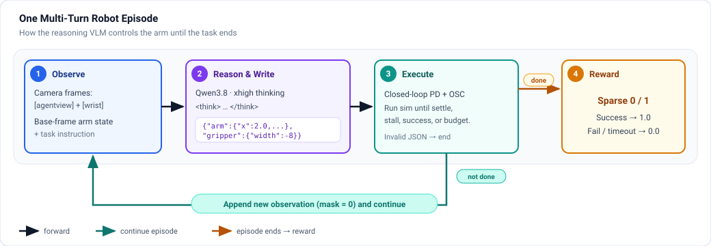
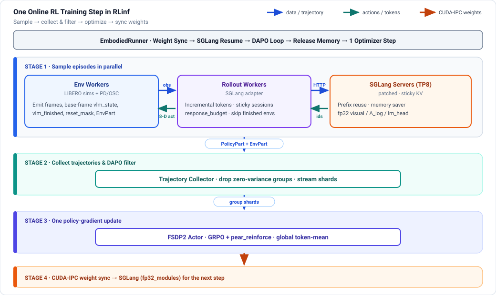
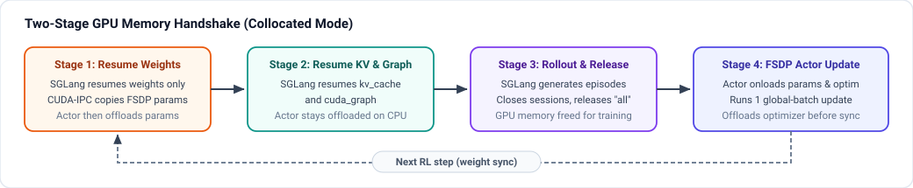

将推理模型训练为具身 Policy
===========================

VLM-as-Policy 用仿真环境中的在线强化学习，直接将推理型视觉语言模型（VLM）训练为机器人 policy，无需专家示范数据，也无需额外的动作解码头。模型不直接预测高频底层力矩，而是观察相机画面与机械臂状态，先写出思维链推理过程，再以 JSON 文本给出末端执行器的下一步相对位姿。

本文先给出整体流程概览，再依次拆解 worker 交互、SGLang 推理与多轮上下文、权重同步、轨迹组装与 DAPO 过滤，以及强化学习算法与长上下文训练细节。

整体流程
--------

可以从两层来理解这套系统：一层是单条任务里，推理模型如何多轮观察环境并控制机械臂；另一层是训练时，RLinf 如何并行采样多条轨迹、过滤后完成一次在线强化学习更新。

单条多轮机器人任务
~~~~~~~~~~~~~~~~~~

在单条任务中，推理模型像操作电脑的智能体一样多轮控制机械臂：读取相机画面与基座坐标系下的臂状态，先写出文本推理，再输出一个 JSON 相对位姿；底层控制器在模拟器中闭环执行该动作。若任务尚未结束，系统追加新观测并进入下一轮；任务成功或超时后，才给出稀疏的 0/1 奖励：

   单条多轮任务：观察 → ``<think>`` 推理 → 输出 JSON 相对位姿 → 执行；未完成则继续，完成后给出 0/1 奖励。

一次在线强化学习更新
~~~~~~~~~~~~~~~~~~~~

训练时，RLinf 在多组环境与 SGLang 服务上并行采样轨迹，经 DAPO 过滤掉零方差组后，用 GRPO 与 REINFORCE 完成一次权重更新，再通过 CUDA IPC 将新权重同步回推理引擎。整步可按「采样 → 收集与过滤 → 优化 → 权重同步」四个阶段理解：

   一次在线 RL 更新：并行采样轨迹，DAPO 过滤后更新权重，再经 CUDA IPC 同步回 SGLang。

传统 VLA 模型通常先在示范数据上监督微调，再将单帧画面映射为连续动作块。VLM-as-Policy 保留基础推理模型原有的多模态对话接口，只依靠任务是否成功的稀疏奖励学会空间定位、纠错与长程操作。

Actor、Rollout 与环境交互
-------------------------

仿真执行、文本生成与权重更新分别由 env worker、rollout worker 和 actor worker 承担。在默认配置中，三组 worker 按 ``actor,env,rollout: all`` 时间共享同一批 GPU，使 FSDP 训练与 SGLang 张量并行推理错峰占用显存。

Rollout 阶段，env worker 推进模拟器并通过 channel 向 rollout worker 发送观测。每份观测包含多视角相机图像、任务指令、重置与结束标记（``reset_mask`` 与 ``vlm_finished``），以及转换到机器人基座坐标系下的状态（``vlm_state``）。基座坐标系与系统提示词里的朝向约定一致，且按固定小数位舍入；在 ``vlm_action_mode`` 开启时，若观测缺失 ``vlm_state``，adapter 会直接报错，避免静默回退到世界坐标系状态。

Rollout worker 收到一批观测后，为每个环境生成一个宏动作，并向 env worker 返回 8 维动作向量（LIBERO 对应 6 维相对位姿 ``x``、``y``、``z``、``roll``、``pitch``、``yaw``，1 维夹爪宽度变化，以及末位有效标记）。若模型输出无法解析为合法 JSON 或耗尽整条轨迹的 token 预算，末位有效标记置为 ``0.0``；env worker 收到后会立刻终止该环境，避免把无效输出当成静止动作继续执行。

为保证 actor channel 只有一个写入端和明确顺序，env worker 把上一拍的转移信息附在下一次请求里交给 rollout worker，由 rollout worker 合并转发到 trajectory collector。开启 ``runner.enable_decoupled_mode`` 后，SGLang rollout worker 会记录动态批次路由，支持环境交互与推理在分离资源上异步运行。

SGLang 推理与多轮上下文
-----------------------

一条多轮具身轨迹平均持续约 20 轮，上下文长度可达 160k 至 256k token，并包含数十张 512x512 图像。若每轮都重新渲染完整历史对话并重复编码全部历史图像，不仅开销呈平方增长，还可能被 chat template 改写或剥离历史思维链。

增量 Token 拼接与 Sticky Session
~~~~~~~~~~~~~~~~~~~~~~~~~~~~~~~~

SGLang rollout worker 将整批观测按环境拆分，以多线程并发向 SGLang server 发送 ``/generate`` HTTP 请求，并可通过 ``rollout.sglang.max_inflight_sessions`` 控制并发上限。每轮用户消息先写入舍入后的状态 JSON 与动作格式提醒，再在每张图像前插入对应的相机标签（LIBERO 为 ``[agentview]`` 和 ``[wrist]``）。

Rollout adapter 按增量方式维护每条轨迹的 token 序列与多模态输入：

1. 首轮对系统提示词与首条用户消息做一次分词与图像编码，并调用 ``/open_session`` 打开 sticky session。
2. 收到模型生成的 ``output_ids`` 后，直接追加到轨迹 token 缓冲区，将这些位置的 mask 置为 ``1``，并记录精确的全局下标 ``response_index``。
3. 后续轮次只渲染新增用户轮次的模板后缀，只编码本轮新采集的图像，将新增观测 token 以 mask ``0`` 追加到序列尾部，同时只把新增后缀文本与本轮图像发往已打开的 sticky session，复用服务端前缀 KV cache。

这种增量拼接方式保证历史 ``<think>`` 片段完整保留在训练序列中，不依赖事后子序列匹配，同时将每轮图像编码开销降为常数。

Response Budget 与已完成环境短路
~~~~~~~~~~~~~~~~~~~~~~~~~~~~~~~~

整条轨迹的 token 预算（``rollout.sglang.response_budget``，第一阶段为 ``160000``，第二阶段为 ``262144``）统计首条 prompt 之后的全部 token，同时涵盖助手生成 token 与注入的观测文本及图像占位 token。每轮发给 SGLang 的 ``max_new_tokens`` 等于剩余预算；一旦注入新观测或本轮生成触及上限，轨迹立刻标记预算耗尽并干净结束，不再发出多余的推理请求。

向量化环境在单个 rollout epoch 内锁步推进，较快完成的环境会在剩余步里持续上报 ``vlm_finished``。Rollout worker 检测到已完成或预算耗尽的环境后，跳过 SGLang HTTP 调用，只填充极小的占位样本，不再重复编码 512x512 图像，大幅降低内存与进程间通信开销。

两阶段显存切换
~~~~~~~~~~~~~~

Collocated 模式下，SGLang 显存回收机制按两阶段恢复显存，避免 FSDP 参数与 SGLang KV cache 同时常驻导致显存溢出：

   Collocated 模式下 FSDP actor 训练与 SGLang rollout 之间的两阶段显存切换流程。

权重同步
--------

每个 RL step 开始时（由 ``runner.weight_sync_interval`` 控制频率），actor 通过 CUDA IPC 将最新 FSDP 权重直接推送到 patched SGLang server，无需经过磁盘或主机内存中转。

Actor 先卸载优化器状态并将模型参数加载到 GPU，随后把分片状态字典按桶（默认 128 MB）切分。每个桶内，各 actor rank 将 ``DTensor`` 聚合为完整张量，生成 CUDA IPC handle 并发送给对应的 SGLang 实例与张量并行 rank。

Rollout 侧，全部 rollout worker rank 都会递增本地 policy 版本号并关闭旧的 sticky session（异步模式下可开启 ``rollout.sglang.keep_sessions_on_weight_sync`` 保留 KV cache）；每台 SGLang server 由唯一一个 leader rank（``rank < num_servers``）触发服务端权重加载，确保多节点多 TP8 实例全部完成同步。

Patched SGLang 调度器在加载前自动去除外层包装前缀，并将 HuggingFace 多模态参数名（``model.visual.*``、``model.language_model.*``）映射为 SGLang 参数树（``visual.*``、``model.*``）。发送端与接收端双向检查 ``rollout.sglang.fp32_modules``\ （默认 ``["visual", "A_log", "lm_head"]``），命中的视觉塔、Gated DeltaNet ``A_log`` 与输出头保持 ``fp32`` 精度，其余权重转为 ``rollout.sglang.dtype``\ （``bf16``），保证推理与训练数值对齐。

数据组装、轨迹收集与 DAPO 过滤
------------------------------

Trajectory collector 将同一个 ``TrajectoryKey`` 对应的 ``PolicyPart`` 与 ``EnvPart`` 配对，并沿时间维堆叠。由于多轮对话序列与图像特征随轮次增长，collector 对 ``prev_logprobs``、``versions`` 以及 ``forward_inputs`` 内的全部张量（``input_ids``、``attention_mask``、``pixel_values``、``image_grid_thw``、``mm_token_type_ids``、``response_index``、``response_mask`` 与可选的 top-K head 张量）做右侧零填充堆叠，形成 ``[T, B, ...]`` 轨迹。

DAPO 零方差组过滤与收集模式
~~~~~~~~~~~~~~~~~~~~~~~~~~~

在 GRPO 中，同一任务组内如果所有轨迹全部成功或全部失败，组内 advantage 全为 0，没有有效梯度信号。RLinf 会在 ``algorithm.pear`` 下提供三种过滤与收集模式：

.. list-table::
   :header-rows: 1
   :widths: 22 32 46

   * - 模式
     - 关键配置项
     - 行为说明
   * - 原地过滤与重采样（MVP）
     - ``dapo_filter: True``、``dapo_resample: True``
     - 将零方差组的 ``loss_mask`` 置 0；若保留组数少于 ``dapo_target_groups``，runner 继续重采样，直到达标或触及 ``dapo_max_batches``。
   * - 全局池化紧致收集
     - ``dapo_compact: True``、``stream_to_actors: False``
     - 跨全部环境源汇总有方差组；数量不足时向 actor 发送等待信号，凑满 ``dapo_target_groups`` 后均匀切片下发。
   * - 流式波次下发（Paper）
     - ``dapo_compact: True``、``stream_to_actors: True``
     - 任一环境源完成后立刻拆出有方差组，每凑满 ``actor_world_size`` 组即发出一波，无需等待最慢环境源。

如果某步凑满目标组数后池中仍有富余组，同步 on-policy 训练可开启 ``clear_surplus_after_step: True`` 在步末清空富余缓存，防止旧 policy 样本混入下一步纯 REINFORCE 更新；异步 off-policy 训练则配置 ``max_off_policy_threshold``\ （例如 ``5``，允许最多滞后 4 个 policy 版本），由 collector 与 actor 依据轨迹 ``versions`` 自动丢弃过期组。

Episode Sequence 时间维压缩
~~~~~~~~~~~~~~~~~~~~~~~~~~~

多轮轨迹中，每个环境最后一个有效步的 ``forward_inputs`` 已经包含该条轨迹从首轮到末轮的全部 token 与所有助手生成区间。开启 ``algorithm.pear.episode_sequence: True`` 后，actor 会先保留每条环境最后有效步的掩码，再在训练打乱前将 ``[T, B, ...]`` 轨迹压缩为 ``[1, B, ...]``：

- 每条环境只保留其终止步对应的 ``forward_inputs`` 与掩码。
- 整条轨迹在 ``T`` 步内的奖励累加到第 ``0`` 步，保证 GRPO 回报不变。
- 展平后的样本数恰好等于单卡 ``batch_size_per_rank``，确保每个 RL step 严格执行 1 次优化器更新，不再对前 ``T - 1`` 个中间步重复跑前向与反向。

RL 算法与长上下文训练细节
-------------------------

稀疏奖励与 GRPO Advantage
~~~~~~~~~~~~~~~~~~~~~~~~~

LIBERO 环境中的闭环控制器结合 PD 律与操作空间解耦（OSC），持续推进仿真器原生步，直到机械臂停稳在目标位姿、受阻停滞、任务成功或耗尽对应 suite 的步数预算（``libero_spatial`` 为 220，``libero_object`` 为 280，``libero_goal`` 为 300，``libero_10`` 为 520）。相机图像旋转 180°，指令中的 ``left`` 与 ``right`` 同步镜像，与渲染视角保持一致。

环境只在任务完成时返回 ``1.0``，其余步返回 ``0.0``；训练不使用 critic、不使用 KL 惩罚（``kl_beta: 0.0``），也不加熵奖励（``entropy_bonus: 0``）。每个包含 ``group_size``\ （默认 8）条轨迹的任务组按组内均值和标准差计算 advantage，并广播到该轨迹所有有效生成 token：

.. math::

   A_{g,i} = \frac{R_{g,i} - \mu_g}{\sigma_g + 10^{-6}}

Bypass REINFORCE 与 Top-K Score Centering
~~~~~~~~~~~~~~~~~~~~~~~~~~~~~~~~~~~~~~~~~

Policy 损失采用无 PPO clip 的 bypass REINFORCE（``algorithm.loss_type: pear_reinforce``）。由于不依赖 ``old_logprobs``，配置中 ``algorithm.recompute_logprobs`` 设为 ``False``，省去一整遍 27B 模型前向重算。

在异步 off-policy 训练中，开启 ``algorithm.pear.score_centering: True`` 后，SGLang 会在采样阶段返回每个生成 token 的 top-K 分布（默认 ``rollout.sglang.topk_log_probs: 32``）。记采样器在位置 :math:`t` 的 top-K 词表集合为 :math:`H_t`，采样概率为 :math:`q_t`，当前训练模型概率为 :math:`p_\theta`，则单 token 损失在 REINFORCE 基础上叠加 score centering 修正项：

.. math::

   \rho_t = \frac{\max\!\left(1 - \sum_{k \in H_t} q_t(k),\; \varepsilon\right)}{\max\!\left(1 - \sum_{k \in H_t} p_\theta(k),\; \varepsilon\right)}, \qquad
   c_t = \sum_{k \in H_t} \operatorname{sg}\!\left[q_t(k) - \rho_t \, p_\theta(k)\right] \log p_\theta(k)

.. math::

   \ell_t = -A_i \log \pi_\theta(y_t \mid x_{<t}) + A_i \, c_t

采样与训练 policy 一致（:math:`q_t = p_\theta`）时，:math:`c_t = 0`；policy 存在版本滞后时，:math:`c_t` 在采样分布下中心化 policy gradient，替代截断重要性采样。

全局 Batch Token-Mean 梯度归一化
~~~~~~~~~~~~~~~~~~~~~~~~~~~~~~~~

多轮轨迹的响应长度差异很大。若每个 ``micro_batch_size: 1`` 各自求平均再除以梯度累积步数，短轨迹的每个 token 会获得过高权重。RLinf 在每个 global batch 开始前，通过跨数据并行 rank 的 ``all_reduce(SUM)`` 统计全局有效生成 token 总数 :math:`N_{\text{global}}`；每个 micro-batch 将 token 损失之和除以 :math:`N_{\text{global}}` 并乘以数据并行规模 :math:`W`，经 FSDP 平均归约后得到精确的全局 token-mean 梯度：

.. math::

   \frac{1}{W} \sum_{r=1}^{W} \sum_{m \in r} \nabla \!\left(\frac{W \sum_{t \in m} \ell_t}{N_{\text{global}}}\right)
   = \frac{1}{N_{\text{global}}} \sum_{\text{all valid } t} \nabla \ell_t

长序列显存与精度优化
~~~~~~~~~~~~~~~~~~~~

为在单次训练中承载最高 256k token 的 27B 多模态序列，训练侧配合了以下机制：

- **Unpadded 样本前向**：每条样本按 ``attention_mask`` 的真实有效长度切片送入主干网络，避免在右侧 padding 上消耗注意力算力与激活显存。
- **分块 FP32 输出头**：LM head 永不物化完整的 ``[sequence, vocab]`` logits，而是以 4,096 行为块在 ``fp32`` 下做矩阵乘，并在开启 score centering 时于同一次分块前向中联合产出目标 token 的 log-probability、熵以及 top-K head 的 log-probability。
- **FSDP2 模块级 FP32 与残差精度**：将 ``actor.fsdp_config.strategy`` 设为 ``fsdp2``，配合 ``fp32_modules: ["model.visual"]``、``fp32_modules_tf32: True`` 与 ``fp32_residual: True``，让视觉塔在 ``fp32`` 下聚合与计算，同时保留残差流的 ``fp32`` 输入。
- **主机常驻流式优化器**：开启 ``actor.optim.streamed_adamw: True`` 后，FP32 Adam 状态常驻锁页 CPU 内存，更新时以 2 GiB 分块经三槽异步 CUDA stream 流水线搬运，避免 27B 优化器状态占满显存。
- **Ulysses 序列并行**：设置 ``actor.fsdp_config.ulysses_sp_size`` 大于 ``1`` 可创建序列并行进程组，提供可微序列切分、聚合、all-to-all 与局部响应窗口映射原语，支撑多卡长上下文切分。

常用配置与延伸阅读
------------------

仓库中内置了四份共享同一套 VLM-as-Policy 栈的配置文件：

.. list-table::
   :header-rows: 1
   :widths: 36 20 44

   * - 配置文件
     - 硬件规模
     - 用途
   * - ``examples/embodiment/config/libero_gso_grpo_pear_sglang.yaml``
     - 单机 8 卡
     - 默认第一阶段 MVP（``libero_gso``、64 环境、group size 8、160k 预算、2 步冒烟），通过 ``bash examples/embodiment/run_vlm_policy.sh`` 启动。
   * - ``examples/embodiment/config/libero_gso_grpo_pear_sglang_paper.yaml``
     - 4 机 32 卡
     - 完整第一阶段配置（2,048 环境、每步 128 个有方差组、流式波次收集、FSDP2 + ``fp32_modules`` / ``fp32_residual``）。
   * - ``examples/embodiment/config/libero_10_grpo_pear_stage2.yaml``
     - 单机 8 卡
     - 第二阶段配置，扩展至 ``libero_10``、262,144 token 预算与 520 原生控制步。
   * - ``examples/embodiment/config/pear_stage3_libero_robodojo.yaml``
     - 多本体模板
     - 开启 ``score_centering: True`` 与 ``max_off_policy_threshold: 5``，用于第三阶段扩展。

如需继续了解底层组件，可参阅 :doc:`trajectory_collector`、:doc:`execution-model/index` 和 :doc:`scheduling-model/index`。
