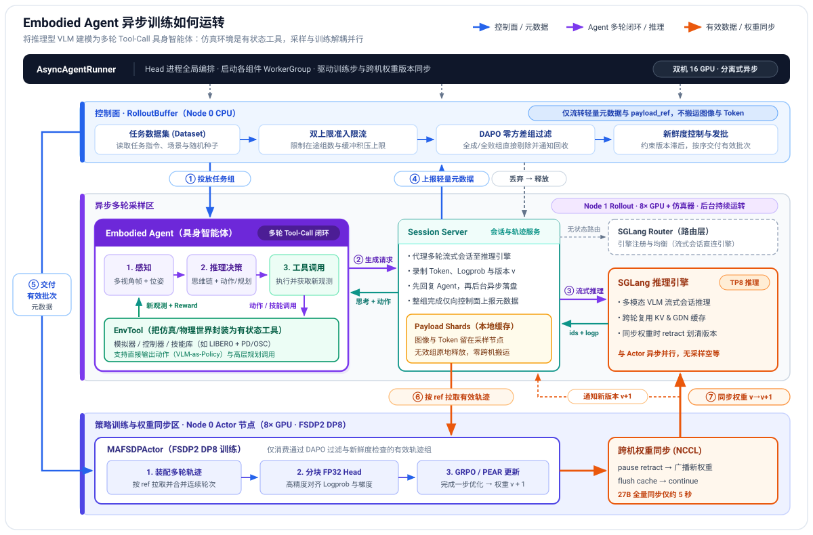
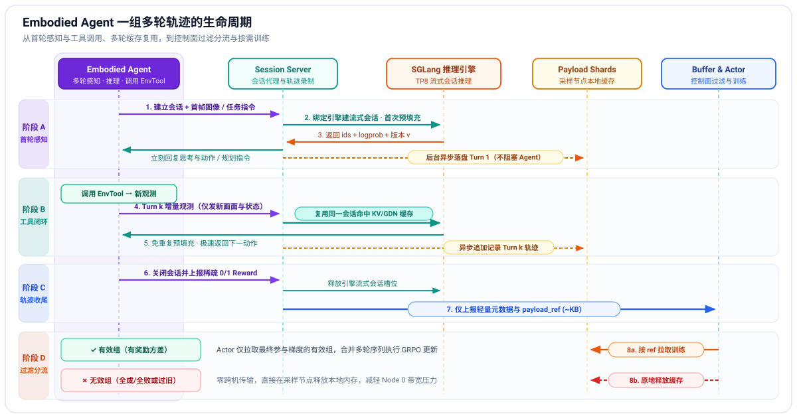

具身智能体
==========

RLinf 中的具身智能体（Embodied Agent）让推理型视觉语言模型（VLM）以多轮调用工具的方式，通过在线强化学习在物理或仿真环境中完成机器人任务。本节收录多轮具身智能体实践，涵盖直接输出末端动作的 VLM-as-Policy，后续也将扩展到把 VLM 作为具身大脑（Planner）调用底层技能的分层训练。

实践示例
--------

.. grid:: 1 2 2 2
   :gutter: 3

   .. grid-item-card:: VLM-as-Policy（LIBERO + Qwen3.8-27B）
      :link: vlm_as_policy
      :link-type: doc

      在 LIBERO 上通过异步 GRPO 与流式 SGLang 会话，直接将 ``Qwen3.8-27B`` 训练为多轮机器人 policy。

   .. grid-item-card:: VLM Planner（规划中）

      将推理 VLM 训练为高层具身规划大脑，拆解长程任务并按阶段调用底层机器人技能。

何时使用具身智能体
------------------

OpenVLA、π₀ 等反应式 VLA 模型以 10–50 Hz 的频率输出连续动作块，每步推理耗时基本固定。这类任务适合同步 rollout 流水线，所有并行模拟器会在相近时间进入下一步。

推理型 VLM 的负载特征完全不同。每一轮里，模型读取多视角相机画面与机器人状态，先在 ``<think>`` 内推理，再输出结构化动作指令或高层技能调用。有的轨迹 3 轮就能完成任务，有的要运行 15 轮才结束，每轮生成的思考长度也相差很大。如果按同步批次等待最慢的一条轨迹，训练 GPU 会长时间空等；如果把全部多轮图像历史直接发往头节点，主机内存与跨机带宽也会很快吃紧。

RLinf 将模拟器、控制器或技能库封装成带 ``open``、``step`` 和 ``close`` 接口的有状态环境工具，同时把多模态轨迹数据留在采样节点的 session server 本地缓存中。将机器人环境封装成工具后，具身推理智能体就能沿用与文本、代码智能体相同的多轮循环：观察画面与状态、思考并决策、调用环境工具获取新观测，任务结束时获得任务奖励。具身智能体实践也因此直接复用 RLinf 的异步 rollout buffer、policy 滞后控制、零方差组过滤和跨机权重同步。

一次异步训练如何运转
--------------------

具身智能体训练把 actor 与 rollout 放在互不重叠的 GPU 组上，让采样与训练同时运行。头节点上的 runner 拉起各类 worker、启动后台采样、推进优化器更新并协调权重同步。

   具身智能体异步训练的端到端流程：Node 0 上的 rollout buffer 控制任务投放与过滤，Node 1 上的具身智能体与环境工具、流式 SGLang 引擎持续多轮采样，Node 0 上的 FSDP2 actor 按需拉取有效组更新权重并跨机同步回推理端。

沿着图中编号 1 到 7，一次训练闭环分为五个阶段：

1. **任务投放与准入限流（编号 1）。** Node 0 上的 rollout buffer 从数据集读取任务，只要在途组数和缓冲组数均未达到上限，就持续向下游投放新的任务组。
2. **后台持续多轮采样（编号 2 与 3）。** 每个任务组在 Node 1 上并行运行一组具身智能体轨迹。每轮交互中，智能体从环境工具读取相机画面和状态，经 session server 向 SGLang 引擎发起流式推理，拿到动作或技能指令后再交由环境工具执行。整个采样过程在后台持续运行，不等待训练端。
3. **轻量元数据上报与过滤（编号 4）。** 同组轨迹全部结束后，session server 只向 rollout buffer 上报几 KB 的元数据，包括奖励、权重版本、token 数和本地 payload 引用，图像与 token 留在 Node 1 本地。rollout buffer 依据元数据过滤全成功或全失败的零方差组（DAPO 过滤）以及超出滞后上限的旧组，并通知采样节点原地释放对应缓存。
4. **按需拉取与权重更新（编号 5 与 6）。** 有效组攒够一个批次后，rollout buffer 把批次元数据交给 Node 0 上的 FSDP2 actor。actor 只按引用拉取这些有效组的图像、token 与 rollout logprob，将同一轨迹的连续轮次合并成单条多轮序列，完成一步梯度更新。
5. **跨机权重同步（编号 7）。** 每步更新生成新版本权重 ``v + 1`` 后，runner 以 ``retract`` 模式暂停正在生成的请求（将在途请求退回引擎队列并保留已生成 token），通过 NCCL 将新权重广播到 SGLang 引擎，清空旧版 KV 与循环状态缓存，通知 session server 刷新版本号，随后恢复生成。

一组多轮轨迹的生命周期
----------------------

单个任务组在多轮交互中与 session server、SGLang 引擎及本地 payload 缓存的协作流程如下。

   单组多轮轨迹的四个阶段：首轮感知与建立流式会话、工具闭环与缓存复用、轨迹收尾与元数据上报，以及有效组拉取训练与无效组原地释放。

首轮开始时，具身智能体发送初始图像与任务指令，打开流式会话。session server 将这条轨迹直接绑定到固定的 SGLang 引擎实例（绕过无状态路由转发），由引擎建立并保留 KV 与循环状态缓存。引擎返回生成 token、logprob 和权重版本号后，session server 先把动作或规划结果立刻交还给智能体驱动环境执行下一步，再在后台异步将多模态记录写入本地 payload 分片。

从第二轮起，环境工具执行完上一轮动作或技能后，智能体只向 session server 发送新增的观测帧与状态。由于会话固定在同一引擎实例上，SGLang 直接命中历史前缀缓存，免去重复预填充历史图像与思考 token 的开销。

轨迹结束时，智能体关闭会话并上报任务奖励。session server 释放引擎槽位，仅把轻量元数据提交给 Node 0 的 rollout buffer，actor 在训练前按引用拉取有效组，采样节点则原地释放被过滤的无效组。

后续阅读
--------

- :doc:`vlm_as_policy`：安装环境、下载模型并启动 LIBERO + Qwen3.8-27B 的 VLM-as-Policy 训练。
- :doc:`../../guides/async_agentic`：调整在途与缓冲准入上限、滞后上限与权重同步暂停模式。
- :doc:`../../guides/session_server`：配置 session server 端口、payload 分片、路由策略与验证检查。
- :doc:`../../concepts/execution-model/index`：了解 RLinf 的 worker、channel 与 cluster 基础抽象。

.. toctree::
   :hidden:
   :maxdepth: 2

   VLM-as-Policy <vlm_as_policy>
