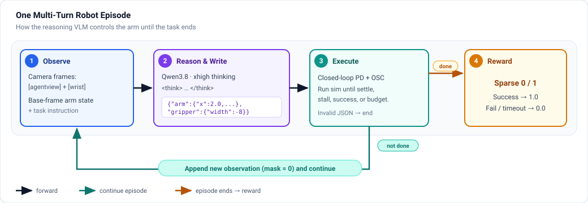

VLM-as-Policy：LIBERO + Qwen3.8-27B
===================================

本实践使用 RLinf 的 :doc:`具身智能体 <index>` 架构，通过在线强化学习在 LIBERO 上直接把 ``Qwen3.8-27B`` 训练为多轮机器人 policy。模型读取多视角相机画面与基座坐标系下的机械臂位姿，在 ``<think>`` 内推理，再输出 JSON 相对位姿交由闭环控制器执行。

概览
----

在稀疏 0/1 奖励下端到端训练推理型 VLM 完成多轮桌面操作任务。

.. grid:: 2 4 4 4
   :gutter: 2

   .. grid-item-card:: 环境
      :text-align: center

      LIBERO（``libero_gso``、``libero_10``）· RoboDojo 动作格式

   .. grid-item-card:: 算法
      :text-align: center

      GRPO（``grpo_dynamic`` + ``pear_reinforce``）· DAPO 过滤

   .. grid-item-card:: 任务
      :text-align: center

      多轮桌面操作

   .. grid-item-card:: 硬件
      :text-align: center

      2 机 16 × 80 GB GPU · 论文规模 4 机 32 卡 H200

| **你将完成：** 安装环境 → 下载 ``Qwen3.8-27B`` → 启动多节点 Ray → 启动训练 → 观察 ``rollout/rewards``。
| **前置条件：** :doc:`环境安装 </rst_source/start/installation>` · :doc:`多节点 Ray 集群 </rst_source/guides/multi_node>` · 所有节点共享可见的存储目录。

单条轨迹中，模型读取相机画面与舍入后的基座坐标系机械臂位姿，在 ``<think>`` 内推理，然后输出 JSON 相对位姿。模拟器运行闭环 PD 与操作空间控制，直到机械臂到位、受阻停滞、任务完成或原生步数预算耗尽。

   单条多轮轨迹：观察画面与位姿，在 ``<think>`` 中推理并输出 JSON 相对位姿，执行后继续下一轮，任务结束时获得稀疏 0/1 奖励。

本实践背后的分离式异步采样与训练架构见 :doc:`index`。

任务
~~~~

.. list-table::
   :header-rows: 1
   :widths: 18 22 30 30

   * - 环境
     - 任务 / 任务集
     - 配置 / 权重
     - 侧重点
   * - LIBERO
     - ``libero_gso``\ （Goal、Spatial、Object）
     - ``libero_gso_grpo_pear_sglang.yaml``
     - 第一阶段默认配置（2 机 16 卡，每步 8 组，160k 预算，默认 ``max_steps: 2`` 快速验证）
   * - LIBERO
     - ``libero_gso``\ （Goal、Spatial、Object）
     - ``libero_gso_grpo_pear_sglang_paper.yaml``
     - 第一阶段论文规模（4 机 32 卡，每步 128 组，``max_turns: 300``，``max_steps: 1000``）
   * - LIBERO
     - ``libero_10``\ （Long）
     - ``libero_10_grpo_pear_stage2.yaml``
     - 第二阶段长程任务（262,144 token 预算，``max_turns: 64``）
   * - LIBERO / RoboDojo
     - 混合多本体
     - ``pear_stage3_libero_robodojo.yaml``
     - 第三阶段 off-policy 训练，开启 top-K score centering（``topk_log_probs: 32``，``seq_length: 8192``）

观测与动作
~~~~~~~~~~

.. list-table::
   :header-rows: 1
   :widths: 20 80

   * - 字段
     - 说明
   * - 观测
     - 两路旋转 180° 的 512x512 RGB 图像（LIBERO 为 ``[agentview]`` 与 ``[wrist]``），以及基座坐标系下舍入后的机械臂位姿（厘米与弧度）和夹爪宽度。
   * - 动作
     - 一个 ``json`` 代码块，包含 ``arm``\ （``x``、``y``、``z``、``roll``、``pitch``、``yaw``）和 ``gripper``\ （``width``）的相对变化量。输出无法解析时立即结束轨迹并计 ``0.0`` 奖励。
   * - 奖励
     - 任务成功给 ``1.0``，否则给 ``0.0``；不使用 critic、KL 惩罚或熵奖励。
   * - 提示词
     - 系统提示词定义坐标系与 JSON 格式，每轮追加状态 JSON 与带相机标签的新帧。LIBERO 指令中的左右方向已做镜像，与旋转后的相机画面一致。

安装与运行
----------

.. include:: ../embodied/_setup_common.rst

启动训练前先在多节点集群上拉起 Ray（默认与第二阶段配置需 2 台 8 卡节点，论文规模需 4 台 8 卡节点），每个节点在执行 ``ray start`` 前导出唯一的 ``RLINF_NODE_RANK``\ （头节点为 ``0``，工作节点依次为 ``1`` 等）。

.. tab-set::

   .. tab-item:: 第一阶段（LIBERO-GSO）
      :sync: pear-stage1

      **1. 安装环境**

      安装包含 LIBERO 与 SGLang ``0.5.22``\ （CUDA 13 wheel）的具身 Qwen3.8 环境，并在每个节点激活：

      .. code-block:: bash

         git clone https://github.com/RLinf/RLinf.git && cd RLinf
         bash requirements/install.sh embodied --model qwen3_8 --env libero && source .venv/bin/activate

      **2. 下载模型**

      将 ``Qwen/Qwen3.8-27B`` 下载到所有节点共享可见的目录（启动脚本默认导出 ``HF_HUB_OFFLINE=1`` 与 ``TRANSFORMERS_OFFLINE=1``）：

      .. code-block:: bash

         hf download Qwen/Qwen3.8-27B --local-dir ./Qwen3.8-27B

      **3. 启动训练**

      .. list-table::
         :header-rows: 1
         :widths: 26 40 34

         * - 场景
           - 配置（``examples/embodiment/config/``）
           - 说明
         * - 2 机默认（16 卡）
           - ``libero_gso_grpo_pear_sglang.yaml``
           - ``cluster.num_nodes: 2``，默认 ``max_steps: 2`` 快速验证
         * - 4 机论文规模（32 卡）
           - ``libero_gso_grpo_pear_sglang_paper.yaml``
           - ``cluster.num_nodes: 4``，每步 128 组，``max_steps: 1000``

      在头节点运行 2 机 16 卡默认快速验证，传入本地模型路径：

      .. code-block:: bash

         bash examples/embodiment/run_vlm_policy.sh libero_gso_grpo_pear_sglang \
           actor.model.model_path=$PWD/Qwen3.8-27B \
           rollout.model.model_path=$PWD/Qwen3.8-27B \
           actor.tokenizer.tokenizer_model=$PWD/Qwen3.8-27B

      正式训练时追加 ``runner.max_steps=1000``，或直接启动 4 机 32 卡论文规模配置（需 4 节点，``cluster.num_nodes: 4``）：

      .. code-block:: bash

         bash examples/embodiment/run_vlm_policy.sh libero_gso_grpo_pear_sglang_paper \
           actor.model.model_path=$PWD/Qwen3.8-27B \
           rollout.model.model_path=$PWD/Qwen3.8-27B \
           actor.tokenizer.tokenizer_model=$PWD/Qwen3.8-27B

      .. dropdown:: 进阶配置（可选）

         按集群规模或显存余量调整 YAML 时，重点修改下表字段：

         .. list-table::
            :header-rows: 1
            :widths: 22 40 38

            * - 类别
              - 配置项
              - 说明
            * - 节点划分与步数
              - ``cluster.num_nodes``、``cluster.component_placement``、``runner.max_steps``、``runner.seq_length``
              - 将 ``actor`` 与 ``rollout`` 放在互不重叠的 GPU 上；异步模式下 ``reward`` 与 ``rollout`` 共用卡号。
            * - 采样并发
              - ``data.task_suite_name``、``data.rollout_batch_size``、``agentloop.max_turns``、``tools.embodied_env.max_concurrent_envs``
              - 按推理端卡数调整并发 LIBERO 模拟器数量与最大交互轮数。
            * - 缓冲与滞后上限
              - ``rollout_buffer.max_inflight_groups``、``rollout_buffer.max_buffered_groups``、``agentloop.max_actor_accept_staleness``
              - 让推理引擎保持满载，同时约束 policy 滞后。
            * - 流式会话与缓存
              - ``session_server.engine_streaming_session``、``session_server.merge_continuous_turns``、``session_server.payload_shards``
              - 跨轮保持 KV/GDN 前缀缓存，并将多模态帧暂存在采样节点本地。
            * - SGLang 与 FSDP2 显存
              - ``rollout.sglang.attention_backend``、``rollout.sglang.max_mamba_cache_size``、``actor.fsdp_config.enable_gradient_accumulation``
              - 80 GB 显存下保持 ``attention_backend: null``、``max_mamba_cache_size: 256`` 与 ``enable_gradient_accumulation: False``。
            * - 组过滤与第三阶段
              - ``algorithm.down_sampling.down_sampling_config.reject_equal_reward``、``algorithm.pear.score_centering``、``session_server.topk_log_probs``
              - 开启 DAPO 零方差组过滤；第三阶段按需开启 top-K score centering。

   .. tab-item:: 第二、三阶段
      :sync: pear-stage23

      **1. 安装与下载**

      复用第一阶段标签中的 Qwen3.8 虚拟环境与 ``./Qwen3.8-27B`` 权重。第三阶段的 RoboDojo 执行需额外准备 Isaac Sim 与 cuRobo。

      **2. 启动训练**

      .. list-table::
         :header-rows: 1
         :widths: 26 40 34

         * - 场景
           - 配置（``examples/embodiment/config/``）
           - 说明
         * - 第二阶段（LIBERO-10 长程）
           - ``libero_10_grpo_pear_stage2.yaml``
           - ``cluster.num_nodes: 2``，262,144 token 预算，``max_turns: 64``
         * - 第三阶段（混合 RoboDojo）
           - ``pear_stage3_libero_robodojo.yaml``
           - ``cluster.num_nodes: 2``，``score_centering: True``，``topk_log_probs: 32``

      在头节点启动 2 机 16 卡第二阶段 ``libero_10`` 训练（需 2 节点，``cluster.num_nodes: 2``）：

      .. code-block:: bash

         bash examples/embodiment/run_vlm_policy.sh libero_10_grpo_pear_stage2 \
           actor.model.model_path=$PWD/Qwen3.8-27B \
           rollout.model.model_path=$PWD/Qwen3.8-27B \
           actor.tokenizer.tokenizer_model=$PWD/Qwen3.8-27B

      启动 2 机 16 卡第三阶段 top-K score centering 训练（需 2 节点，``cluster.num_nodes: 2``）：

      .. code-block:: bash

         bash examples/embodiment/run_vlm_policy.sh pear_stage3_libero_robodojo \
           actor.model.model_path=$PWD/Qwen3.8-27B \
           rollout.model.model_path=$PWD/Qwen3.8-27B \
           actor.tokenizer.tokenizer_model=$PWD/Qwen3.8-27B

可视化与结果
------------

在 TensorBoard 中跟踪 ``rollout/rewards``、``rollout/buffer/dropped_equal_reward``、``rollout/session_server/payload_queued_groups`` 和 ``train/actor/policy_loss``\ （``tensorboard --logdir logs/``，指标说明见 :doc:`训练指标 <../../reference/metrics>`）。本地排队的 payload 组数稳定贴近缓冲区大小，说明被过滤掉的多模态组已及时释放采样节点内存。

.. list-table::
   :header-rows: 1
   :widths: 34 30 36

   * - 配置
     - 硬件
     - 实测运行参考
   * - ``libero_gso_grpo_pear_sglang.yaml``
     - 2 机（16 × 80 GB A100）
     - FSDP2 单步更新约 8–10 秒；27B 跨机 NCCL 权重同步约 5 秒；第 2 轮起命中流式前缀缓存

常见问题
--------

**工作节点加入 Ray 时报 ``InvalidAuthToken``**
   Ray 2.60 及以上版本在未配置共享 token 时会拒绝未认证加入；在所有节点执行 ``ray start`` 前导出 ``RAY_AUTH_MODE=disabled``。

**80 GB actor GPU 显存溢出（OOM）**
   保持 ``actor.fsdp_config.enable_gradient_accumulation: False`` 与 ``actor.fsdp_config.gradient_checkpointing_use_reentrant: False``，让 FSDP2 在每个 micro-batch 逐层归约梯度，避免在显存中常驻未分片的 27B 完整梯度。

**采样在凑满一个批次前长时间卡住**
   调高 ``rollout.max_running_requests`` 或 ``rollout_buffer.max_inflight_groups`` 时，同步调大 ``rollout.sglang.max_mamba_cache_size``\ （默认 ``256``），确保每条活跃流式会话都有足够的循环状态槽位。

延伸阅读
--------

- :doc:`index`：了解具身智能体架构、异步训练运转流程与单组多轮生命周期。
- :doc:`../../guides/async_agentic`：调整准入上限、滞后上限与权重同步暂停模式。
- :doc:`../../guides/session_server`：配置 session server、payload 分片与路由策略。
- :doc:`../../guides/multi_node`：多节点 Ray 集群与 ``RLINF_NODE_RANK`` 配置说明。
- :doc:`../../reference/metrics`：查看 rollout、policy 滞后与训练指标。
