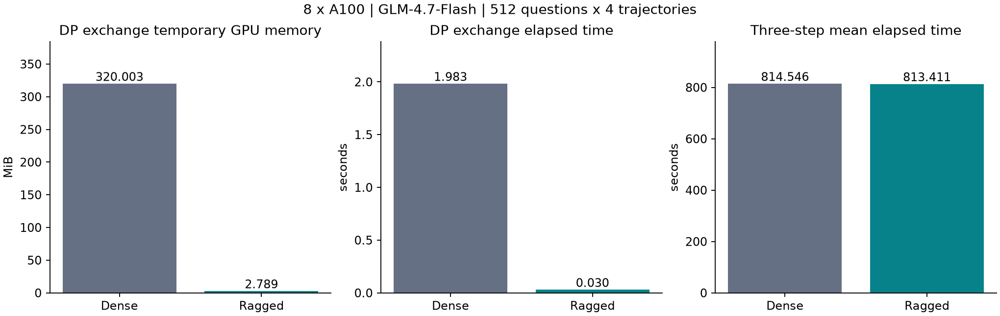
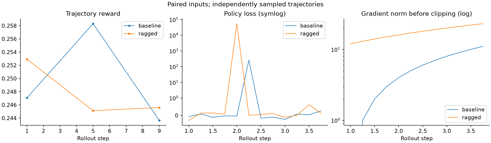
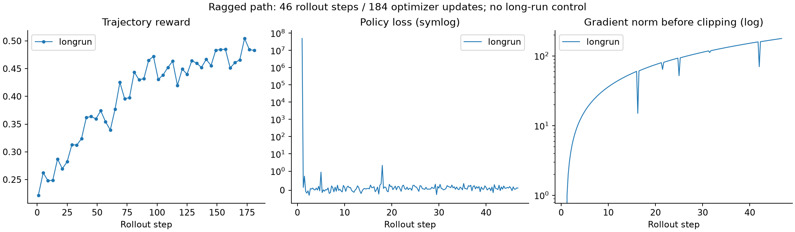

# Ragged rollout-to-training batch validation

Real-length storage and early question-group redistribution substantially reduce the measured DP exchange buffers and elapsed time. The three-step comparison does not establish an end-to-end throughput gain. Fixed-trajectory model probabilities and loss inputs match under a controlled schedule; gradients and parameter updates are not bitwise identical. This report separates those findings so communication results are not used as evidence of training equivalence.

The user guide documents the old and new ten-stage flows in `docs/source-en/rst_source/guides/performance/ragged_batches.rst`, with a Chinese counterpart. `README.md` provides reproduction commands. `evidence.json` contains the source values and run identifiers; the separate artifact archive preserves original inputs, configs, scripts, logs, and events. This report was prepared with an AI assistant.

## Configuration and provenance

| Setting | Recorded value |
| --- | --- |
| Hardware | 8 x NVIDIA A100-SXM4-80GB; driver 570.195.03 |
| Model | GLM-4.7-Flash; BF16 |
| Actor parallelism | TP=4, DP=2, EP=8, PP=1, CP=1 |
| Batch | 512 questions x 4 trajectories; 4 optimizer minibatches per rollout |
| Sequence length / microbatch token budget | 8192 / 8192 |
| GRPO | trajectory advantages; group/agent/turn loss scales; no advantage normalization |
| Old probabilities / rollout probabilities | recompute_logprobs=True / return_logprobs=False |
| Python / PyTorch | 3.12.12 / 2.11.0+cu128 |
| SGLang / Transformer Engine / Ray | 0.5.12.post1 / 2.17.0 / 2.58.0 |
| Megatron source | dc0ee41ada177d4c74ba46bb501bba5967264815 |
| Fixed input fixture | 1536 JSONL rows; dataset shuffling disabled; seed 42 |
| Input SHA-256 | fedc5d339cc09d8def4086f8607212f415a3882e57e7857cf24f3f0a375d8d15 |
| Retrieval | CPU E5/FAISS service; wiki-18 corpus, e5_IVF4096,Flat index; recorded service and asset metadata in archive |
| Checkpoints | Disabled in the training comparisons and long run |

Historical GPU runs used snapshots of the main-based ragged feature, without the earlier R3 branch. Subsequent removal of 13 newly introduced ValueError guards was checked statically. The preparation/relocation wrappers were added later; this report does not present them as a fresh GPU rerun. Source snapshots and hashes distinguish these versions. CPU checks and documentation validation are recorded separately in the preparation material.

On 2026-11-06, the current code passed 6 ragged data cases, 3 Gloo redistribution cases, and 3 Megatron CPU packing cases. Collection initially failed because Gymnasium and then ImageIO were absent from the agentic environment; the successful rerun supplied these optional imports from an isolated temporary dependency directory. Both Sphinx language trees built with zero reported warnings. The reproduction configurations and both fixed-state replay preparations were checked without launching GPU workers.

## Communication and memory

Both modes replay the same original first-step generation results: 512 complete question groups and 2048 trajectories. The dense benchmark recreates derived token fields at their training shapes with placeholder probability values. The ragged benchmark exchanges the original groups before those derived fields exist. Tensor serialization preserves the dense storage size regardless of these placeholder values. This benchmark measures the actual change in data-flow placement as well as representation and collective choice.

| Measurement | Dense | Ragged |
| --- | ---: | ---: |
| DP exchange temporary allocated-memory peak, largest rank | 320.003 MiB | 2.789 MiB |
| DP exchange elapsed time, warm-trial mean of per-trial rank maxima | 1.983362 s | 0.030226 s |
| Whole-run physical GPU peak, largest device | 70.646 GiB | 70.554 GiB |
| Actor PyTorch allocated peak | 48.457 GiB | 48.139 GiB |
| Three-step mean elapsed time | 814.546 s | 813.411 s |
| Last-two-step mean elapsed time | 808.843 s | 810.750 s |

Run three communication trials and discard the first for elapsed-time aggregation. Dense mode uses four TP-lane DP process groups; ragged mode uses only the two data-I/O ranks. Timings include partitioning, serialization, transfer, and synchronization; they exclude model-parallel broadcast. Memory is the peak PyTorch allocation above the start-of-phase allocation, not whole-device occupancy. `nvidia-smi` physical memory is sampled separately once per second.

The dense largest field is approximately `1024 * 8192 * 8 = 64 MiB`. In the installed PyTorch build, the object-collective send buffer, two-rank output buffer, and extra flattened NCCL output buffer explain approximately `64 + 128 + 128 = 320 MiB`. The ragged rank sends 1,472,992 bytes and receives 1,450,368 bytes; their sum is 2.787933 MiB, matching the observed 2.789 MiB peak after small allocation overheads. This is workload- and implementation-dependent. It is not the total tensor payload, a measurement of network wire bytes, or a prediction of whole-device memory savings.

The paired runs use identical input-question batches, verified by all three recorded batch hashes, but independently sample their answers at temperature 1.0. Their end-to-end times include generation-length variation. The warm step means do not show a speedup; the approximately 0.14% three-step mean difference is not evidence of a throughput improvement.

## Fixed-trajectory correctness

The GPU diagnostic freezes 512 questions, 2048 trajectories, and 3465 original turn records, including tool returns. It fixes original DP ownership and microbatch composition, compares real model recomputation over 2,404,488 real token positions (1,036,633 training-response positions), and trains the same first minibatch: 256 merged trajectories per DP, 512 globally.

| Check | Recorded result |
| --- | --- |
| Complete-group NCCL exchange | Preserved |
| Real input IDs, masks, positions, lengths, rewards, trajectory identity | Identical after alignment |
| Recomputed logprob on all real positions | Maximum absolute difference 0 |
| Recomputed logprob on training positions | Maximum absolute difference 0 |
| Controlled-schedule training advantages, loss scales, old/current probabilities, masks | Identical |
| First update loss, dense / ragged | 0.4178088903427124 / 0.4178088903427124 |
| Captured initial model/optimizer tensors restored | Verified |

A separate full-data CPU check exercises early question-group reassignment and source-DP normalization. Moving groups changes the separate advantage and scaling values when the number of turn rows per replica changes. Their product, the effective advantage entering the loss, has maximum absolute difference 4.76837158203125e-7 in that check. Its probability values are placeholders; real probabilities are covered by the GPU comparison above.

### Gradient and update limits

Repeat the restored-state comparison with dense mode on both sides as a self-control. Both the dense/ragged comparison and dense/dense self-control have numerical differences:

| Measurement | Dense vs ragged | Dense vs dense control |
| --- | ---: | ---: |
| Raw gradient maximum absolute difference, divided by loss scale | 1.00024795532 | 0.663771271706 |
| Raw gradient mean absolute difference, divided by loss scale | 1.40081355711e-5 | 6.47354008455e-6 |
| Updated BF16 model parameter maximum absolute difference | 1.90734863281e-6 | 1.90734863281e-6 |
| Updated BF16 model parameter mean absolute difference | 8.97804035435e-9 | 8.96171919009e-9 |
| Updated FP32 optimizer parameter maximum absolute difference | 1.19209289551e-6 | 1.19209289551e-6 |
| Updated FP32 optimizer parameter mean absolute difference | 5.4596555267e-7 | 5.45079145202e-7 |
| Native pre-clipping gradient norm, first / second run | 593.9235 / 581.7225 | 587.9644 / 586.7490 |

Gradients were captured before the native optimizer step and before clipping, with loss scale 65536. The table removes that loss scale only. Gradient clipping is configured at 1.0. Statistics aggregated across ranks include replicated parameters and do not count unique model parameters.

The self-control demonstrates a repeatability limit, but does not prove all differences are caused by nondeterministic kernels. The harness verifies captured state, not every possible hidden state. These results do not establish bitwise update equivalence or identical long-term accuracy. Normal early balancing also changes DP grouping and microbatch composition, which the controlled numerical comparison intentionally fixes.

## Training records

Both three-step runs complete 12 optimizer updates with finite recorded losses. The figures show unsmoothed reward, loss, and pre-clipping gradient norms; a finite value can still be a large spike.

The ragged long run completes 46 rollout steps and 184 optimizer updates with exit code 0, preserving TensorBoard and logs. Its dataset shuffle is enabled; it is a separate run, not a continuation of either three-step comparison. It contains a very large initial loss/gradient spike, so completion alone is not a numerical-equivalence or stability proof. No matched 46-step dense control was run.

## Scope of the conclusion

Measured DP exchange buffers and elapsed time improve substantially. Frozen-data transport, real-token recomputation, controlled loss inputs, and loss checks pass. End-to-end throughput improvement, bitwise gradient/update equivalence, and matched long-run accuracy are not established by these experiments. Use the default-off code path or toggle the YAML flag for comparison, and retain the reported controls when extending coverage to other placements or backends.
